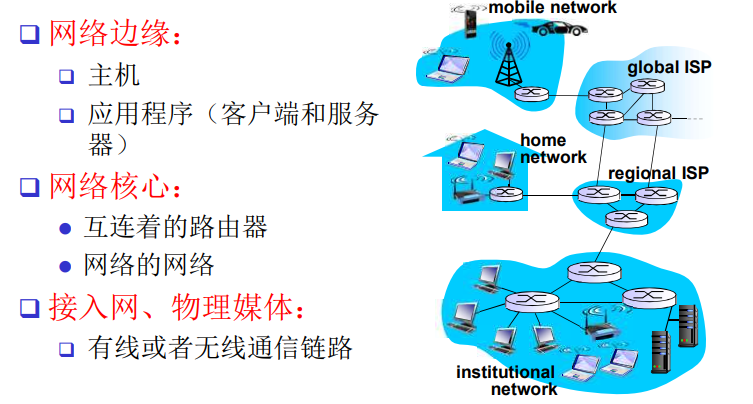
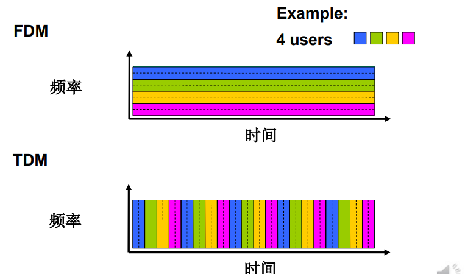
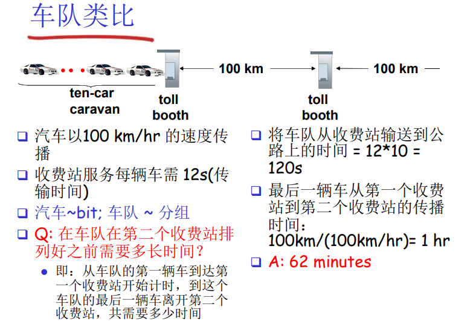
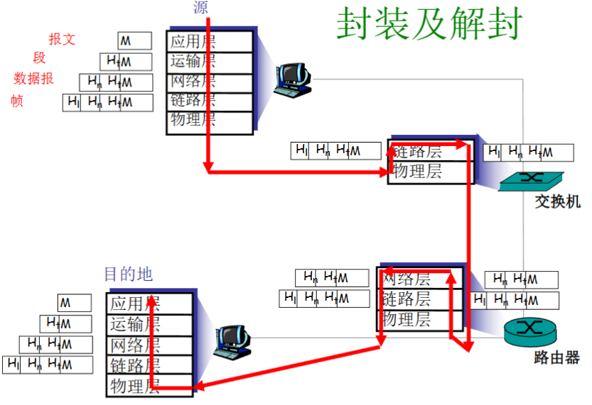

<h1 align='center'>第一章: 概论</h1>

[TOC]

主要介绍**框架性内容**, 为后面打下基础

## 1.1 何为Internet

### 1.1.1 具体构成角度
**计算机网络**包含以下设备
1. **主机(host)/端系统(end system)** [节点]
主机作为数据的源或目的
2. 端系统通过**通信链路**和**分组交换机**(packed switch)连接到一起
3. 分组交换机[节点]有网络层**路由器**(router)和链路层**交换机**(link-layer switch)两种主要类型
4. 链路[边]可以分为**接入网链路**和**主干链路**
    - 接入网链路(access): 主机到互联网的链路;
    - 主干链路(back bone): 路由器之间的链路
5. 以上部件都运行一系列**协议**(protocol) 

**Internet** 就是以TCP/IP作为主要协议的计算机网络. 
互联网是"网络的网络", 小型网络通过网络互联设备组成大的网络, 即为Internet

### 1.1.2 提供服务角度
**因特网**即为**向应用程序提供(通信)服务的基础设施**
1. 这里的应用程序是指运行在端系统上的**分布式应用程序**, 即他们涉及多个相互交换数据的端系统
2. **套接字接口**(socket interface), 该接口规定了运行在一个端系统上的程序请求Internet向另一个端系统的特定目的地程序交换数据的方式. 是一套发送程序必须遵守的规则集合 

### 1.1.3 什么是协议(protocol)
**协议**定义了在两个或多个通信实体之间交换的**报文的格式(语法和语义)和顺序**, 以及报文发送和/接收一条报文或其他事件**所采取的动作**

网络的不同对等层次有不同的协议, 应用层的协议, 传输层的协议...

协议就是标准, 全球的InterNet标准有**互联网工程任务组IETF**研发, IETF的标准文档称为**请求评论(RFC)**, 他定义了IP, TCP, HTTP等很多协议  

## 1.2 网络边缘

**互联网**可以分为**网络边缘(edge)**和**网络核心(core)**, 以及**接入网(access)**. 三个子系统构成互联网

### 1.2.1 网络边缘
**需要运行应用程序的端系统**即构成网络边缘

**端系统(end system)又叫主机(hosst)**, 可以划分为两类: **客户**(client) 和 **服务器**(server)

### 1.2.2 应用的通信服务
基础设施为应用提供通信服务的两种方式
- 第一种: 面向连接通信服务
  端系统通信之前要"握手", 先建立连接状态. [TCP-传输控制协议]
  - 使用TCP应用:HTTP(Web), FTP(文件传输), Telnet(远程登录), SMTP(email)
- 第二种: 无连接服务
  不需要握手  [UDP-用户数据报协议]
  - 使用UDP的应用: 流媒体, 远程会议, DNS, Internet电话(实时性)

## 1.3 网络核心
通过网络链路和交换机移动数据的两种基本方式:
1. **电路交换(circuit switching)**
2. **分组交换(packet switching)**

### 1.3.1 电路交换
源主机和目的主机之间建立一个独享的线路(电路circuit), 是一种**专门的端到端连接(end to end)**

#### 1.3.1.1 链路的片
电路交换中, 一个较宽的链路能够被分为片用于复用, 分片方式有**频分(FDM)**, **时分(TDM)** 和  **波分(WDM)**

### 1.3.2 分组交换
源将长报文划分为较小的数据块, 称之为**分组(packet)** 

不同于**电路交换**, 分组以等于该**链路最大传输速率的**速度传输通过通信链路

分组交换有如下特征:
1. **存储转发传输**机制
交换机能够开始向输出链路传输该分组的第一个比特之前, 必须先接收完整个分组
2. **排队时延和分组丢失**
分组交换机会给每个要输出的链路分配一个**输出缓存(output buffer, 也叫输出队列)**, 当要输出的链路被其他占用时, 先把分组放在**输出缓存**中排队
另外, 输出缓存满的时候, 分组没有地方排队, 就**分组丢失(丢包)**
3. **转发表和路由选择协议**
路由器同意**IP地址**和**转发表**来决定到达的分组应该传向哪条链路

分组交换不用建立独享的电路, 使得**共享性更强**, 但会有时延和丢包的代价

### 1.3.3 分组交换 vs 电路交换
- 分组交换是 "突发数据的胜利者";
- 电路交换是**预先分配**, 分组交换是**按需分配**
- 分组交换, 某时刻活跃用户数较大的概率是比较小的, 因此分组交换能够在用户数更大的情况下实现和电路交换同样的性能

## 1.4 接入网
**接入网**的目标是将主机连接到**边缘路由器**
**边缘路由器**是端系统Host去往任何其他远程端系统的路径上的第一台路由器

### 1.4.1 接入网的方式
- **有线网络**接入技术: **光纤到户FTTH**, **以太网**, 同轴电缆, 双绞线的DSL, 古老的拨号上网
- **无线网络**接入技术: **WiFi、4G/5G**, 卫星广域覆盖
- 接入场景: 住宅 (家庭) 接入网, 机构 (学校、公司) 接入网, 移动接入网络 (WiFi、4G/5G)

### 1.4.2 物理介质
**物理介质**是连接主机和边缘路由器的物理设备, 有:

1. **电缆**
2. **光纤**
3. **无线介质**
4. **其他介质**

### 1.4.3 广域网, 局域网, 城域网
1. **广域网(WAN)**
覆盖范围大, 如一个大城市一个国家或洲际间建立的网络
2. **局域网(LAN)**
覆盖范围有限, 属于**一个部门或单位组建**的小范围网络
3. **城域网(CAN)**
包括城市网络, 区域网络等

## 1.5 分组交换的时延,丢包
### 1.5.1 时延类型
- 处理时延
检查分组的首部和决定将分组导向何处所需要的时间是处理时延的一部分
- 排队时延
在队列中, 分组在目标链路的**缓存**上经受排队时延. 取决于当前链路上排队分组的数量
- **传输时延**
用$L$比特表示分组长度, $R\ bps$ 表示路由器A到B的链路传输速率, 传输时延即为$L / R$, 即为将分词的所有比特推向链路所需要的时间
- **传播时延**
用$d$代表物理链路长度, $s$代表媒体上的传播速度, 传播时延即为$d / s$, 和两个路由器间的物理距离有关

### 1.5.2 排队时延和丢包
#### 1.5.2.1 排队时延
假定每个分组到达队列的平均概率为$a$ 分组/秒, 且所有分组都是$L$比特, 那么定义**流量强度**值的是$La/R$, 这个代表了到达比特速率和输出比特速率的比值 
- $La/R > 1$的话, 比特到达队列的平均速率超过从该队列传输出去的速率, 队列趋于无限大, 因此, 现实中的工程设计不会出现$La/R > 1$的情况
**一个事实**是: **当流量强度接近于1时, 平均排队时延会很大**

#### 1.5.2.2 丢包
队列满了的时候, 之后到达的分组就没有地方排队, 就会丢失.

### 1.5.3 吞吐量
**吞吐量**: 在远端和目标端(end2end)之间的速率(数据量/单位时间)
- 瞬间吞吐量: 在一个时间点的速率
- 平均吞吐量: 在一个长时间内的平均值

对于多链路的端到端线路, 吞吐量取决于**瓶颈链路**
例如一个在服务器端和客户端之间具有$N$条链路的网络, $R_i$是第$i$条链路的传输速率, 那么端到端的吞吐量为 $min\{R_1,R_2,...,R_N\}$ 

## 1.6 协议层次和服务模型
Internet是个非常复杂的系统, 为了组织他的网络体系结构, 我们可以用**分层体系结构进行模块化组织**

### 1.6.1 服务
**服务(Service)**: 低层实体向上层实体提供他们之间通讯的能力
**原语(primitive)**: 上层使用下层服务的方式, 高层使用低层提供的服务, 以及低层向高层提供服务都是通过服务访问原语来进行交互的
**服务访问点SAP(Services Access Point)**: 上层使用下层提供的服务要通过层间的接口--地点;

### 1.6.2 层次化方式实现复杂网络功能
- 将网络复杂的功能分层功能明确的层次, 每一层实现了其中一个或一组功能, 功能中有**它的上层**可以使用的功能: **服务**
- 本层协议实体相互交互执行本层的协议动作, 目的是**实现本层功能, 通过接口为上层提供更好的服务**
- 在实现本层协议的时候, **直接利用了下层所提供的服务**
- 本层的服务: 借助下层服务实现的本层协议实体之间交互带来的新功能 (上层可以利用的) + 更下层所提供的服务

### 1.6.3 Internet协议栈
网络设计这以**分层**的方式组织**协议**以及实现这些协议的网络硬件和软件, 这些协议属于这些层次之一

各层的所有协议被称为**协议栈(protocol stack)**, 因特网的协议栈有五个层次组成, **自顶向下**依次是:
- **应用层**
网络应用程序和它们的应用层协议存留的地方, 协议有: **FTP, HTTP, DNS**
- **传输层**
主机到主机数据传输. 协议有: **TCP, UDP**
- **网络层**
从源到目的地数据报的选路, 协议有**IP, 选路协议**
- **链路层**
在邻近网元之间传输数据, **PPP, 以太网**
- **物理层**
将数据转换为物理信号, 并在物理媒体上传输, **比特**

### 1.6.4 各层次的协议数据单元
1. **应用层**: 报文(message)
2. **传输层**: 报文段(segment)[TCP段, UDP数据报]
3. **网络层**: 分组packet(若无连接方式: 数据报datagram)
4. **链路层**: 帧(frame)
5. **物理层**: 位(bit)

### 1.6.5 封装
**封装**: 将数据从上层协议转换为下层协议, 并在下层协议的首部添加必要的信息

应用层报文 → 加运输层首部(运输层向上给应用程序交付报文的信息) → 运输层报文段 → 加网络层首部(源和目的端系统等信息) → 网络层数据报 → 加链路层首部 → 链路层帧
