<h1 align='center'>第二章 应用层(Application Layer)</h1>

[TOC]

> 通过应用层的学习, 有助于更好了感受到**协议的方方面面**, 遇到的问题也学习运输层，网络层及数据链路层也会遇到

## 2.1 应用层协议原理
研发网络应用程序的**核心**是写出能够运行在不同的**端系统**和**通过网络彼此通信**的程序

应用程序软件要为**端系统**编写, 而不是路由器或链路层交换器这些网络核心设备

### 2.1.1 应用程序体系结构
**应用程序体系结构(Application Architecture)** 规定了如何如何在各种端系统上组织该应用程序

有**两个主流体系结构**
1. 客户-服务器体系结构(C/S)
2. P2P(peer to peer)体系结构/分布式体系结构(Distributed)

#### C/S体系结构
C/S体系结构中:
- 服务器(server):
一直运行(被动接受服务请求);
有固定的IP地址和周知的端口号(约定)
会扩展成*服务器场* (google数据中心)
- 客户端(client):
**主动**与服务器通信(请求服务);
与互联网有间歇性的连接;
可能是动态IP地址;
客户相互之间不直接通信

具有C/S体系结构的应用程序, 最著名的就是Web引用程序

#### P2P体系结构(P2P architecture)
**P2P 体系结构特点**
- 几乎没有一直运行的"服务器"
- 任意端系统(称为对等方peer)之间可以直接进行通信
- 每一个节点既是客户端又是服务器
- 参与的主机间歇性连接并且是可以改变IP地址的

具有P2P体系结构的应用程序, **迅雷**, 每一个用户上线时都能作为一个"服务器"供他人来进行文件下载

**P2P的自扩展性**
在一个P2P文件共享系统中, 尽管每个对等方都由于请求文件而产生工作负载, 但**每个对等方通过向其他对等方分发文件来为系统增加服务能力**


### C/S和P2P混合体
对于一些**即时讯息应用**而言, 服务器被用于跟踪用户的IP地址, 但用户到用户的报文也可以在用户主机之间直接发送接受

### 2.1.2 进程通信
程序间通信:
1. 对于同一主机上的多个**进程**(即理解成一个程序)
进程间通信规则由主机上的操作系统来确定
2. 对于不同主机(端系统)上的进程
通过**跨越计算机网络交换message(报文)来进行相互间的通信**

对于每一对进程通信, 通常将两个进程之一标识为**客户(client)**, 另一个进程表示为服务器(server).
例如: P2P应用中, 下载文件的peer标识为客户, 上载文件的peer标识为服务器

#### 进程和网络之间的接口--套接字
**套接字**是同一台主机内应用层和运输层之间的接口
由于该套接字是建立网络应用程序的可编程接口, 因此套接字也称为应用程序和网络之间的**应用程序编程接口(Application Programming Interface, API)**

#### IP地址
在因特网中, 主机由其**IP地址进行唯一标识**
IP地址是一个32位地址(IPv4), 有`.`号分隔的二进制数字组成

进程间通信时, 有**发送进程**向**接受进程**发送分组时, 需要知道接受进程的地址, 为了标识, 需要有两个信息:
1. 进程所在的主机的地址, 即IP;
2. 进程的端口号
一台主机有多个进程, 进程通信要精确到单个进程到另一个主机的单个进程(光有IP地址不够), 就需要这样的信息, 我们定义成**端口号**, 用来唯一标识主机上的某个进程

**需要重点记忆的端口号**:
1. Web服务器用**端口号80**来表示
2. 邮件服务器进程(使用SMTP协议)用端口号25来标识

### 2.1.3 运输层服务
应用层的应用程序通过套接字接触到**运输层协议**
运输层协议有多个(UDP, TCP等), 如何选到恰当的, 需要有以下的考量:
1. **可靠数据传输(可靠性)**
一些应用要求程序的一段发送的**数据能够正确的, 完整的交付给该应用程序的另一端**, 如果那个协议能提供这样的服务, 那么就认为提供了**可靠数据传输(reliable data transfer)**
当然也会有**容忍丢失的应用**不需要可靠性
2. **吞吐量(带宽)**
吞吐量大概就是发送进程向接受进程交付比特的速率
3. **定时(低时延)**
某些应用, 不如联网多方游戏就非常要求**低时延**
4. **安全性**

### 2.1.4  因特网提供的运输服务
本小节考察更具体的因特网提供的两种运输服务类型 **UDP**和**TCP**
#### TCP
- 面向连接服务: 客户机和服务器之间所需的建立("握手")
- 可靠传输: 在发送和接受进程之间, 无差错,按适当次序收发数据
- 流量控制: 发送方不会淹没接收方
- 拥塞控制: 当网络过载时抑制发送方
- 并不提供: 定时, 最小宽带保证(吞吐量)

TCP有可靠传输的特点
电子邮件, Web, 远程终端访问, 文件传输, 流式多媒体大多运行在TCP
微信qq文字消息, 在线充值支付...


#### UDP
- 在发送进程和接受进程之间的不可靠数据传输
- 不提供: 连接建立; 可靠性; 流控; 拥塞控制; 定时; 带宽保证;

UDP有快速传输的特点
因特网电话应用通常能容忍某些丢失, 因此通常被运行在UDP上
微信语音, 多人在线实时游戏, 视频会议, 抖音直播等


## 2.2 Web和HTTP
Web页是由**对象**组成, 对象可以是HTML文件, JPEG图片, Java小程序, 音频文件等...
每个对象都存储在服务器中, 可以通过URL寻址, 例如:
```text
www.someschool.edu/someDept/pic.gif
```
其中`www.someschool.edu`是存储对象的主机名;
`/someDept/pic.gif`是某对象在主机上的位置


Web的应用层协议就是**超文本传输协议(HyperText Transfer Protocol, HTTP)**

### 2.2.1 HTTP协议概况
HTTP有两个程序实现, 客户程序和服务器程序, 他们运行在两个不同的端系统上, 通过**交换HTTP报文进行会话**
HTTP定义了这些**报文的结构以及交换的格式规则**

HTTP**使用TCP**作为它的支撑运输协议, 首先用户会发起与服务器的TCP连接请求("三次握手"), 客户和服务器程序都通过套接字接口来访问TCP连接来发送和接收HTTP报文
分层体系结构**最大的优点**:
1. HTTP协议不用担心数据的丢失
2. HTTP协议也不用关注低层的TCP从网络数据丢失和乱序故障中恢复的细节

HTTP是 **"无状态的"**, 每个HTTP报文都是独立的, 与之前的报文没有联系, 为了记住"状态", 后面会引入**cookie**来实现状态保持

### 2.2.2 非持续连接和持续连接
1. 非持续连接
至多一个对象经过一个TCP连接发送 (HTTP/1.0使用)
2. 持续连接
多个对象能够经过客户机和服务器之间的单个TCP连接发送 (HTTP/1.1使用)

#### 响应时间RTT(road-trip time)
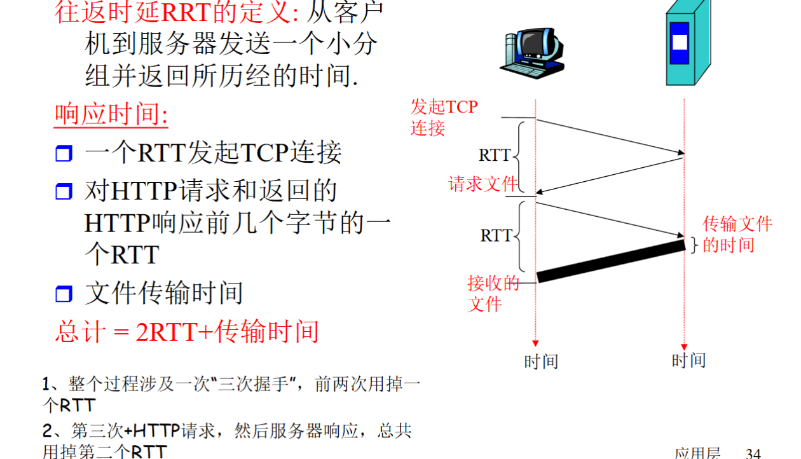

持续连接的TCP运输又有**非流水线**和**流水线**两种方式
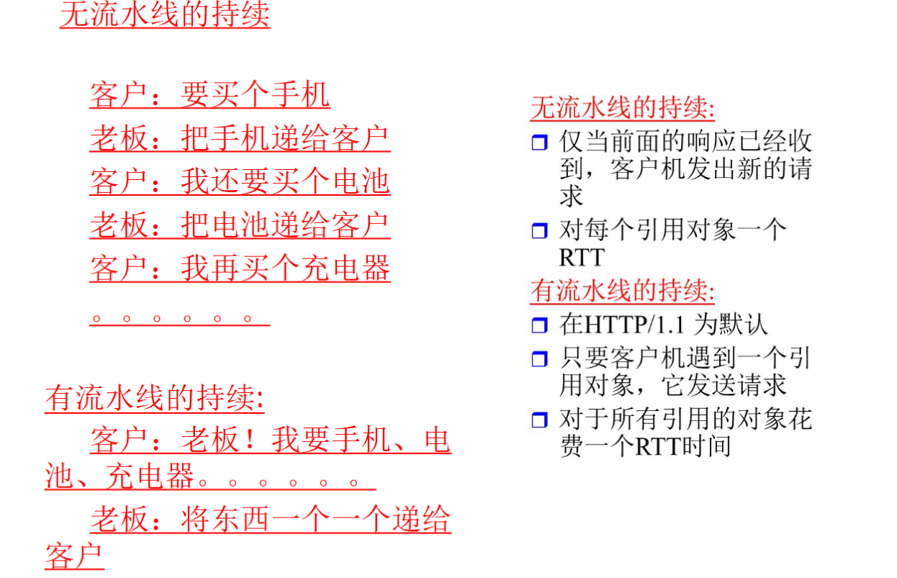

非持续性连接每个对象的传输都要先建立TCP连接, 传输完成后直接关闭, 下一个对象还需要"三次握手"
持续性连接的传输, 建立一个TCP连接后, 后续对象都可以通过该链接有次序的进行运输

#### RTT 相关例题
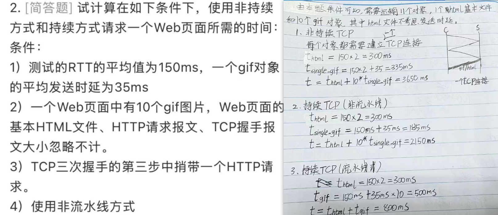

### 2.2.3 HTTP报文格式
HTTP报文有两类:
1. HTTP请求报文;
2. HTTP响应报文

#### HTTP请求报文
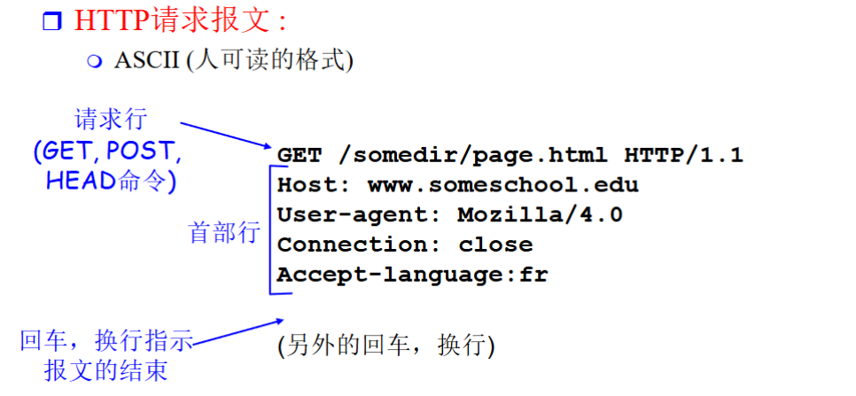

第一行**请求行**有3个字段, `method URL version`:
- `method`: 请求方法, 有GET, POST, HEAD, PUT, DELETE, OPTIONS, TRACE, CONNECT等
- `URL`: 资源定位符, 例如`/someDept/pic.gif`, 对象的路径名
- `version`: HTTP版本, 例如`HTTP/1.1`

**method方法字段:**
- **Get**: **获取资源**, 例如HTML文件, JPEG图片, Java小程序, 音频文件等...
- **Post**: **提交数据**, 例如表单数据(浏览器搜索), 上传文件等..
- **Head**: 服务器收到这样的报文后, 会用一个HTTP报文响应, 但不返回请求对象
- **Put**: **上载文件**, 例如修改HTML文件, 上传文件等...
- **Delete**: **删除资源**, 例如删除HTML文件, 上传文件等...
- ...

#### HTTP响应报文
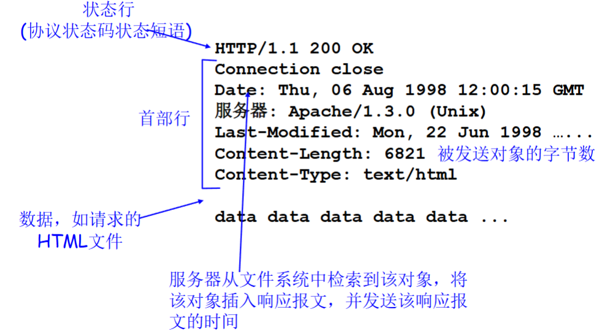

状态行有3个字段: `version 状态码 相应状态信息`
- `version`: HTTP版本, 例如`HTTP/1.1`
- `状态码`: 例如200, 404, 500等
- `相应状态信息`: 例如`OK`(200), `Not Found`(404), `HTTP Version Not Supported`(401), `Internal Server Error`(500)等

首部行有一个`Last-Modified`字段, 用于表示资源的最后修改时间, 这一字段对于既可能在本地客户也可能在网络缓存服务器上的对象缓存来说非常重要

### 2.2.4 用户和服务器的交互--cookie
HTTP服务器是"无状态"的, 为了保持一些客户信息, 引入了**cookies**技术

cookies技术有四个组件:
1. HTTP响应报文的cookie首部行
2. 客户端浏览器的cookie存储
3. HTTP请求报文的cookie首部行(客户端浏览器有存储时)
4. web站点的后端数据库

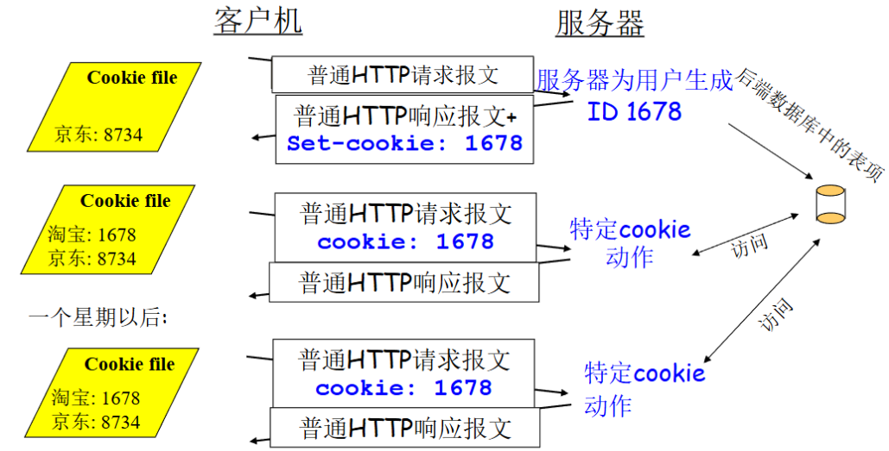

### 2.2.5 Web缓存
Web缓存(Web Caching)也叫**代理服务器(Proxy Server)**, 他能够代替 *初始服务器* 来满足来自客户的HTTP请求

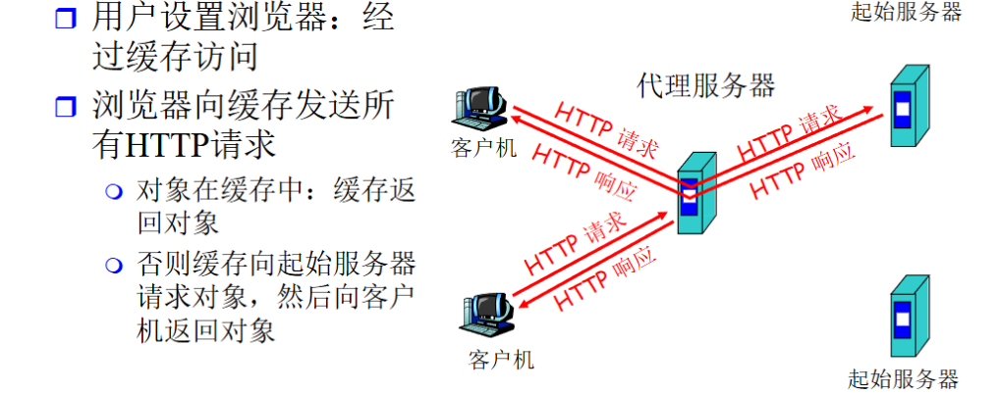

**Web缓存的作用**
1. **减少客户机请求的响应时间**
客户与代理服务器之间的瓶颈带宽一般要远高于客户与初始服务器之间的瓶颈带宽
2. **减小机构访问链路的流量**
Web缓存中有想要的对象时, 就无需从初始服务器获取, 从而减小机构访问链路的流量

**当接入链路流量强度很大时(接近1时, 排队时延会很大), 有两种方法进行改善:**
1. 增加接入链路的带宽
通常这样能降低流量强度, 但带宽升级费用较高
2. 在局域网中部署Web缓存服务器
这样也能降低流量强度, 更加降低客户机请求的响应时间

#### 条件GET
存放在代理服务器的对象副本可能是陈旧的, 即保存在初始服务器中的这个对象可能已经被改过, 但是代理服务器的副本缓存并不知道
HTTP协议通过**条件GET**这个机制来解决这一问题

一个**条件GET**请求报文的特征就是: 该报文包含**一个`If-Modified-Since`首部行**, 该行包含了代理服务器中对象的最后修改时间
这样的请求报文会被发给初始服务器, 用于检查是否需要更新代理服务器中的对象副本
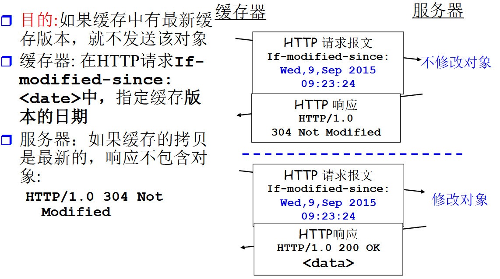

如果条件GET的响应报文的状态行**有 `304 Not Modified`的字段**, 则说明代理服务器中的对象副本是最新的, 代理服务器就可以直接将该对象交付给客户机

## 2.3 FTP
*FTP(File Transfer Protocol)* 是**文件传输协议**, 用于在网络上进行文件的上传和下载
FTP使用**TCP**作为运输协议, FTP服务器监听**TCP端口21**, 等待客户机的连接请求
FTP使用**两个TCP连接**来传输数据:
1. **控制连接(control connection)**: 用于客户机和服务器之间的命令和响应的交换 该连接建立在**端口21**
2. **数据连接(data connection)**: 用于客户机和服务器之间的文件传输
FTP服务器在**TCP端口20**上监听**数据连接请求**, 当客户机需要传输文件时, 就会建立一个数据连接来进行文件的传输
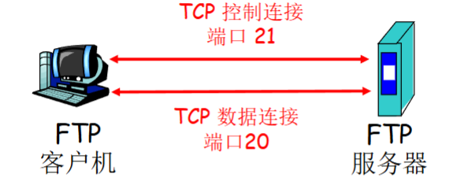

### 2.3.1 FTP 命令
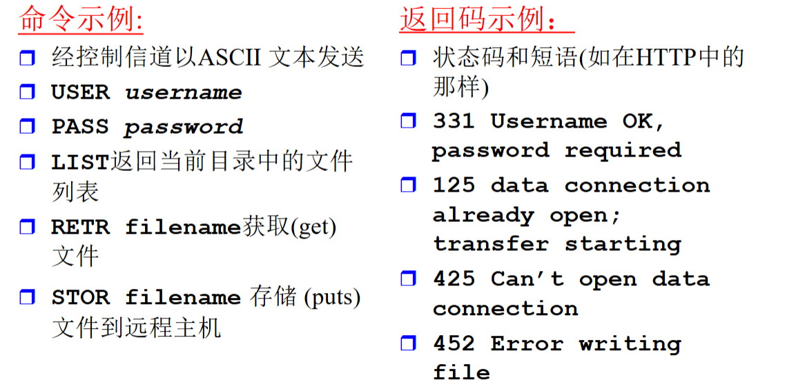

## 2.4 电子邮件
因特网电子邮件系统有三个主要组件:
1. **用户代理(user agent)**: 电子邮件客户端程序, 例如Outlook, Gmail等
2. **邮件服务器(mail server)**: 电子邮件服务器程序, 例如SMTP服务器
3. **简单邮件传输协议(Simple Mail Transfer Protocol, SMTP)**: 电子邮件传输协议, 用于在邮件服务器之间传输电子邮件
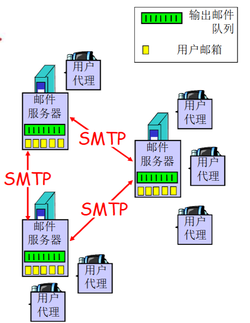

一个典型的邮件发送过程:
1. 用户**在用户代理中撰写邮件**, **用户代理**将邮件发送给SMTP服务器
2. SMTP服务器将邮件转发给**目的地SMTP服务器**
3. 目的地SMTP服务器将邮件存储在**邮箱中**
4. 接收方的用户代理从SMTP服务器的该用户邮箱(用户名和口令鉴别)中取出邮件, 并显示给用户


### 2.4.1 SMTP协议
SMTP是电子邮件的主要应用层协议, 使用TCP作为运输协议, SMTP服务器监听**TCP端口25**来等待客户机的连接请求

SMTP传输电子邮件的过程分为三个阶段:
1. 握手(TCP三次握手)
2. 报文的传输(可以传送多个邮件)
3. 关闭(QUIT)


#### 命令/响应的交互: 
以下左图为一个邮件传送的场景实例, 右图是SMTP建立TCP连接**之后**, SMTP的发送服务器(C)和接收服务器(S)之间的命令/响应交互:
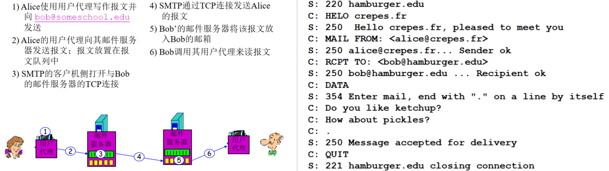

**基本是C发送规定格式的命令(HELO, MAIL FROM, RCPT TO, DATA, QUIT), S给出相应的响应**

#### 邮件报文格式
SMTP是交换邮件报文的协议
邮件报文的格式有**首部**和**主体**两部分:
1. 首部行, 如:
    - `To:`
    - `From:`
    - `Subject:`
2. 主体行:
报文, 均为ASCII字符
3. 两部分之间用一个空白行间隔

#### SMTP vs HTTP
1. HTTP大致是"拉协议", SMTP是"推协议"
2. SMTP要求每个报文采用7比特ASCII吗格式
3. HTTP会把每个对象封装在其自己的响应报文中, SMTP则把所有对象封装在一个邮件报文中

### 2.4.3 邮件访问协议
接收方用户代理向他的ISP的邮件服务器取邮件是一个"拉报文"操作, 但是SMTP是一个"推报文"协议, 这个过程需要引入一些特殊的**邮件访问协议**
1. **POP3(邮局协议3)**
2. **IMAP(互联网邮件访问协议)**

#### POP3协议
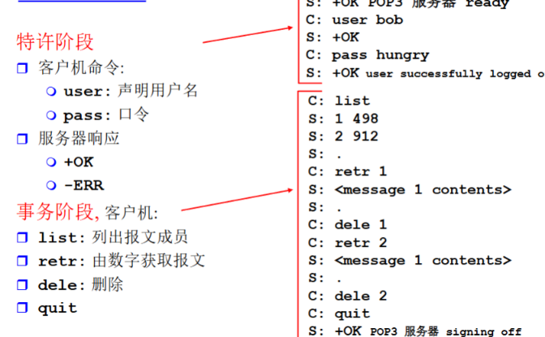

## 2.5 DNS: 域名系统
*DNS(Domain Name System)* 是**域名系统**:
1. 一个有由分层的DNS服务器实现的**分布式数据库**
2. 一个**应用层协议**, 使得主机能够查询该分布式数据库来获取主机名和IP地址之间的映射关系

为了有意义, 好记, 主机通常使用**主机名(hostname)**而不是IP地址来标识, 并且这样的命名要是**层次化**的, 例如`www.someschool.edu.cn`, 另外网络传输需要IP地址, 因此就有了DNS, 其**主要服务就是将主机名转换为IP地址**, 并且DNS服务器是分布式的, 以层次化的方式组织成一个树形结构, 每个DNS服务器负责管理一个域, 例如`edu.cn`域, `someschool.edu.cn`域等 

#### 其他服务 -- 负载分配
一些繁忙的站点要被冗余分布在多台服务器上, 一个域名对应的是一个**IP的值的集合**, 客户端发出这样的DNS请求时, DNS服务器就会返回一个IP地址, 该IP地址是从这个集合中**轮询**(每次请求**出队**一个, 出队的这一个重新排到**队尾**)选出的, 这样就实现了负载分配

### 2.5.1 DNS名字空间 -- 一颗 "树"
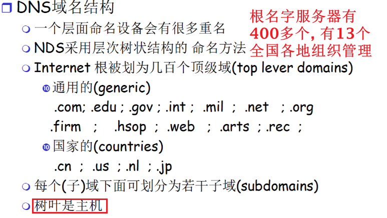

**主机的域名**是从叶子往上直到根 
**域的域名**是从非叶子节点往上走到根

#### 权威DNS服务器
名字空间会被分为不同的区域(zone), 每个区域由一个**权威DNS服务器**来管理, 权威DNS服务器记录的主机名和IP的映射关系是**权威的**, 对于没有缓存的主机名查询路径, **最终都会到达权威DNS服务器**来获取主机名和IP的映射关系

#### DNS记录: 资源记录(RR, resource record)
共同实现DNS分布式数据库的所有DNS服务器存储了**资源记录**:
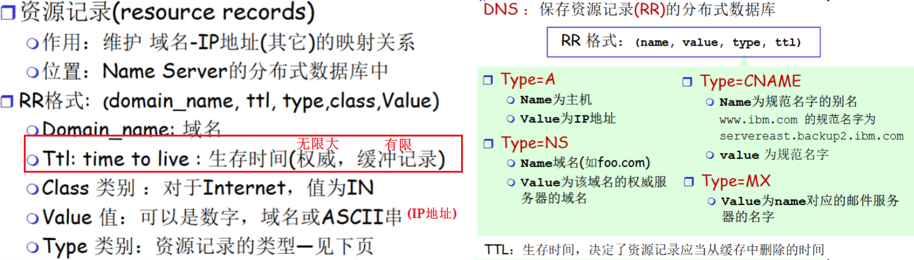

比如一个RR的内容是:
```text
www.someschool.edu.cn. 3600 IN A 128.119.245.
```
这里的`www.someschool.edu.cn.`是主机名, `3600`是TTL, `IN`表示Internet, `A`表示该记录是一个主机名和IP地址的映射关系(type), `128.119.245.`是对应的IP地址(value)

### 2.5.2 DNS名字服务器
除了**权威DNS服务器**之外, 还有**本地DNS服务器(local DNS server)**, **根DNS服务器(root DNS server)**, **顶级域DNS服务器(top-level domain DNS server, TLD)** 等

#### 本地DNS服务器
当一个主机发起一个DNS查询时, 该查询会先送到其本地DNS服务器
1. 当查询名字位于本地DNS服务器的**缓存(caching)**中, 本地DNS服务器就直接返回查询结果
2. 当本地DNS不能解析该查询名字时, **就会开始沿着根DNS服务器 -> 顶级域DNS服务器 -> 权威DNS服务器**的查询路径来进行查询

**第二种查询**有两种方式:

### 2.5.3 两种查询过程
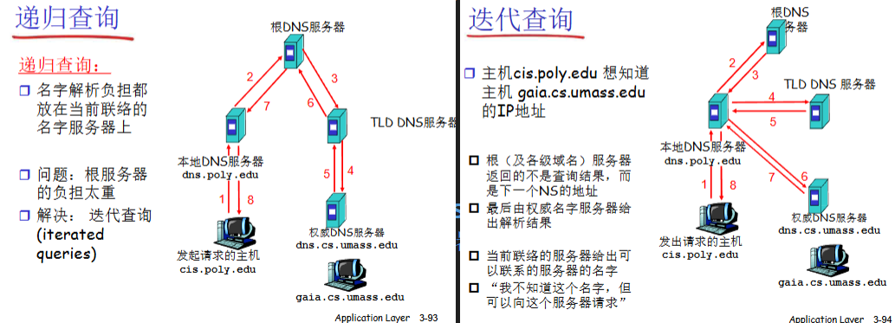

在**DNS**中, 为了提高性能, 一旦名字服务器学到了一个名字和IP地址的映射关系, 就会把该映射关系保存在本地DNS服务器的**缓存**中
- 根服务器通常都在本地服务器中缓存着根服务器的IP地址, 因此根服务器不会经常被访问

**缓存**是为了提高效率, 但是缓存不能一直存在, 要有一个**生存时间(TTL, time to live)**, 当TTL过期(默认为两天)时, 该缓存就会被删除, 需要重新查询

### 2.5.4 DNS协议, 报文
DNS协议使用UDP作为运输协议(不需要握手), DNS服务器监听**UDP端口53**来等待客户机的连接请求
DNS的报文格式如下:
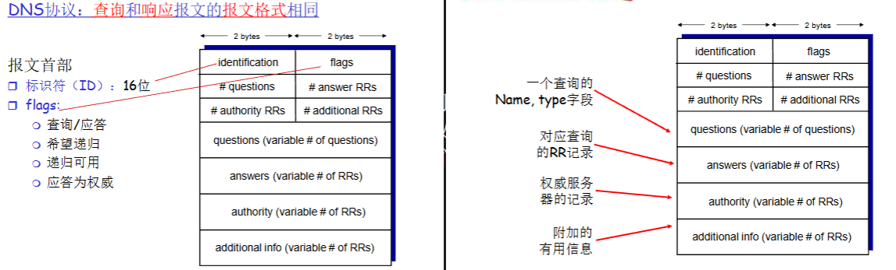

### 2.5.5 DNS攻击
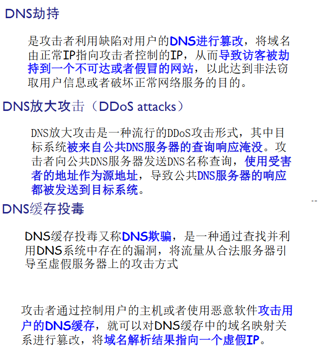

### 2.5.6 DNS的维护
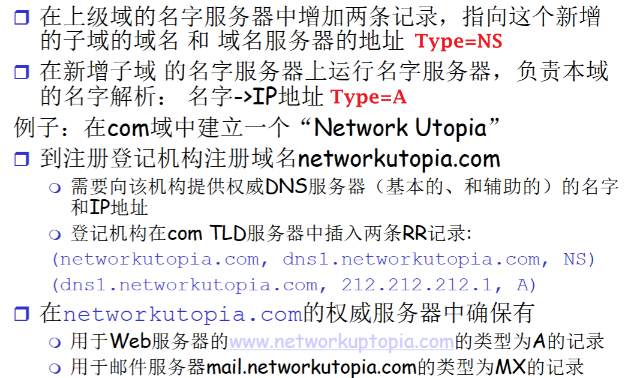


## 2.6 P2P文件共享
关于P2P的文件共享分发, 大致可以分为两种, 一种是**非结构化P2P文件共享**, 另一种是**DHT结构化P2P文件共享**
1. **非结构化P2P**中, peer节点之间的连接(yverlay)是任意的, 有大致三种形式
    - 集中化目录: Napster, 用一个服务器维持Peer List, 需要是进行查询, 然后建立P2P文件传输. 会有单点故障的问题
    - 完全分布式: Gnutella, 没有服务器, 通过**洪泛查询**来进行查询, 但是效率较低
    - 混合型: KaZaA, 可以理解成Napster和Gnutella的混合体, 分为很多小组, 每个小组的组长之间采用Naspter, 一个小组内的peer之间采用Gnutella
2. **DHT结构化P2P**中, peer节点之间的连接是有结构的, 不如构成一个环形的或者是树形的overlay, 并且通过**哈希函数**来进行查询, 例如Chord协议, 通过哈希函数把文件名映射成一个ID, 通过哈希函数把peer节点的IP地址映射成一个ID, 通过这些ID来进行查询, 这样效率较高

#### P2P vs. CS 文件传输
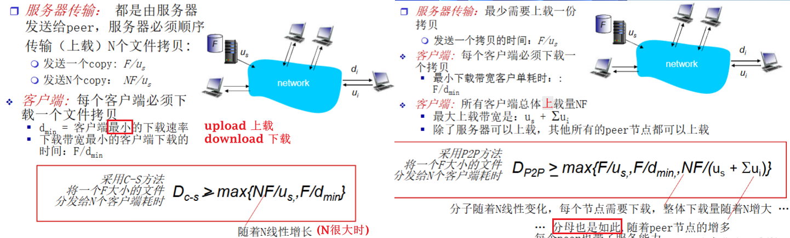

### 2.6.1 BitTorrent协议
接下来重点讲一下一个非结构化P2P文件共享的实例, **BitTorrent**协议
在**BitTorrent**协议中, 有三个重要的机制:
1. **稀缺性优先(Rarest First)**, 即优先从对等节点请求那些稀缺的文件块, 最稀缺的块就是那些他邻居中存在最少的块, 这样能够维持洪流的健康, 不会受peer节点的加入和离开而受到太大的影响.
2. **一报换一报(tit-for-tat)**, 即并不是雨露均沾, 而是优先选择对他传输速率最高的四个peers来发送块.
3. **乐观疏通(optimistic unchoking)**, 即定期选择一些之前没有与之交换数据的peers进行数据交换, 以发现更好的下载源, 更新最好的四人名单; 这样就有可能给一些刚加入洪流的小白提供第一桶金, 是他们后面有能力加入到Torrent的集体利益提升中去.

BitTorrent的基本前提:
1. 追踪器Tracker: 记录着维持某个文件的peer列表
2. 洪流Torrent: 参与一个特定的文件分发的所有peers集合
3. 新手加入torrent是, 会从tracker获得参与的对等方节点信息
4. 洪流里的每个节点都有一个**bit map**, 用于映射自己对文件的每个块的拥有情况.
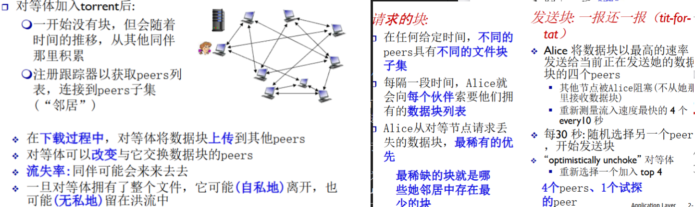

### 2.6.2 Distributed Hash Table (DHT)
无论是peer还是文件块, 都会**通过Hash算法变成所谓的ID**
DHT的世界里, 没有什么中心服务器, 整个DHT就是一个巨大的查询数据库, 每个节点负责存储某个文件他的ID和文件所在的位置, 即存的是key-value
在DHT的结构中, key-value的分配规则是: **将key-value对分配给具有最接近ID的peers.**
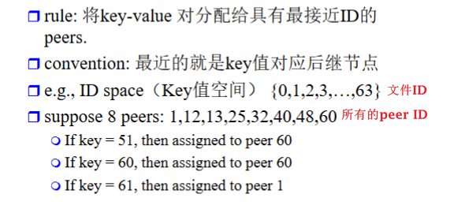
每次一个peer想要获得某个文件, 他就会根据改文件的ID去找到那个具有相应key-value的peer, 向他获得文件位置(可能是某个peer的IP), 然后再去文件位置获得文件内容
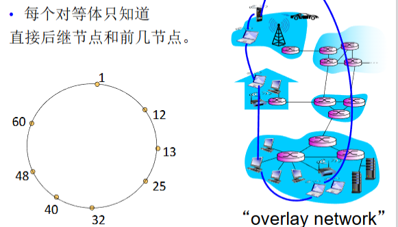
最经典的就是chord环形DHT结构

## 2.7 CDN
最常见的网络视频点播场景是: **流化服务**
即, 用户即点即看, 直接播放, 传多少数据, 播放多少, 并不需要完整下来之后才能开始看.
常见的流化服务是**DASH**
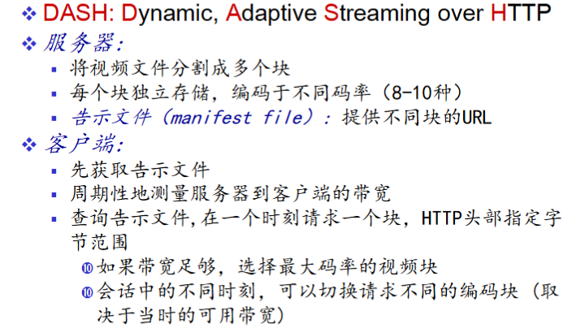

在这种流化服务下, 会有这样的挑战: **服务器如何通过网络向上百万用户同时流化视频内容?**
直接的想法是不断升级服务器, 制造一个超级服务器, 但是会有如下问题:
1. 服务器到客户端的路径上跳数较多, 瓶颈链路的带宽小导致停顿
2. 网络中同时充斥着同一视频的多个拷贝, 资源浪费
3. 单点故障

因此就有了**内容分发网络(Content Distribution Network, CDN)**的概念, 其核心思想就是**将内容分发到离用户更近的地方**, 这样就能提高效率, 减少停顿, 避免单点故障
CDN运营商会在很多地方部署**缓存节点**, 即缓存服务器, ISP向CDN服务商购买这些节点后, 这些缓存服务器会从原始服务器(ISP运营商的源服务器)上获取内容的副本, 当用户请求内容时, 就会从离用户最近的缓存服务器上获取内容, 这样就是能够加速ISP的流化服务
用户在进行点播时, 客户端会先按DASH那样获得告示文件, 通过告示文件获悉最近的最快的缓存服务器(也可以通过域名解析重定向), 然后从该服务器上获取内容, 这样就能加速流化服务
以下是一个简单的CDN的示例:
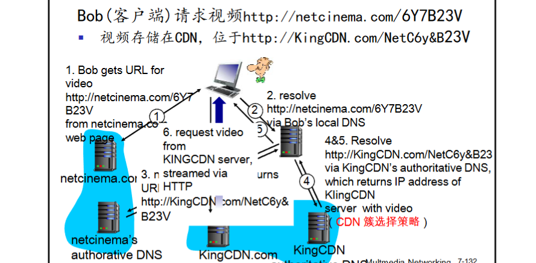

## 2.8 套接字编程

应用进程使用传输层提供的服务才能交换报文, 实现这一功能的接口就是**套接字(socket)**, 套接字是应用层和运输层之间的接口, 也是应用程序编程接口(API)
**socket**可以理解成是分布式应用进程之间的门，传输层协议提供的端到端的服务接口.

#### 2.8.1 TCP套接字编程
TCP传输的过程可以用一下伪代码来表示.
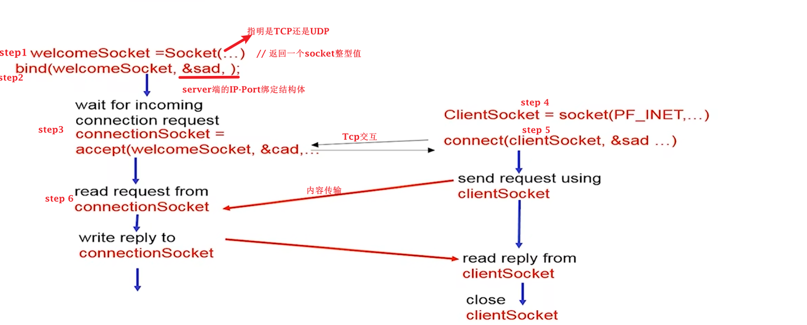
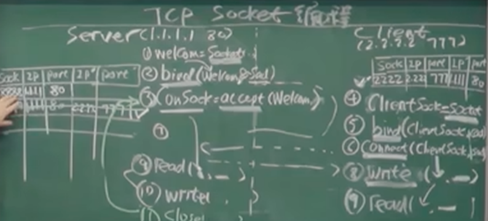
用文字表述TCP连接的过程:
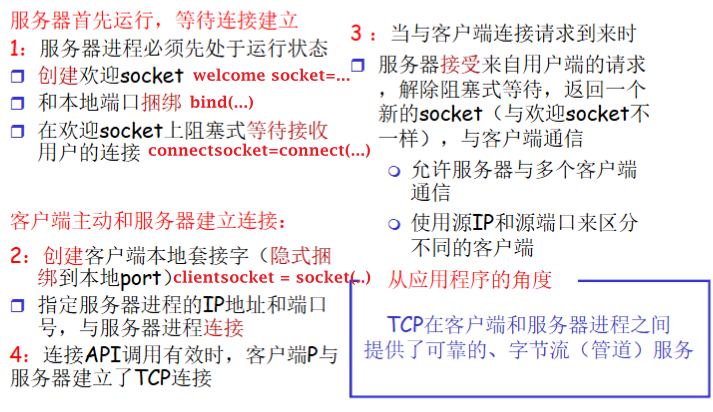

### 2.8.2 UDP套接字编程
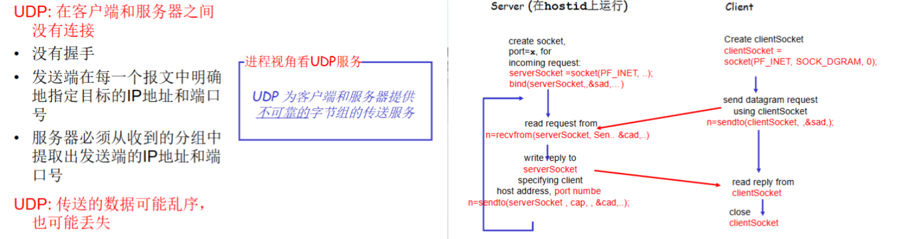
