<h1 align='center'>第三章 传输层</h1>

[TOC]

## 3.1 传输层概述
传输层的定位是为**运行在不同主机上的应用进程**提供**逻辑通信**服务

传输协议(TCP, UDP等)运行在端系统:
1. **发送方**: 蒋应用层的报文分成**报文段**, 并为每个报文段添加一个**传输层首部**(header), 形成**传输层数据报**(segment), 然后将数据报交给网络层(网络层是IP协议)
2. **接收方**: 从网络层接收数据报, 去掉传输层首部, 将报文段重组成应用层报文, 交给应用层

### 3.1.1 传输层 vs. 网络层
网络层提供的服务是**主机到主机的服务**, 传输层把网络层服务**细分为进程到进程的服务**
传输层的服务属于是**更加的优化网络层的服务品质**, 然后传给应用层
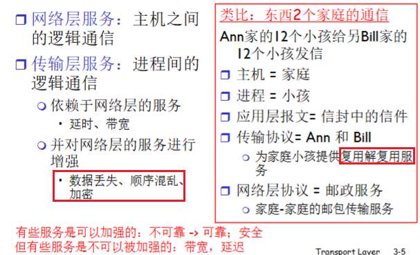

这里传输层带来的"加强服务"如下:
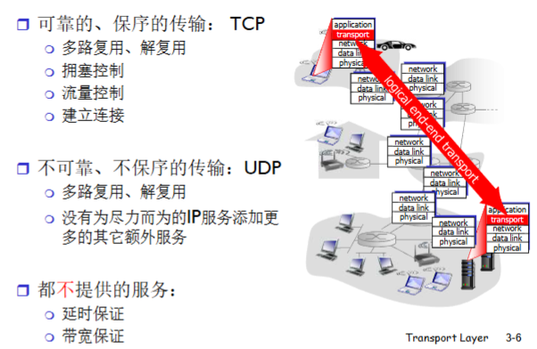

## 3.2 多路复用和解复用
为了实现**进程到进程的通信**, 传输层需要使用**端口号(port number)**来标识不同的应用进程, 端口号是一个16位的整数, 范围是0~65535
1. **多路复用(multiplexing)**: **发送方**从多个套接字接收来自多个进程的报文, 根据套接字对应的IP地址和端口号等信息对每个端口对应的报文段**用头部加以封装**, 这些头部信息会用于以后的解复用(TCP和UDP的头部信息不太一样)
2. **解复用(demultiplexing)**: **接收方**根据报文段的**头部信息中的IP地址和端口号**将接收到的报文段发给正确的套接字和对应的应用进程

$$
IP数据报(网路层) = IP首部 + 传输层报文段(传输层) = IP首部 + 传输层首部(源端口目标端口) + 应用层报文
$$

### 3.2.1 UDP的多路复用和解复用
UDP的数据段首部包含**源端口号**和**目的端口号**;
UDP使用**二元组**来标识一个套接字, 二元组由**目的IP地址**和**目的端口号**组成;
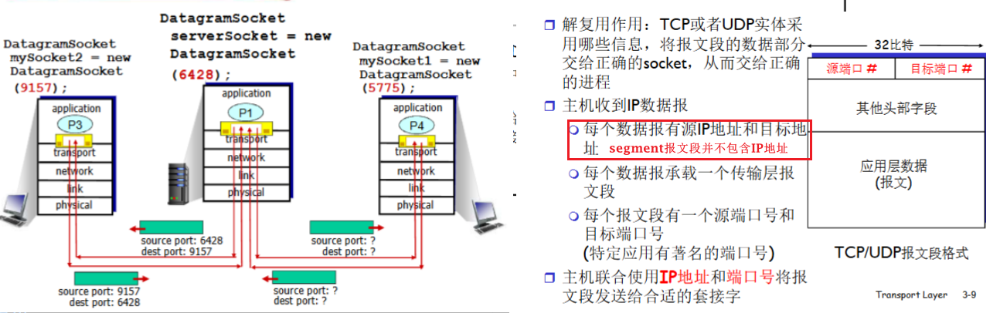

当主机接收到UDP的段时, 会检查UDP点钟的目标端口号, 将**UDP段交给具备那个端口号的套接字**
即便UDP的报文段的源端口号不同(即来自不同的客户端进程), **只要目的端口号相同, 他们就会被交给同一个套接字**

### 3.2.2 TCP的多路复用和解复用
TCP使用**四元组**来标识一个套接字, 四元组由**源IP地址, 源端口号, 目的IP地址, 目的端口号**组成
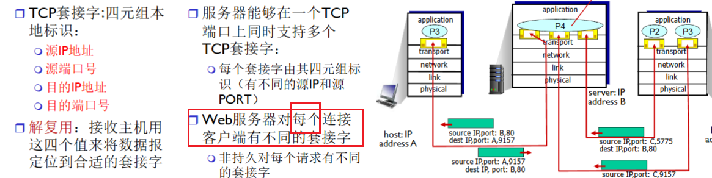

接收主机用这四个值来**将数据报定位到合适的套接字**, 服务器能够在一个TCP端口上同时支持多个TCP套接字, 每个套接字的区别是**源IP地址和源端口号不同**

### 3.2.3 UDP vs TCP
**一个使用二元组一个使用四元组**, TCP为了能够实现可靠的连接, 必须使用四元组来标识一个套接字, 以区分不同的连接; UDP不需要连接, 只需要使用二元组来标识一个套接字

## 3.3 无连接传输: UDP
**UDP(User Datagram Protocol)** 被称为"尽力而为"的传输协议, 因为他在网络层提供的IP服务的基础上, 并没有给出太多的服务质量提升.
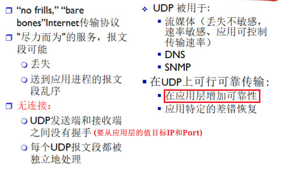

**UDP报文段**的首部包含**源端口号, 目的端口号, 长度, 校验和(差错检测码, EDC)**四个字段; 首部之后就是应用层的报文数据;

**为什么要有UDP ?**
1. **不建立连接**: 减少一部分时延
2. 简单: 在发送端和接收端没有连接状态
3. **报文段的头部很小**: 开销小
4. **无拥塞控制和流量控制**: UDP可以尽可能快的发送报文段, 不受网络拥塞和接收端处理能力的限制; TCP则需要进行拥塞控制和流量控制, 以避免网络拥塞和接收端过载

### 3.3.1 UDP校验和
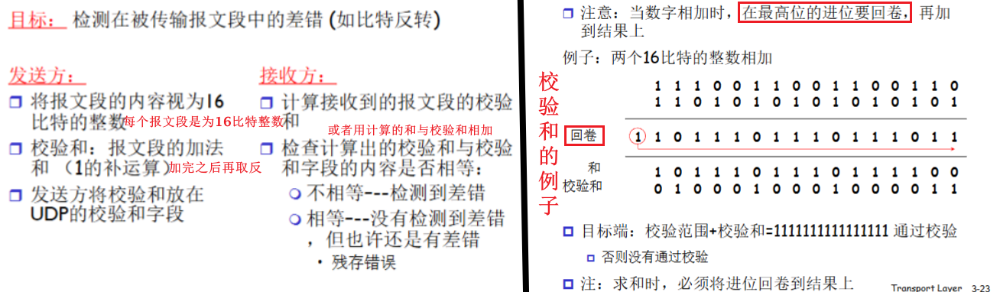

## 3.4 可靠数据传输(rdt)的原理
> **可靠数据传输(reliable data transfer, rdt)**在应用层, 传输层和数据链路层都很**重要**

rdt协议的设计目标是**在不可靠的信道(比如比特差错, 分组丢失) 上实现可靠的数据传输**, 来自下层提供的服务是不可靠的, 但是rdt要向上层提供可靠的服务.
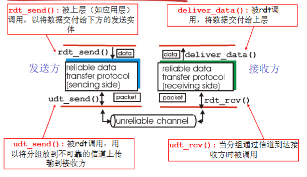

接下来我们将通过一个rdt逐步进化的过程来理解rdt协议的设计原理, 下层是不可靠的信道, 我们可以先假设他是可靠的, 然后逐步来理解rdt在信道变得越来越不可靠时要怎么去升级以维持对上层的可靠服务.
**每一步升级我们都用有限状态机(FSM)来描述rdt协议的行为**

### 3.4.1 rdt 1.0
**信道可靠, 没有比特差错和分组丢失**
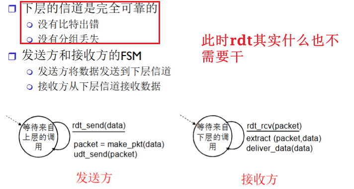

### 3.4.2 rdt 2.0
**信道不可靠, 有比特差错**
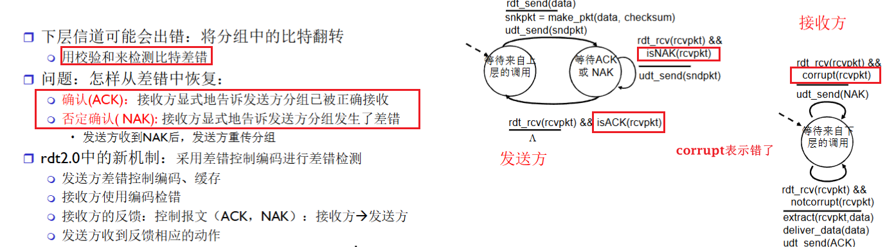

**要注意**, 传送的分组数据可能会有比特差错, 那么**NAK, ACK分组也可能会有比特差错**, 这就是rdt2.0的致命缺陷.

#### 3.4.2.1 rdt 2.1
解决2.0的NAK, ACK分组可能会有比特差错的问题, 通过**添加序列号**来解决这个问题, 这样就可以区分出ACK和NAK分组的比特差错了.
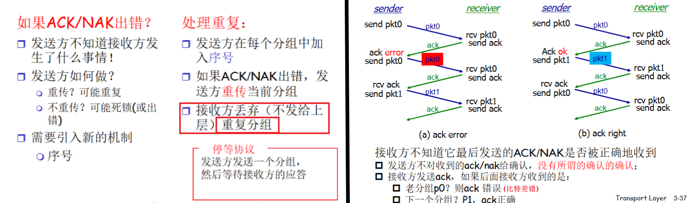

实际上的序列号只用0和1就够了, 因为我们只需要区分出当前分组和上一个分组就可以了, 这样就可以解决ACK和NAK分组的比特差错问题了

#### 3.4.2.2 rdt 2.2
**取消掉NAK分组**, 只使用ACK分组来确认分组的正确接收, 这样就可以简化协议了, 但是需要在ACK分组中添加一个序列号来区分当前分组和上一个分组
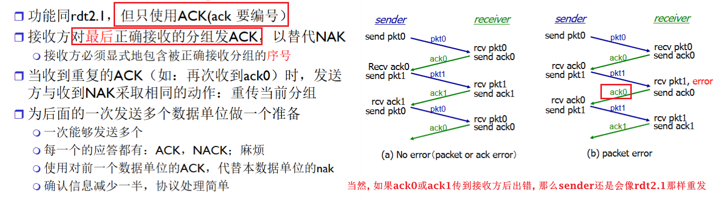

### 3.4.3 rdt 3.0
**信道不可靠, 有比特差错, 有分组丢失(路由器缓存队列满了)**
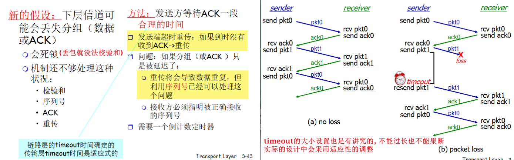

当超时时间设置非常不合理, 比如过短时, 就会出下列的(d)情况:
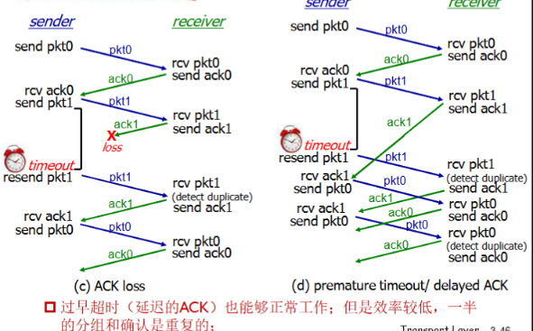

虽然也能正常工作, 但是会导致**效率很低**

到此为止, rdt3.0已经看起来**基本完备**了

**但是rdt3.0的效率很低**, 因为每发送一个分组都要等待一个ACK分组的到来, 这就导致了**停等协议(stop-and-wait protocol)**, 也就是每发送一个分组都要停下来等待ACK分组的到来, 这就导致了**信道利用率非常低**
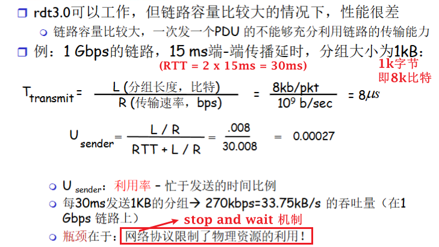

### 3.4.4 流水线协议
因此, 现在我们需要把**停等协议**升级为**流水线协议(pipelined protocol)**
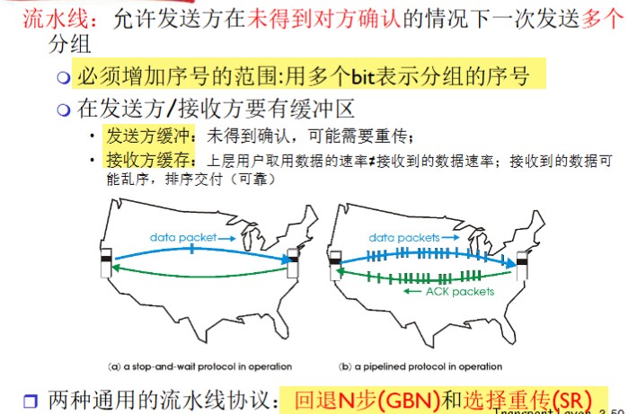

流水线协议主要有两种, **回退N步(GBN)和**选择重传(SR)**, 他们的区别在于接收方的滑动窗口/接收缓冲区的大小是等于1还是大于1.
这两个流水线协议, 都要基于一个通用的**滑动窗口协议(sliding window protocol)来实现

#### 3.4.4.1 滑动窗口协议
该协议引入了**缓冲区和滑动窗口的概念**
1. **发送缓冲区**: 用于存放可以允许进行发送的分组
2. **发送窗口**: 用于存放已经发送但还没有收到ACK的分组, 发送窗口是发送缓冲区的一个子集, 用于存放已经发送但还没有收到ACK的分组
3. **发送缓冲区的大小**: 对于停等协议, 发送缓冲区的大小为1; 对于**流水线协议**, 发送缓冲区的大小大于1, 但是也有上限, 太大的话链路利用率达到饱和了, 就没有意义了
4. **接收缓冲区**: 用于存放已经收到但还没有被应用层读取的分组
5. **接收缓冲区的大小**: 对于GBN协议, 接收缓冲区/接收窗口的大小为1, 表示允许接收的分组. 对于SR协议, 接收缓冲区/接收窗口的大小大于1, 表示可以乱序接收的分组范围
6. **接收窗口**: 接收窗口等于接收缓冲区的大小

**发送窗口的后沿和发送缓冲区的后沿始终是同一个位置**, 当从当后沿位置的分组己收到ACK确认后, 发送缓冲区就整体前移, 发送窗口的后沿也就跟着发送缓冲区的后后沿移动一下
**每发送一个缓冲区中的分组, 发送窗口的前沿就往前移动一格**
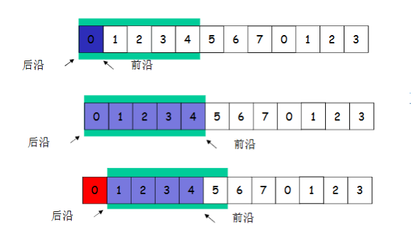

对于接收窗口/接收缓冲区, 规则如下:
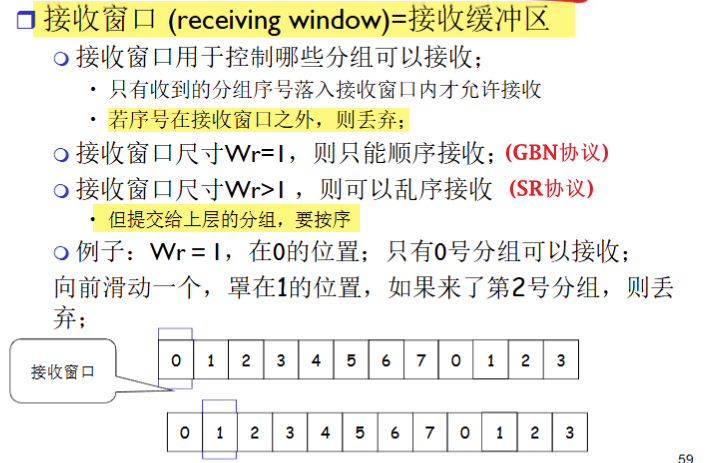

#### GBN vs SR协议
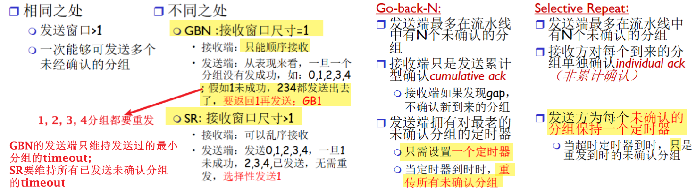

#### GBN和SR图示例子
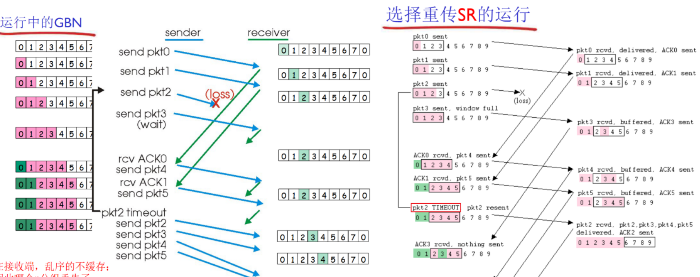

## 3.5 面向连接的传输: TCP

**TCP(transmission control protocol)概述**
1. **点对点**: 一个接收方, 一个发送方
2. **可靠, 按顺序的字节流**: 没有报文段边界
3. **具有发送与接收缓冲**
4. **管道化(流水线)**: TCP拥塞控制和流量控制窗口大小
5. **全双工**: 数据可以同时在两个方向传输
数据报文被分成一个个的报文段, 每个把文段都给他加上一个TCP首部, 形成TCP数据报
**MSS**表示最大的报文段长度, MSS的值是由TCP首部和IP首部的长度决定的....
6. **面向连接**: 数据交换之前, 通过握手初始化发送方和接收方的状态变量
7. **流量控制**: 发送方不会发送超过接收方缓冲区大小的数据

### 3.5.1 段结构

#### TCP的报文段结构
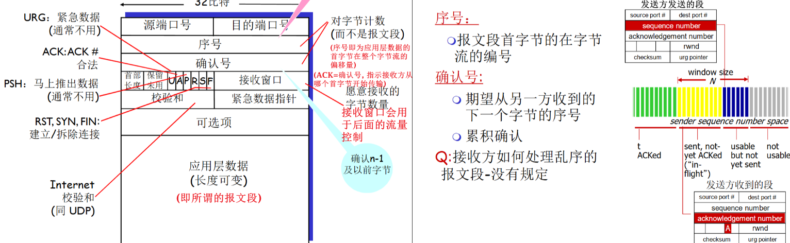

#### TCP超时定时器的设置
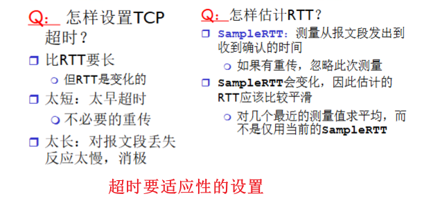
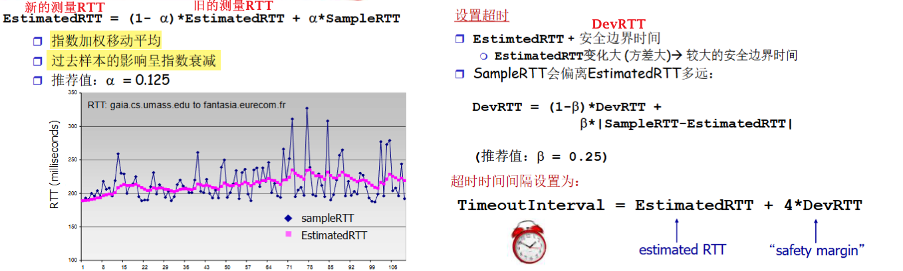

### 3.5.2 可靠数据传递
前面有将GBN和SR协议, 而TCP的可靠数据传输可以是两者的结合体, 在某些方面像GBN, 在某些方面像SR
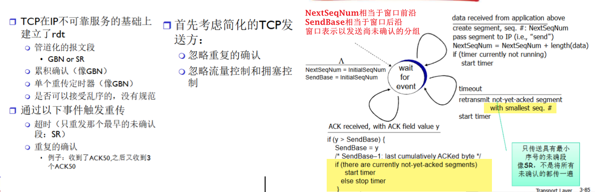
TCP的rdt规定的是**累计确认**, 即ACK(n)表示已经正确接收了所有序列号小于n的分组 (但是不保证序列号为n的分组已经被正确接收了)

#### tcp发送方应有动作
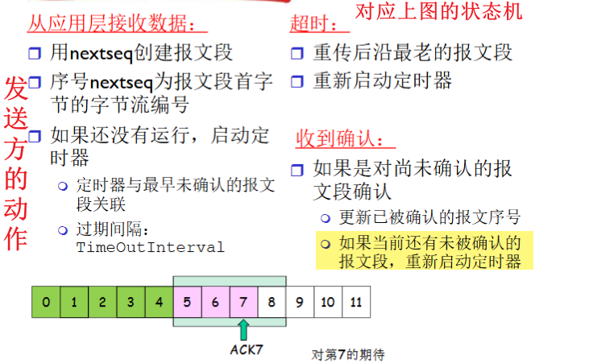

#### tcp接收方应有动作
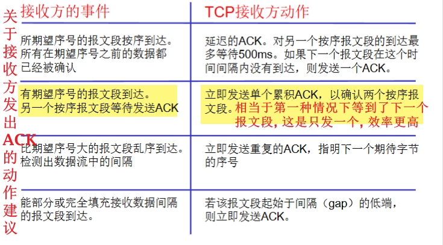

#### 快速重传(fast retransmit)
前面说到, tcp接收方发出的ACK确认是**累计确认**, 因此就会有前面所说的没有超时, 但是发送方连续收到了多个同一个ACK分组确认的情况, 这个时候, 发送方需要做的是立即重传, 无需再等待超时了, 这个机制就叫做**快速重传**(fast retransmit),  这样做的目的就是要尽快的重传丢失的分组, 以减少重传的时延
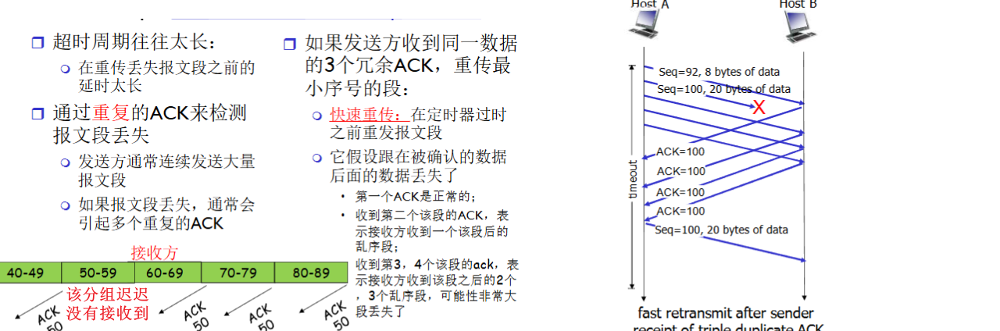

### 3.5.3 流量控制
**流量控制的主要目的是**: 防止发送方发送太快, 太多以至于让接收方的缓冲区溢出, 造成分组丢失
前面的TCP报文的头部信息里有**接收窗口大小**的字段(接受方空闲的缓冲区大小, rwnd), TCP的发送方就是根据这个来进行流量控制
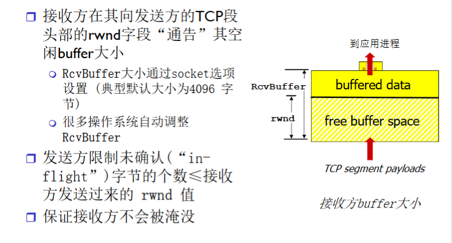

### 3.5.4 TCP连接管理

#### TCP建立连接
在正式交换数据之前, 发送方和接收方需要握手建立通信关系, 一方面需要双方都同意建立连接, 另一方面需要交换一些初始的状态变量(比如序列号等), 以便后续的数据传输能够顺利进行

正常的逻辑来讲, 建立连接似乎用**两次握手**就足够了, 但是由于不可靠的信道有丢失等问题, 可能导致两次握手建立连接出现很多问题, 下图左侧失败场景是**服务器半连接问题**, 右侧失败失败场景是**服务器把旧数据当做新数据接收**
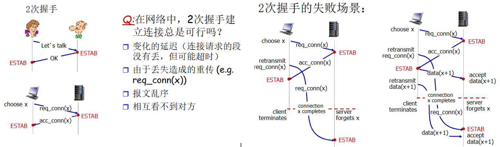

因此, 通过三次握手建立连接是必要的, TCP报文包含一个**SYN**的标志位, 用于表示这是一个连接请求报文
为了解决两次握手的半连接问题和接收老数据问题, TCP的三次握手过程如下:
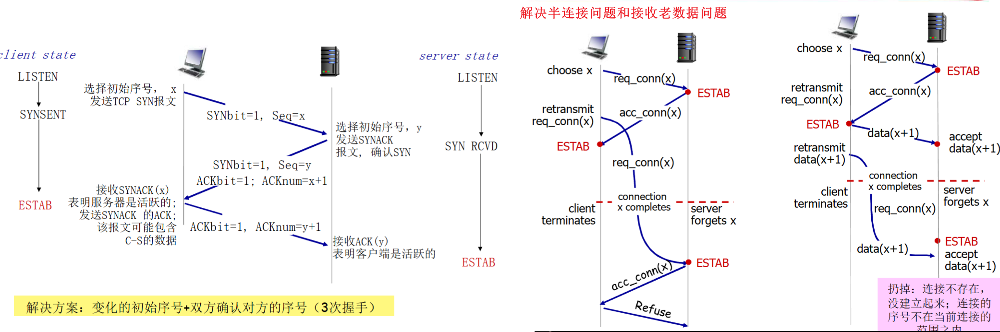

通俗的解释TCP三次握手的过程如下:
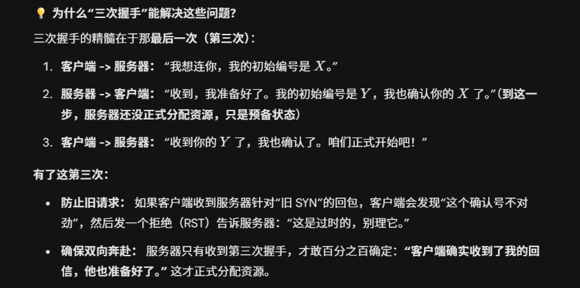

#### TCP关闭连接
TCP设计的关闭链接**不算是一个很完备的机制**
TCP在关闭连接是需要服务器端和客户端分子**关闭他们自己那一侧的连接**, 也就是说, 服务器端和客户端都需要发送一个**FIN**报文来关闭连接.
一旦一端接收到FIN, 就会哦那个ACK回应, 同时可以把自己需要发出的FIN段连同这个ACK段一起发出.
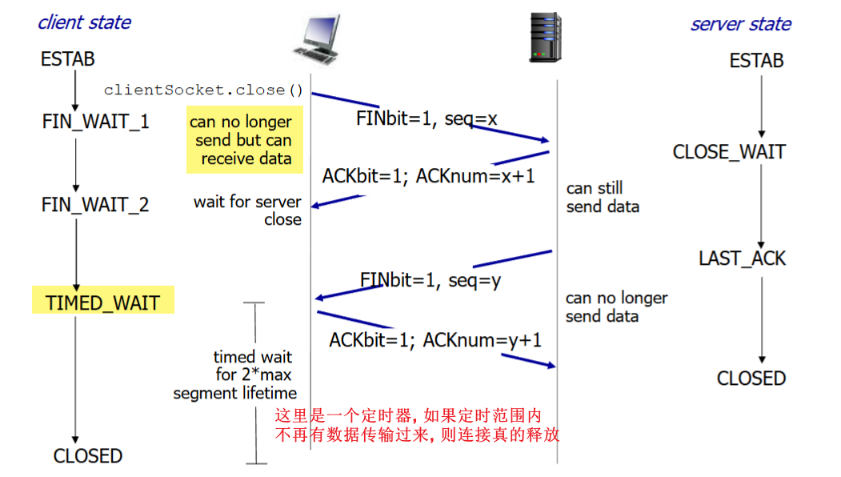

## 3.6 拥塞控制原理
流量控制是**端系统之间的控制**, 主要是为了防止发送方发送过快, 以至于让接收方的缓冲区溢出

**拥塞控制**是为了应对**网络的堵塞(网络核心)**, 而不是端系统的过载, 网络堵塞的表现主要是:
1. **分组丢失**: 路由器的缓冲区溢出, 丢失率要比不堵塞时高很多
2. **时延增加**: 要在路由器的队列中排队, 时延要比不堵塞时高很多

### 3.6.1 拥塞的原因
由于路由器的**缓冲区是有限的**, 当网络中的数据流量过大时, 路由器的缓冲区就会溢出, 导致分组丢失; 同时, 当网络中的数据流量过大时, 路由器的队列就会变长, 导致时延增加 
对于那些丢失的分组, **为了保证有效的输出**, 发送端会利用**超时**来进行重传, 这样的重传是必要的; 但是由于发送端并不知道路由器的缓冲大小以及是否缓冲区已满, 此时即便某个分组不丢失, 只是滞留在了路由去的缓冲队列里, 那么发送端仍会发送重传分组, 这些属于是**不必要的重传**.
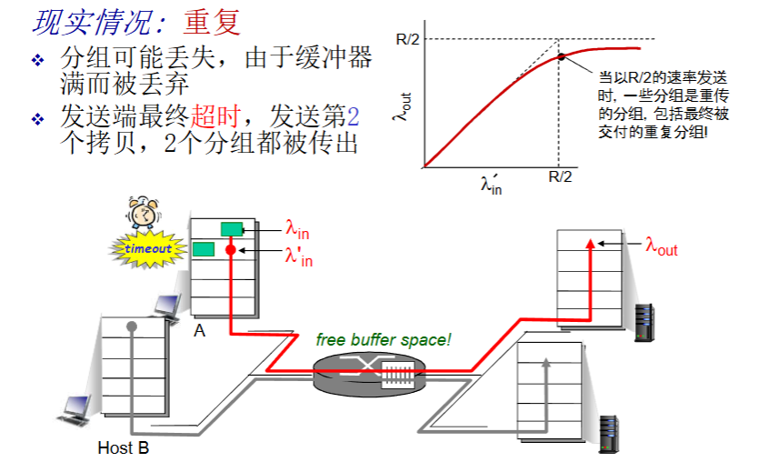

另外, 但一个路由器负责多重路径路径时, 各个路径可能会争抢路由器的缓冲区, 往往位于上游的路径会占用更多的缓冲区, 导致位于下游的路径的分组更容易被丢弃, 这就是**公平性问题**.
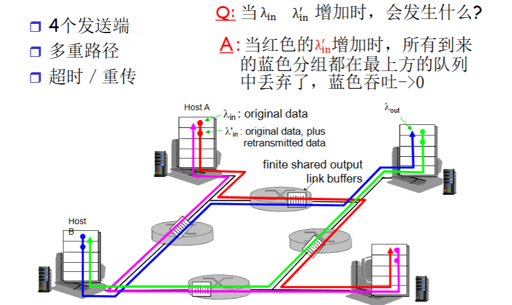

### 3.6.2 拥塞的代价
综上, 根据他们的原因, 可以知道拥塞带来的危害有
1. 为了达到一个有效输出, 网络需要做更多的工作---**重传**
2. 没有必要的重传使得链路中包括了多个分组的拷贝, 即那些没有丢失, 但是处于拥塞状态, 传播时间很长导致超时的分组.
3. 当分组丢失时, **任何关于这个分组的上游传输能力**都被浪费了

### 3.6.3 拥塞控制的方法
拥塞控制的主要方法有两种, **端到端的拥塞控制**和**网络辅助的拥塞控制**
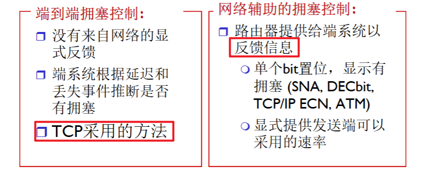

#### 案例: ATM ABR拥塞控制
ATM网络的拥塞控制就是典型的**利用反馈信息**来进行控制的案例, 缺点就是会给网络本身带来额外负担, 复杂性提升.
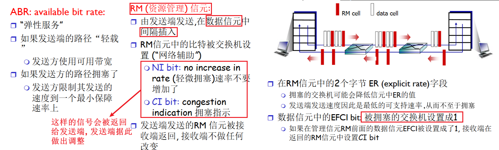

### 3.7 TCP 拥塞控制
TCP 采用**端到端的拥塞控制**, 路由器不向主机提供有关拥塞的反馈信息, 端系统只根据自身的得到的信息判断是否发生拥塞, 并采取相应的动作
这样的机制下, **路由器的负担较轻**, 符合**网络核心简单的TCP/IP架构原则**

**设计TCP的拥塞控制需要考虑以下问题**:
1. **如何检测拥塞?**: 是轻微拥塞还是拥塞
2. **控制拥塞的策略**: 在拥塞发送时如何动作来降低发送速率(轻微拥塞如何做, 拥塞如何做?), 在拥塞缓解时如何动作来增加发送速率?

#### 3.7.1 端到端拥塞感知
TCP的拥塞感知主要是通过**超时**和**重复ACK**来实现的, 这两者都可以用来检测拥塞, 但是他们的检测能力不同, 超时可以检测到严重拥塞, 而重复ACK能检测到轻微拥塞
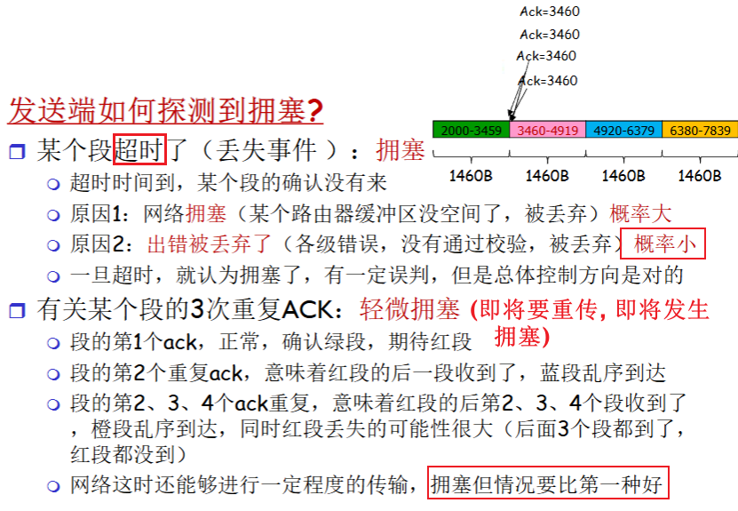

#### 3.7.3 TCP 拥塞控制 速率控制
TCP通过维持一个**拥塞窗口(congestion window, cwnd)** 来控制发送速率, 这个窗口的大小是动态变化的, 根据网络的拥塞程度来调整
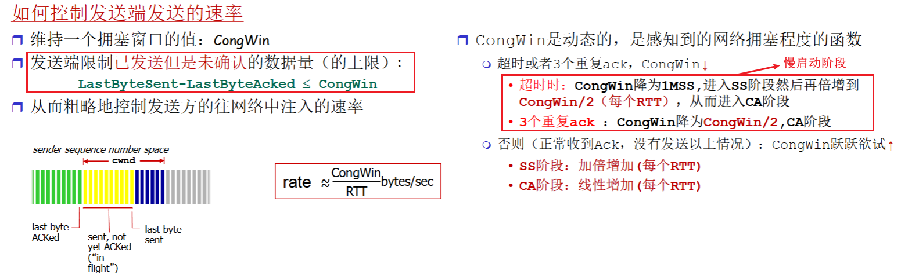

**另外, 为了即照顾到流量控制, 又照顾到拥塞控制**, 通常将TCP的发送窗口(SendWin)设置为拥塞窗口(CongWind)和接收窗口(RecvWin)的最小值
即**SendWin = min(CongWind, RecvWin)**
这样的联合控制操作既能满足拥塞控制, 又能满足流量控制, 以保证TCP的可靠数据传输

#### 3.7.4 TCP 拥塞控制算法
前面图片中提到的**CongWin控制调整策略**可以分为三个:
- **慢启动(SS)**
- **AIMD(加性增, 乘性减)**
- **超时事件后的保守策略**

整个TCP控制过程大致就是:一开始ConWin设置成1 MSS, 进行慢启动(SS阶段), 这时候CongWin增长很快, 也就是发送速率增长很快, 后面由于增长太快大概率发生**超时**, 此时的动作是会**把一个阈值Threshold设置成当前CongWin的一半(这里的阈值用于后续实现从SS状态到CA拥塞避免状态)**, 然后把CongWin设置成1 MSS, 重新开始慢启动SS阶段, 当CongWin增长到Threshold时, 就进入CA拥塞避免阶段, 这时候CongWin的增长就变慢了, 以线性增长的方式增加, 以避免再次发生丢失事件;
如果CA阶段发生了**超时**, 那么就会把Threshold设置成当前CongWin的一半, 然后把CongWin设置成1 MSS, 重新开始慢启动SS阶段, 以此类推
如果在CA阶段发生了丢失事件(**连续收到三个重复的ACK**), 那么就会把Threshold设置成当前CongWin的一半, 然后把CongWin设置成1 MSS, 重新开始慢启动SS阶段, 以此类推然后**并不把CongWin设置成1 MSS, 而是把CongWin设置成Threshold+3, 直接进入拥塞避免阶段, 以此类推**

总结所有动作, 大致如下表格:
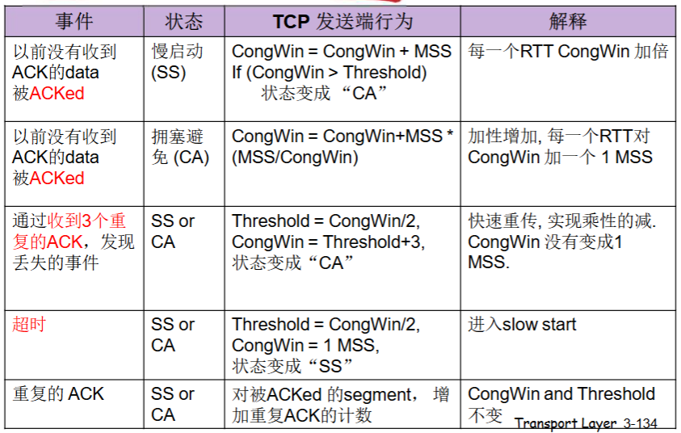

##### 慢启动(SS)
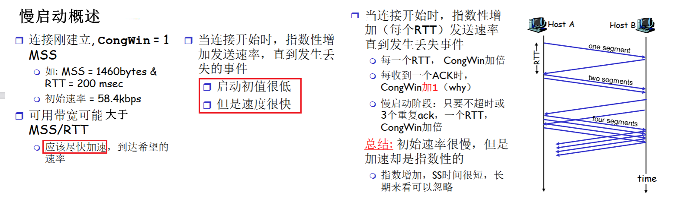

##### AIMD(加性增, 乘性减)
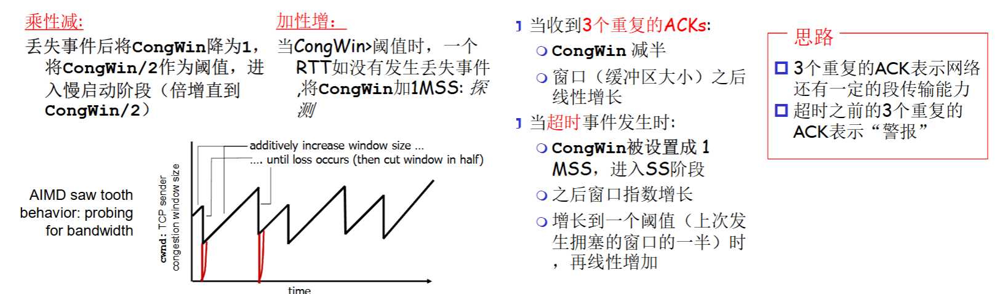

#### 3.7.5 TCP 吞吐量
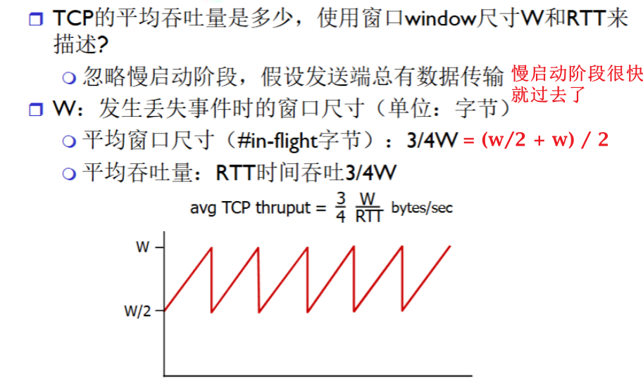

#### 3.7.6 TCP 具有公平性
对于一条被多个连接通道通用的链路, TCP的拥塞控制能够防止某个链路侵略性的独占带宽, 当某个过大时, 他就说主动缩小, 这样的话, 最后能够大致维持一个每个连接通道都能获得一个公平的带宽分配的状态, 这就是TCP的公平性
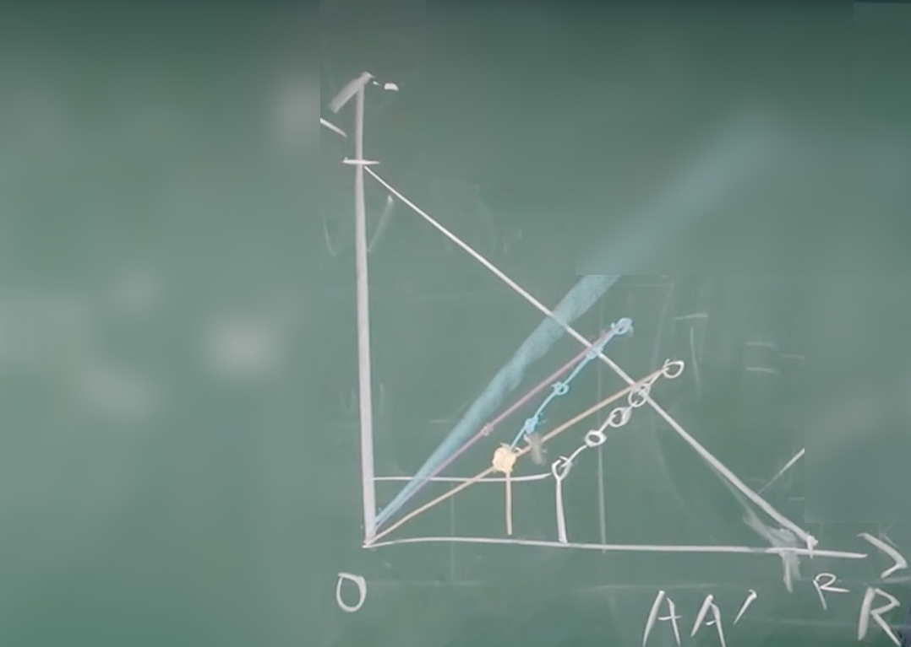

如图, 横纵坐标分别代表两条链路的各自的带宽占用率, 图上的小圈点代表经历不同个数的RTT后, 两条链路的带宽占用率的状态, 可以看到, 不管初始状态是什么样的, 最后都会趋于一个公平的状态(也就是图上的45度线), 这就是TCP的公平性
