<h1 align='center'>第四章：网络层: 数据平面</h1>

[TOC]

## 4.1 导论 -- 网络层概述

### 4.1.1 网络层服务
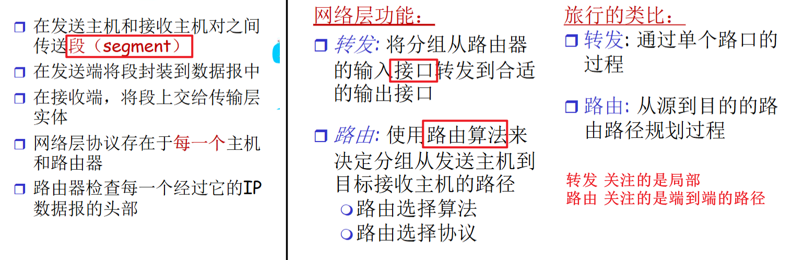

网络层接收来自上层的**报文段**, 封装成**数据报**

发送端和接收端所做的工作大致如下
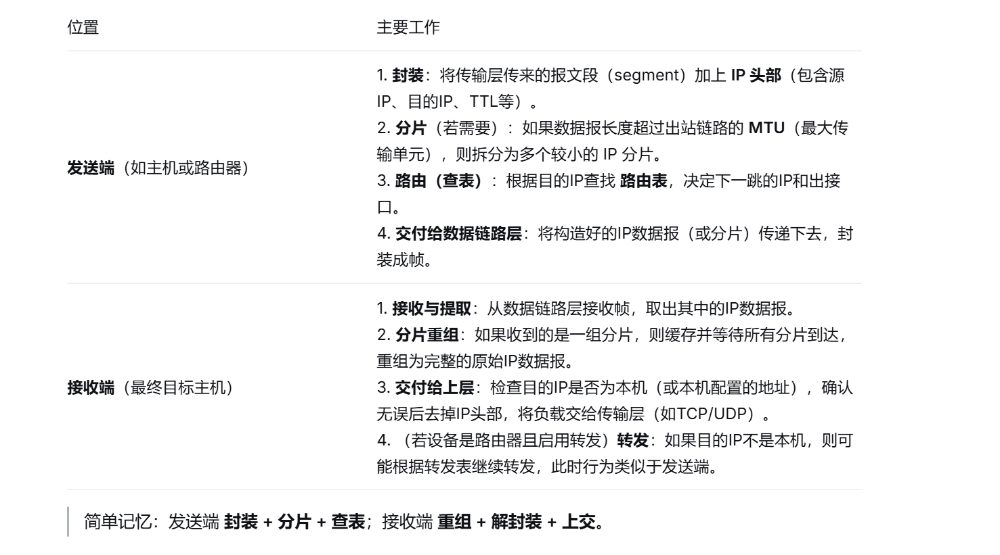

### 4.1.2 网络层的两个平面
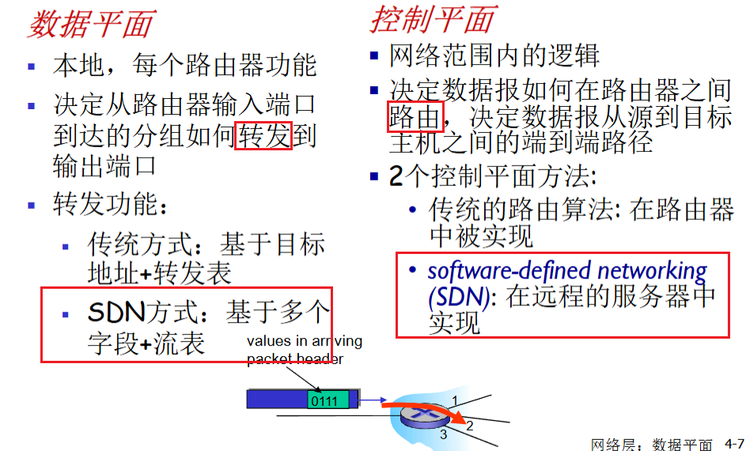

两个平面的区分**描述的是路由器/交换机的内部功能划分**

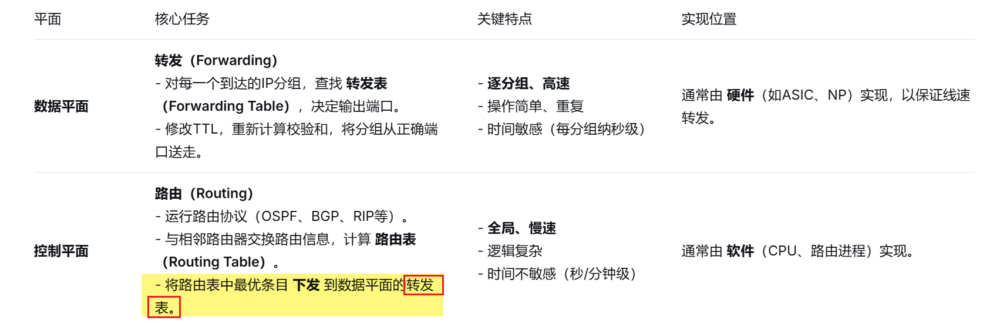

直观理解就是:
- **数据平面**: 像个交换机矩阵 -- 每个包来了, 看一眼表就扔出去 
- **控制平面**: 像个大脑 -- 统一对话了解全网络拓扑, 然后告诉数据平面 "该往哪儿扔"

#### 传统方式 vs. SDN
**SDN（Software-Defined Networking，软件定义网络）** 是一种网络架构思想，核心是**将网络设备的控制平面与数据平面分离**，并**将控制逻辑集中到一个逻辑上统一的控制器**中，从而实现网络的可编程和集中管理。

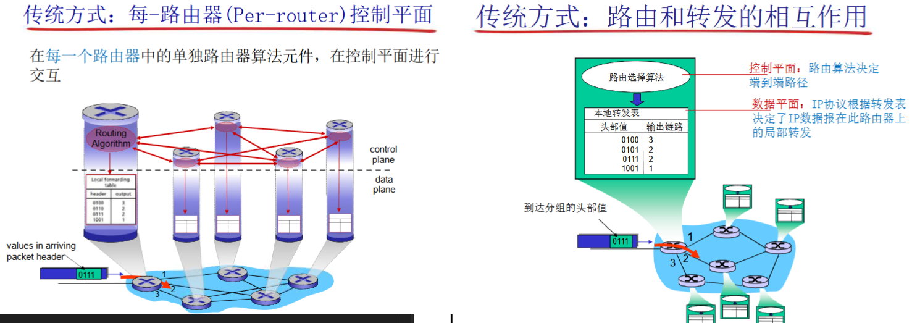
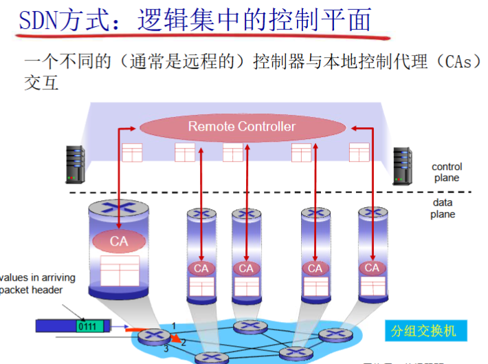

SDN 把控制平面集中在一个 Remote Controller 上, 数据平面则分布在各个交换机上.
控制平面是软件, 把控制平面集中式, 这样就可以更灵活地控制定义改变网络, 也更容易实现一些高级功能

#### 网络服务模型
“服务模型”这个术语，在计算机网络中指的是：网络层向它的上层（通常是传输层）承诺提供什么样的数据传输服务。它定义了上层可以期待什么、不能期待什么——比如数据能否一定送到、会不会有顺序错乱、延迟有多大、带宽能否保证等。

网络层向上层提供的服务, 可以从 可靠性, 延迟 等指标来看待

对于有些网络, 除了以上的传输服务, 网络层还要提供连接建立服务
不同于传输层的"连接"只关注端系统之间的"连接", 网络层的连接建立服务还要关注**路由器之间的连接**.
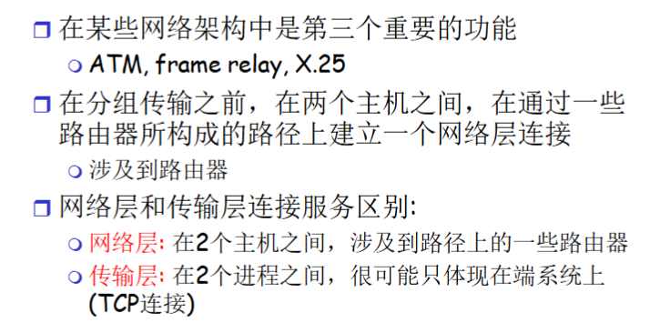

**IP 的服务模型**被称为 “**尽力而为**”（Best-Effort），它的核心意思是：网络会“尽量”把分组送到目的地，但不作任何承诺。
服务模型的定义可以从下面的维度去考量
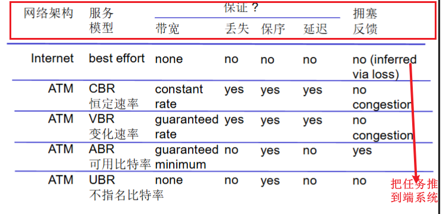

## 4.2 路由器组成
高层面(非常简化的)通用路由器体系架构
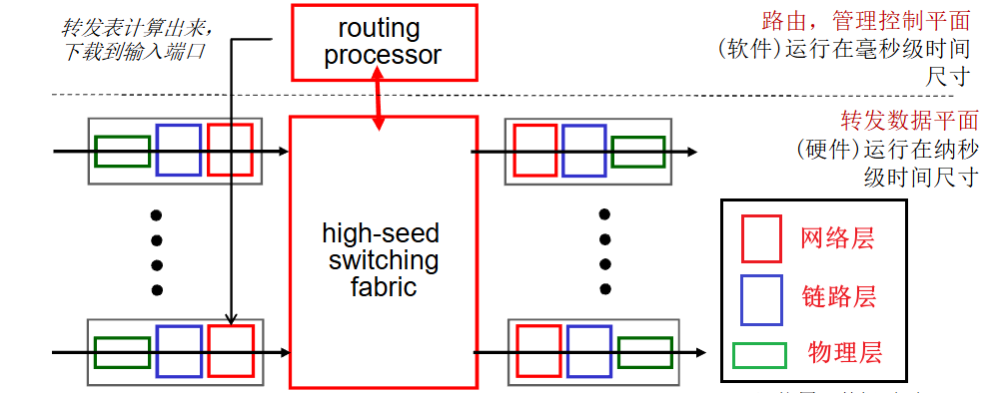

**SDN 流表** 和 **传统模式转发表**
- **传统转发表：** 像一个纸质电话本。你只能根据“姓”（目的 IP）查找一个“固定电话号码”（出端口）。电话本是由分散的邮递员（路由协议）各自手写的，更新很慢。
- **SDN 流表：** 像一个可编程的智能规则引擎。你可以根据“姓、名、地址、家庭人数、通话时间”等 **多个条件查找，** 执行“转接、修改语音、同时录音、转语音信箱”等 **多种动作。** 所有规则由一个中央大脑（控制器）实时编写并推送到每个电话机。
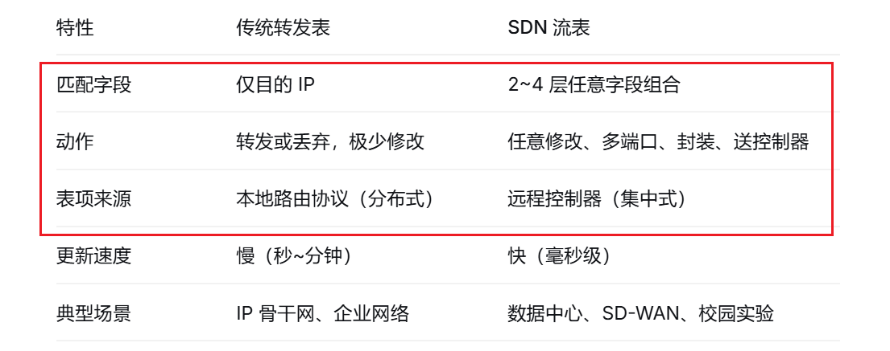

接下来, 我们会讲路由器的端口按照功能划分成两类: **输入端口** 和 **输出端口**
分别描述输入端口和输出端口提供了怎么样功能/服务

### 4.2.1 输入端口功能
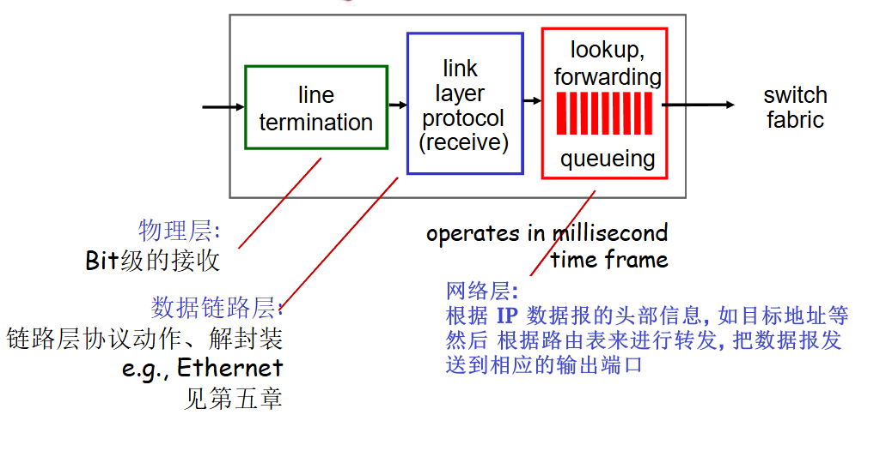

接下来根据上图, 详细介绍输入端口的功能 -- **输入端口缓存**
由于输入端口后出现 HOL（Head-of-Line）blocking, 输入端口需要一个缓存来存储数据报
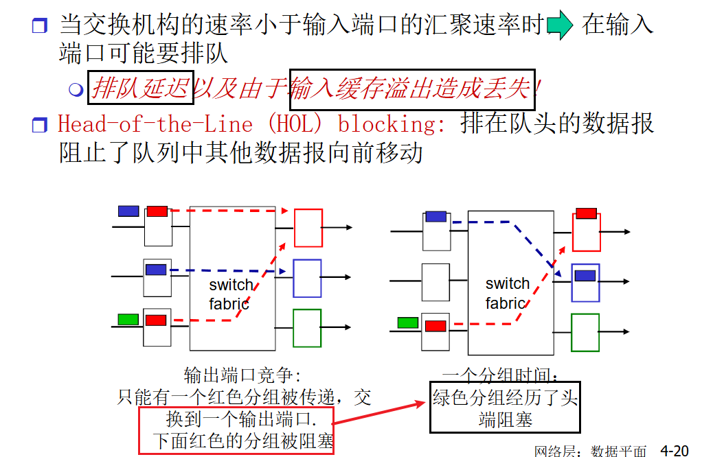

### 4.2.2 交换结构

 

中间的交换, 连接输入端口和输出端口, **他的结构是怎样的**
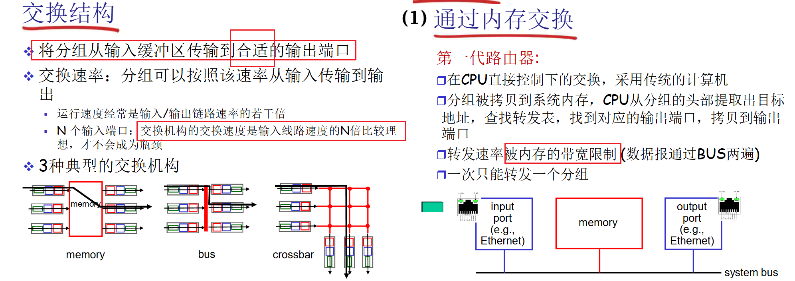
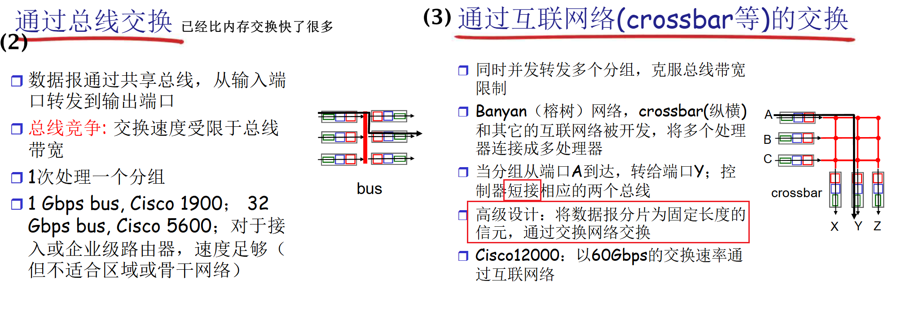

### 4.2.3 输出端口功能
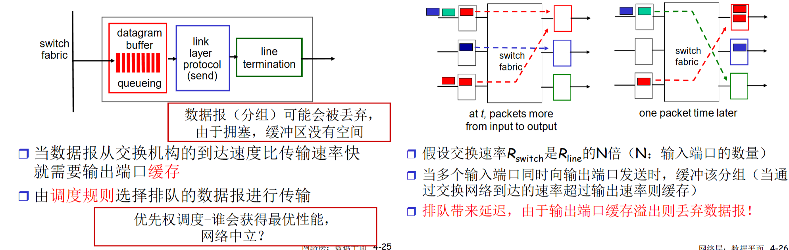

同样由于汇聚和流出速度的不一致性, 输出端口也需要一个 **缓存/排队** 来存储数据报
但是输出端口的数据报排队并不是遵循 FIFO 的, 而是根据一些**调度规则**来进行排队的

#### 调度规则
**调度** 就是指 **选择哪一个分组作为下一个被转发的分组**, 调度规则有很多种:
1. **优先权调度**: 每个队列分配一个优先级（如高、中、低）。只要高优先级队列非空，就总是先发送它的分组；高优先级队列为空时才服务次高优先级，依此类推。
2. **轮询调度(Round Robin)**: 多个队列轮流服务。每个队列每次发送一个分组（或固定字节数），然后切换到下一个队列。若某队列为空则跳过。
3. **加权公平队列(Weighted Fair Queuing, WFQ)**: 类似轮询调度, 但每个队列分配一个权重。权重越高的队列在轮询中获得更多的服务机会。例如，权重为2的队列每轮发送两个分组，而权重为1的队列每轮发送一个分组 (给不同的队列分配不同的带宽)。

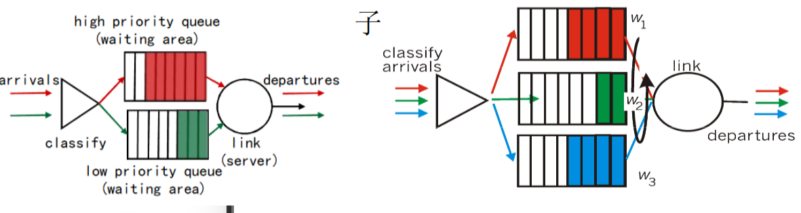

#### 丢失策略
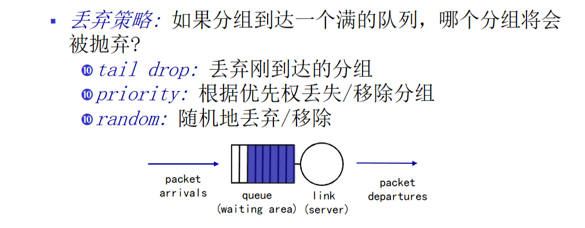

## 4.3 IP 协议
主机, 路由器中的网络层的功能分布如下:
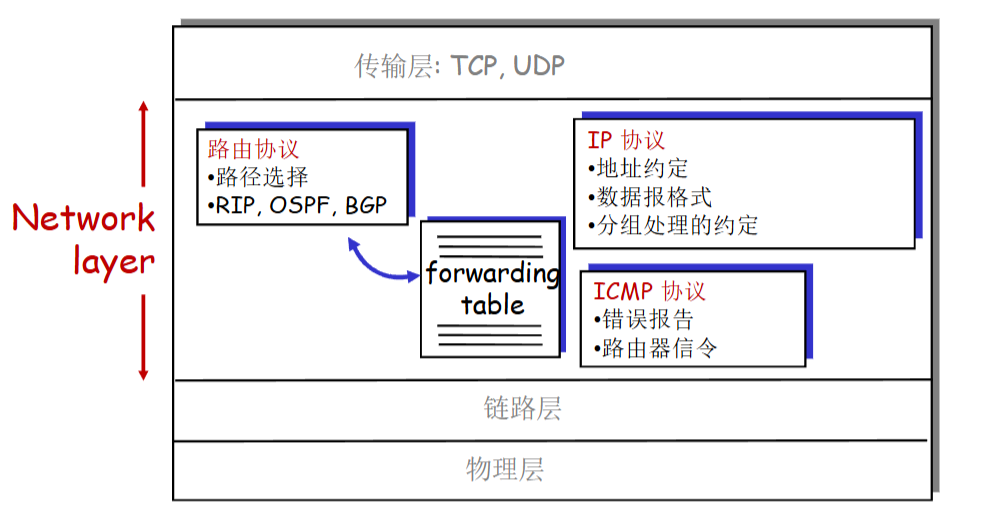

其中, IP 协议的主要功能是 **实现数据平面的转发功能**, 包括
1. **地址约定**
2. **数据报格式**
3. **分组处理的约定**

### 4.3.1 IP 数据报格式(IPv4)
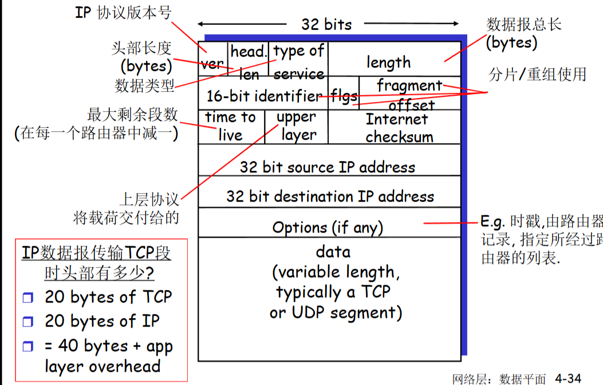

1. **`head len`字段(IHL)**: IP 数据报头部有固定的 20 字节, 以及可选的变长部分, 可选的头部长度可以通过`head len`减去 20 字节
**注意**: `head len`字段的单位是 32-bit word, 因此它的值必须乘以 4 才能得到字节数, 意思就是可选的变长部分以 每 4 字节(一行)进行增加 ( 5 <= head len <= 15 )
2. **第二行的字段**: 包括 `16-bits identification`, `3-bits flags`, `13-bits fragment offset` 这三个字段, 主要是为了实现 **IP 数据报的分片和重组功能**
3. **`TTL`字段**: 代表数据报在网络中可以经过的最大路由器数量, 每经过一个路由器就减 1, 当 TTL 减到 0 时, 数据报就会被丢弃
4. **`Internet Header Checksum`字段**: 代表 IP 数据报头部的校验和, 主要是为了检测数据报头部在传输过程中是否发生了错误

### 4.3.2 IP 数据报分片和重组
不同的链路会有不同的 MTU (Maximum Transmission Unit, 最大传输单元), 当一个 IP 数据报的长度超过了某条链路的 MTU 时, 就需要进行分片
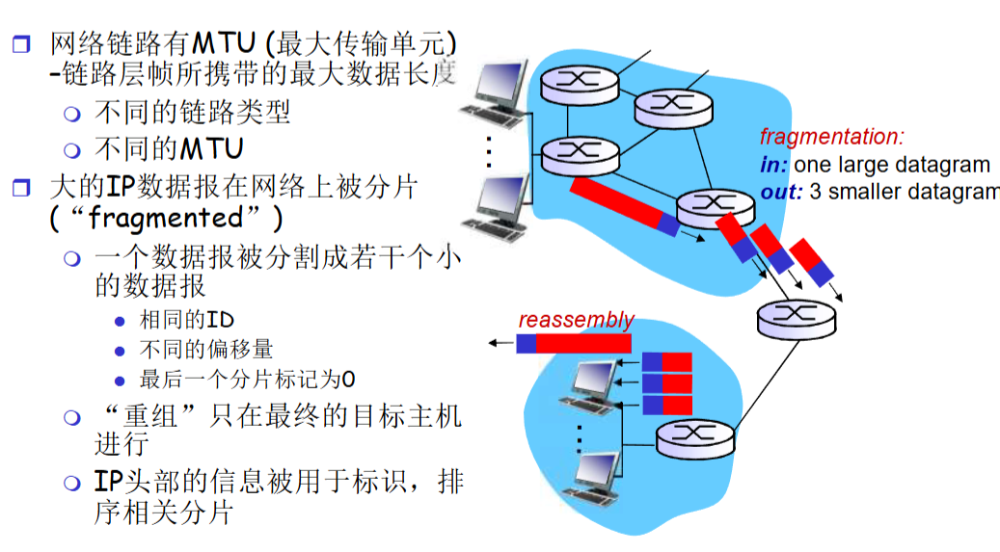

不同的分片头部信息基本相同, 但也有些不同的部分用去**在目标主机重组**:
1. **`identification`字段**: 用于标识一个 IP 数据报的所有分片, 同一个数据报的所有分片具有相同的 `identification` 值
2. **`flags`字段**: 包含一个重要的标志位 `MF` (More Fragments), 当一个分片不是最后一个分片时, `MF` 位为 1; 当一个分片是最后一个分片时, `MF` 位为 0
3. **`fragment offset`字段**: 用于标识一个分片在原始数据报中的位置, 以 **8 字节为单位进行标识**, 因此它的值必须乘以 8 才能得到偏移量字节数 (这也决定了分片时**必须以 8 字节为最小单位进行分片**)
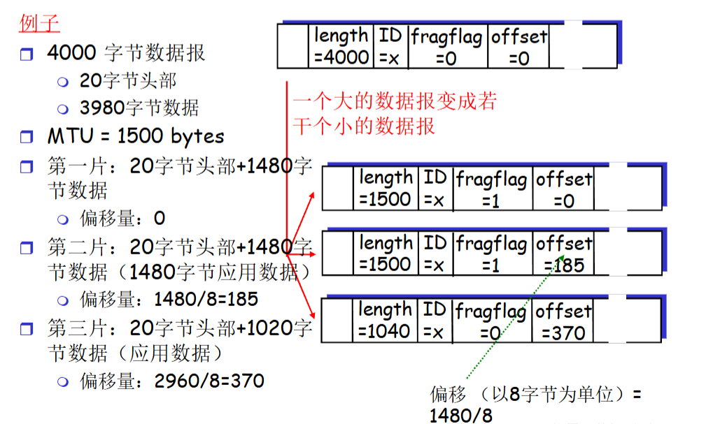

### 4.3.3 IP 编址
**IP 编址**是为了给网络中的每个主机分配一个唯一的地址, IP 地址不同部分划分**本质是通过对IP地址的划分来区分不同的网络和主机**
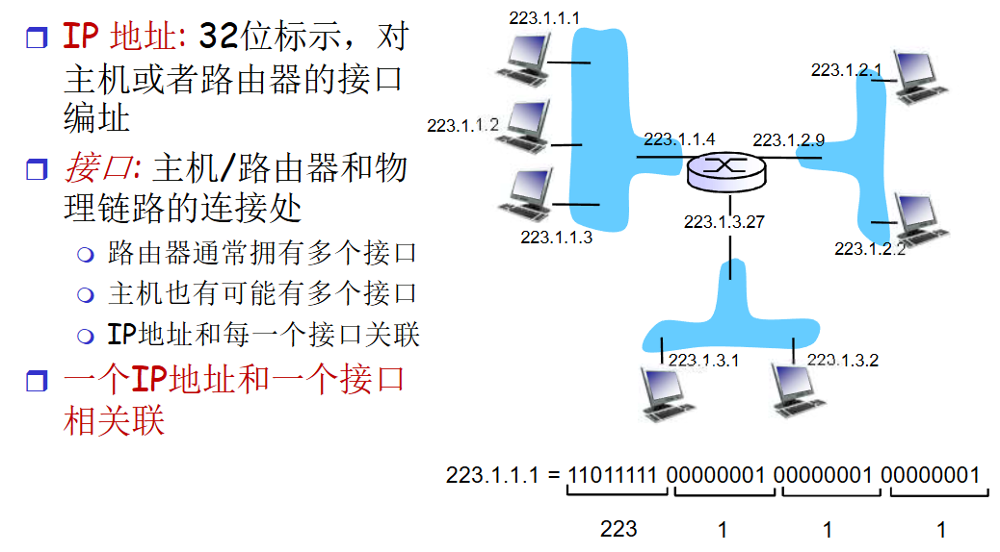

#### 子网
观察可以发现, "同一区域" 的主机 IP 的前24比特位是相同的, 这里的 "区域" 就是一个**子网** (subnet), 也就是一个局域网 (LAN)
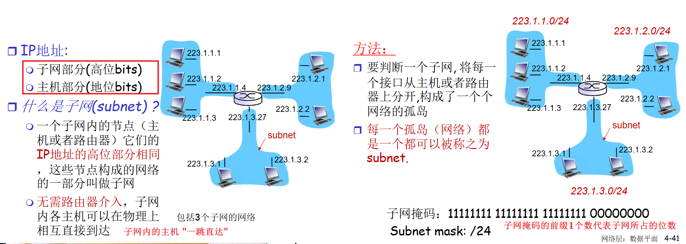

全球范围内路由器的转发实际上是以子网为单位进行的, 而不是以每个主机为单位, 这样的目的是减轻路由转发的负担

#### 传统 IP 地址分类
传统上, IP 地址被划分为 A 类, B 类, C 类, D 类, E 类五类
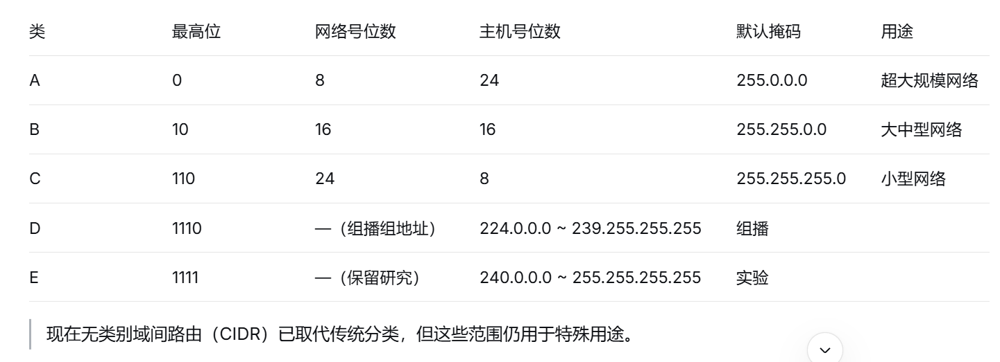

#### 特殊的 IP 地址
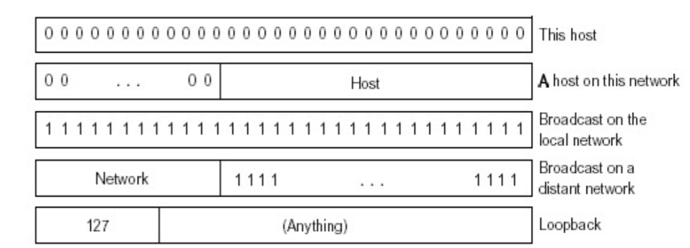

特殊的 IP 地址 作用如下:
1. `0.0.0.0`: 表示“本网络上的本机”或“任意地址”。在服务器中代表监听所有可用接口。
2. `255.255.255.255`: 这个网络的所有主机, 本地网络有限广播，路由器不转发。
3. `127.0.0.0/8`: 本机回环地址, 数据不经过物理网卡

#### 内网地址
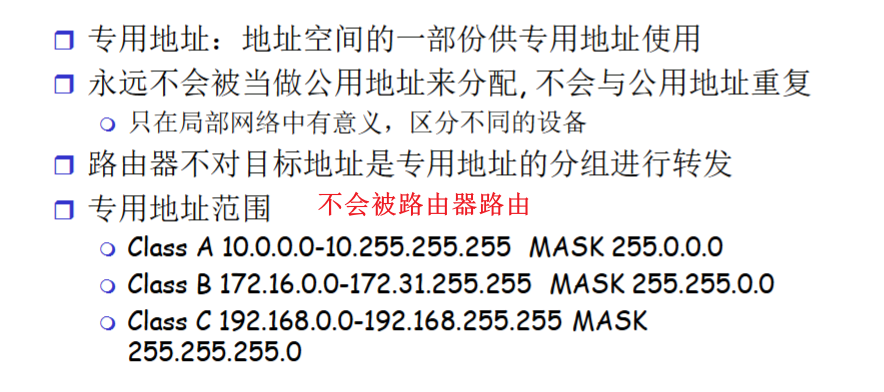

内网地址在互联网范围内不具备意义, 它只在内网范围内有效, 也就是说, 内网地址只能在内网范围内使用, 不能在互联网范围内使用

#### 无类域间路由选择 (CIDR)
传统的 IP 地址分类方法, 各个类的子网和主机数量是固定的, 这样的话没法根据实际需求来分配 IP 地址, 可能会造成 IP 地址资源的浪费
CIDR 是一种 IP 地址分配方法, 它允许更灵活地划分 IP 地址空间(**通过子网掩码来实现子网部分和主机部分的任意划分**),从而更有效地利用 IP 地址资源
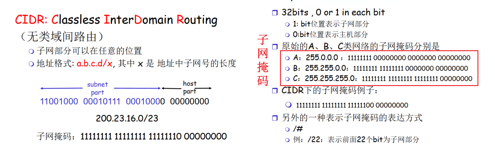

#### 层次编址
一个 ISP 的地址块如何分配出不同的子网 分配给不同的部门
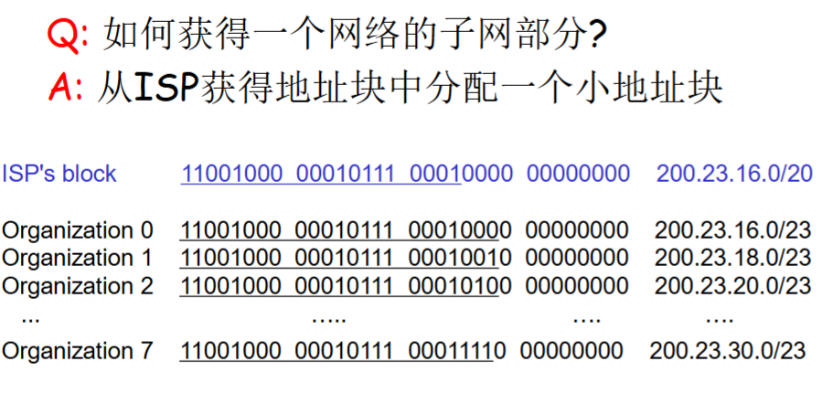

采取的就是 CIDR 的方式, 通过 **更长子网掩码** 来划分出不同的子网, 这样的代价是每个子网所能容纳的主机数量减少了.

### 4.3.4 转发表和转发算法
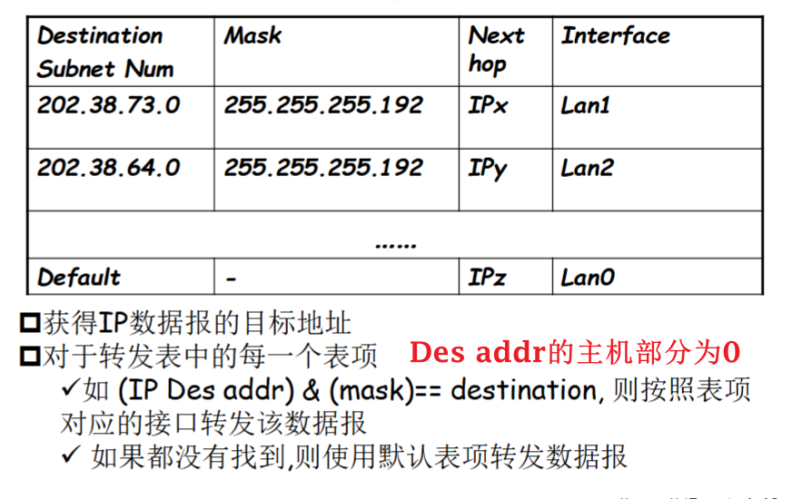

**注意**: 转发表的每一个 Destination 的主机部分都是0, 因为转发表是以子网为单位进行转发的, 而 IP 数据报中的 目标IP 的主机部分只在到达相应子网后才会被用来确定具体的主机, 在转发过程中, 目标IP 的主机部分并不参与转发决策

### 4.3.5 IP 地址的获取
当一个 计算机 开始联网时, 第一步要获得一个合适的 IP 地址, 有两种方式, 一种是**手动配置**, 一种是**DHCP** (Dynamic Host Configuration Protocol, 动态主机配置协议)
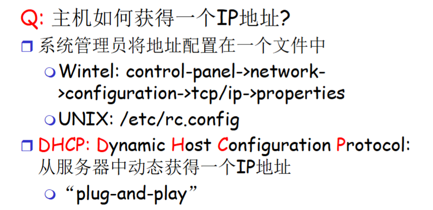

#### DHCP 自动分配
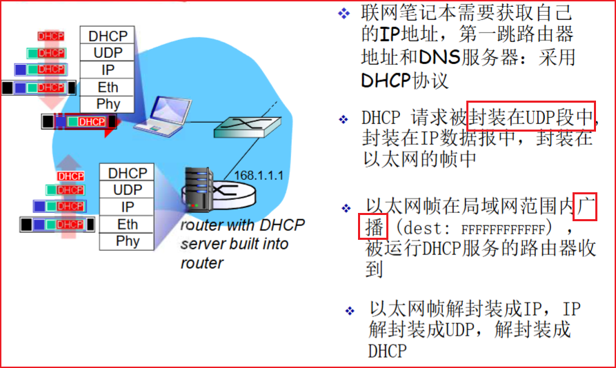

联网之前, 主机是没有 IP 地址的, 因此它无法直接与 DHCP 服务器通信, 只能通过**广播**的方式, 来建立联系, 最终获得 IP地址
**广播交流** 的过程如下:
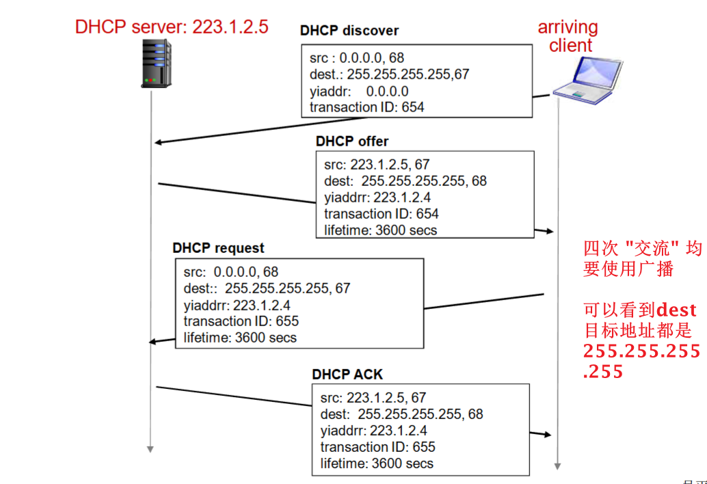

#### ISP 获取地址块 -- ICANN 分配
全球范围内的 IP 地址分配由 ICANN (Internet Corporation for Assigned Names and Numbers, 互联网名称与数字地址分配机构) 负责, ICANN 将 IP 地址空间划分成多个地址块, 分配给不同的 ISP (Internet Service Provider, 互联网服务提供商), 然后 ISP 再将地址块划分成更小的子块, 分配给不同的客户
ICANN 负责的工作大致如下:
- **分配地址**
- **管理 DNS**
- **分配域名, 解决冲突**

### 4.3.6 NAT -- 网络地址转换
前面有提到一些专用的 IP 地址, 内网地址.
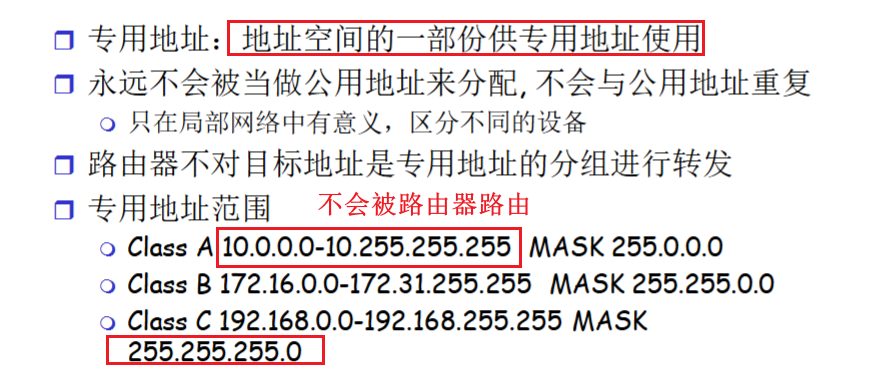

由于 IPv4 地址资源的紧张, 以及内网地址的使用, 导致了 NAT (Network Address Translation, 网络地址转换) 的出现

#### NAT 的工作流程
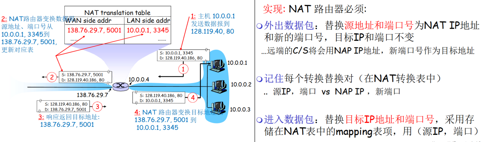

#### NAT 出现的原因/好处
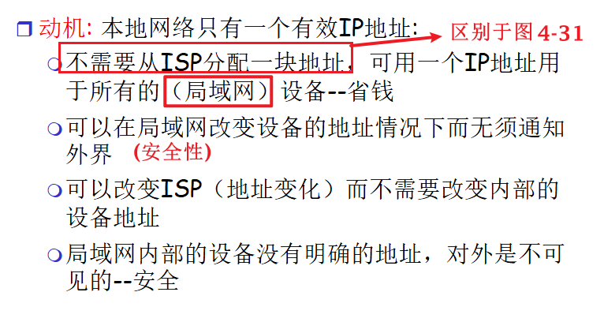

#### NAT 的问题
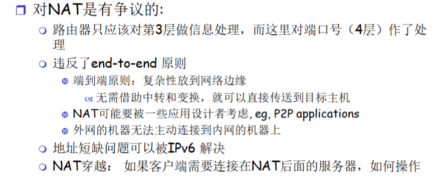

### 4.3.7 层次编址下的路由
前面提到了基于 CIDR 的[层次编址](#层次编址), 那么这种编址下的路由是怎么样?

#### 路由聚集
路由聚集就是 层次编址的反向过程
- **多个具有相同前缀**的子网可以聚集为一条**更短前缀**的路由条目。
- 路由器对外只宣告聚合后的前缀，内部子网细节被隐藏。
- 极大地减少了**路由表条目的数量。**

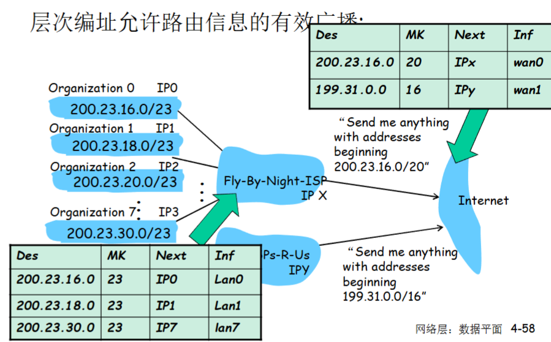

#### 特殊路由信息
当出现**一个子网的 IP 被放到另一个 ISP 下**时, 路由聚集就会做出相应的信息更新, 此时也会充分利用 **最长前缀匹配** 的机制, 来保证数据报能够正确地被转发到目的地
下图的例子中, `200.23.18.0/23`这一子网被分到了 ISPs 下, 因此该 ISP 的路由表以及层次更高的 **广域网** 的路由表中, 都会更新一条新的路由信息
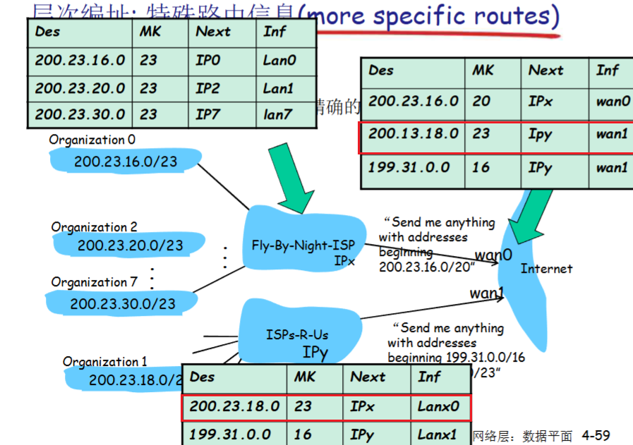

## 4.4 ICMP
前面提到的网络层的服务时, 提到 IP 和 ICMP 分别负责不同的服务.
ICMP (Internet Control Message Protocol, 互联网控制消息协议) 是网络层的**控制与差错反馈协议** -- 它不传输用户数据, 而是让路由器或主机向源端报告网络异常, 诊断连通性, 典型应用就是 `ping`

ICMP 报文则**封装在 IP 数据报**中(协议号 Protocol = 1), 作为 IP 的载荷传输, 但承载的只是网络层的控制信息
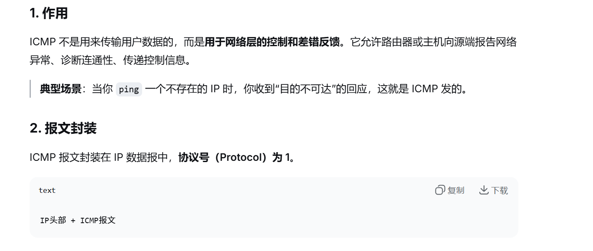

### Traceroute
Traceroute 用于探测源主机到目的主机之间**经过的每一跳路由器**的 IP 地址与往返时延(RTT), 原理是 **TTL 逐跳递减 + ICMP 超时报文**: TTL 从 1 开始逐次加 1, 第 n 跳路由器将 TTL 减到 0 后丢弃分组并回送 **ICMP 超时(类型 11)**, 源主机据此得到第 n 跳的地址与时延; 分组最终到达目的主机时, 因高位端口(如 33434)无服务监听, 目的主机回送 **ICMP 端口不可达(类型 3, 代码 3)**, 探测结束(Windows 的 tracert 改用 ICMP Echo 报文实现, 思路相同)
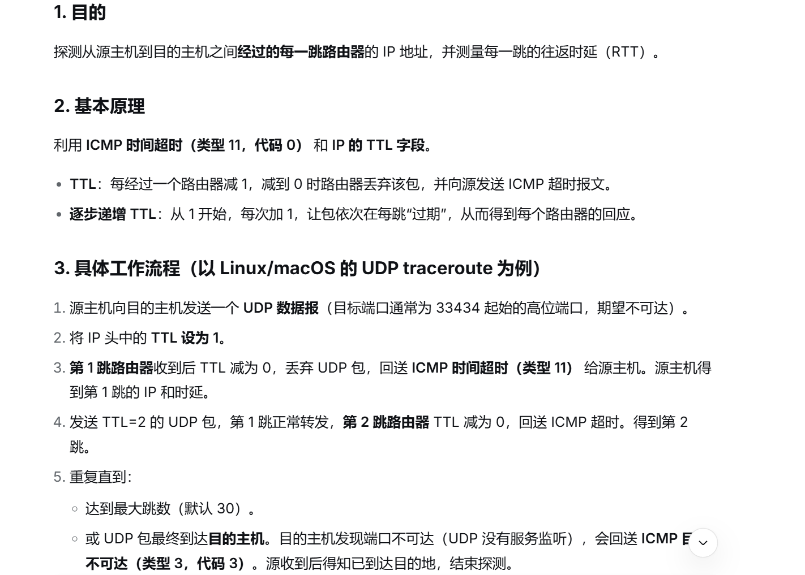
