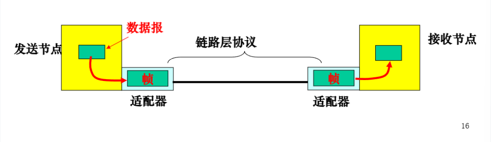
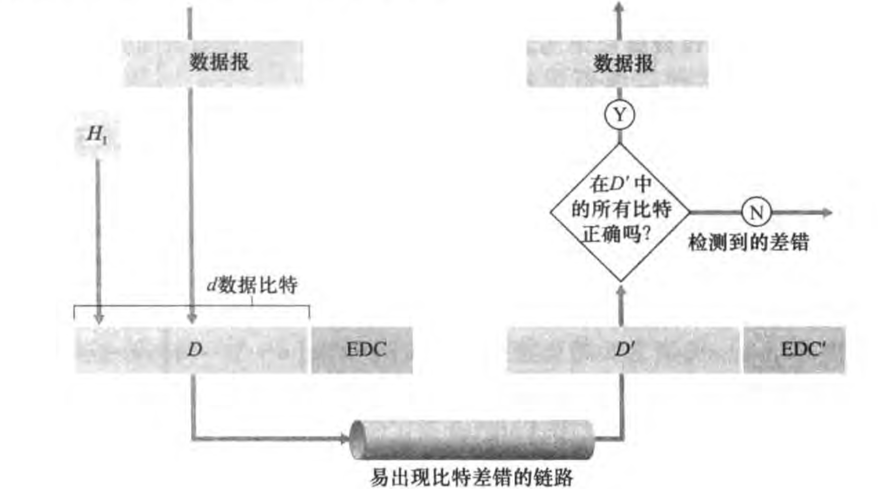
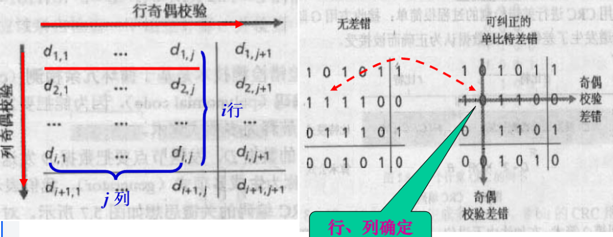
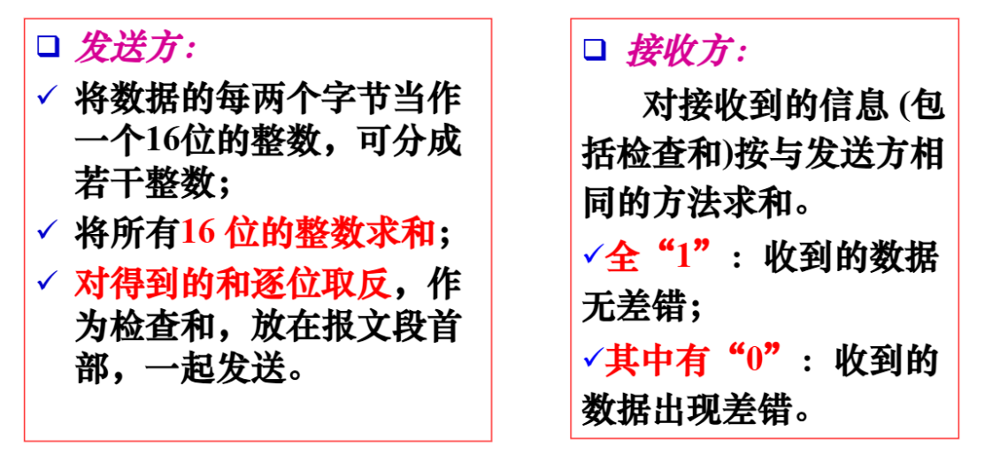
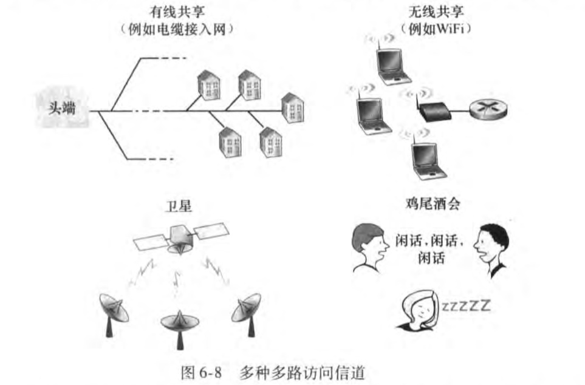

<h1 align='center'>第六章：链路层</h1>

[TOC]

## 6.1 概述与服务

### 6.1.1 链路层提供的服务

#### **链路层协议**

- 用来规范单段链路上的分组传输
- 定义了两个节点之间交互的**分组格式** 
- 以及当发送和接收分组时节点采取的**动作**
  - 差错检测, 纠正(更复杂)
  - 重传/ **节点间的可靠传输**
  - 流量控制: 防止发送节点的发送速率过高
  - 随机访问
- **不同阶段采用不同的链路层协议**

#### **链路层帧**

- 首部包含若干字段: 编号, 物理地址等
- 不同的链路层协议, 帧格式可能不同

#### **链路接入**

有**媒体访问控制 MAC 协议**规定帧在链路上传输的规则, 以下是两种网络链路

1. **点对点链路**: 只要链路空闲, 发送方都能够发送帧
2. **广播链路**: 多个节点共享一个链路(**多路访问**), 使用MAC协议协调多个节点的帧传输

### 6.1.2 适配器通信

**适配器(adapter): **网络接口卡 (网卡, NIC, network interface card)

- 是一个电路板
- 实现物理层及链路层的主要功能

1. 数据报封装成帧
2. 帧传输
3. 适配器接收帧, 并
   - 差错检测: 发送适配器设置差错检测比特, 接收适配器完成差错检测
   - 可靠交付机制
4. 解封帧, 取出数据报, 递交网络层

## 6.2 差错检测和纠错

### 6.2.1 机制过程

1. **发送节点**: 把数据D附加若干差错检测和纠错位EDC, 一起发送到链路.
   - 数据D包含网络层传来的数据报 + 链路级的寻址信息, 序列号等
2. **接受节点**: 接收到 **`D' + EDC'`**, 判断 `D'`是否和初始的D相同
   - 正确: 解封, 提交
   - 出错: 差错处理

### 6.2.2 三种主要差错检测技术

#### 1. 奇偶校验(一维), 基本方法

在d数据比特的后面加上一个校验位, 使得所有比特的'1'的个数为奇数或偶数; 双方约定**奇校验**还是**偶校验**

#### 2. 二维奇偶校验

#### 3. 校验和方法, 常用于 运输层

特点: 

1. 分组开销小: 检查和尾数比较少
2. 差错检测能力**弱**
   1. 适用于运输层
   2. 链路层使用后面提到的更强的CRC方法, 有适配器硬件实现

#### 4. 循环冗余检测 CRC / 多项式编码

生成多项式 G:

- 双方共同选定
- r+1比特, 最高位必须是1, r+1通常是33
- G被发送方用来计算出一个 r 比特(余数)的附加比特R, 添加到 D 的后面 (**G 模2运算 D得到R**, G是除数)

接收方:

1. 用 G 去除 (模2运算, G是除数, DR是被除数) 接收到的DR (d+r比特)
   - 余数为0, 传输正确, 去掉R, 得到D
   - 余数不为零, 传输发生错误

## 6.3 多(址)路访问协议

两种网络链路, 点对点链路和广播链路, 本节学习**广播链路的信道共享技术**

如何**协调多个发送和接收节点对共享广播信道的访问**, 这就是本节需要学的 多路访问协议, 目的就是为了避免多个节点同时使用信道去传输帧, 使得接收方收不到正确的帧 (冲突导致所有帧受损)

#### **多路访问的理想特性**:

设广播信道的速率为R b/s

- 只有一个节点传输时, 节点的吞吐量为 R b/s
- 有 M 个节点发送数据时: 每个节点吞吐量为 R/M b/s
- 协议是去中心化的 , 不需要主节点协调传输
- 协议成本:  实现方便, 价格适中

### 6.3.1 三种协议类型

1. 信道划分协议
   - 信道划分为小片(时隙)
   - 给节点分配**专用**小片
2. 随机访问协议
   - 不划分信道, 允许冲突
   - **能从冲突中恢复**
3. 轮流协议
   - 轮流访问信道来避免冲突

#### 1. 信道划分协议

主要有 **TDM, FDM, CDMA**三种

#### 2. 随机访问协议

基本思想:

- 发送节点以信道全部速率 (R b/s) 发送;
- 发生冲突时, 冲突的每个节点分别等待一个随机时间, 再重发, 直到帧(分组)发送成功.

典型随机访问协议:

- ALOHA 协议
  - 时隙ALOHA
  - 纯ALOHA
- 载波监听多路访问CSMA协议
- 带冲突检测载波监听多路访问CSMA/CD

#### 3. 轮流协议

轮流协议能够总结随机访问和信道划分协议的优点

- 轮流MAC协议
- 令牌传递协议

