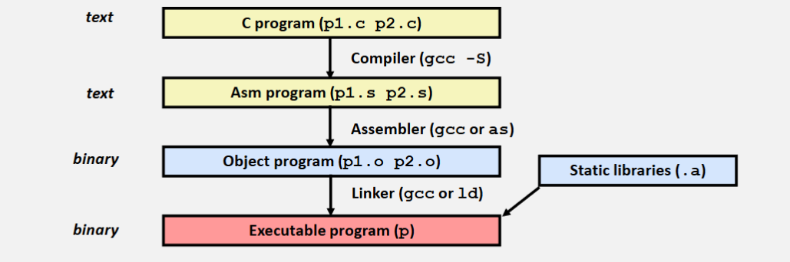
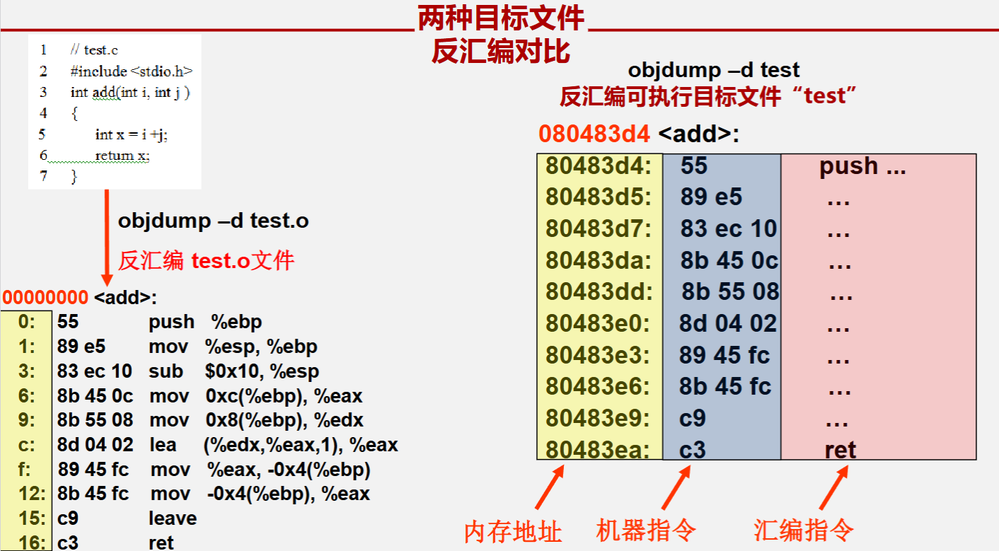

<h1 align='center'>csapp相关配置和introduction</h1>

[TOC]

## 一. 相关配置
**环境**: VMware17.6.3 + Ubuntu24.04桌面版

**GNOME Terminal查看环境**
```bash
long@ubuntu2404:~/Desktop/test$ uname -m # 查看系统架构
x86_64  # i686 代表32位系统

long@ubuntu2404:~/Desktop/test$ lsb_release -a  # Ubuntu版本
No LSB modules are available.
Distributor ID:	Ubuntu
Description:	Ubuntu 24.04.4 LTS
Release:	24.04
Codename:	noble

long@ubuntu2404:~/Desktop/test$ dpkg --print-architecture # 查看dpkg当前架构
amd64   # 当前是64位架构

long@ubuntu2404:~/Desktop/test$ dpkg --print-foreign-architectures # 输出空表示当前系统未开启32位支持

long@ubuntu2404:~/Desktop/test$ gcc -v
Using built-in specs.
COLLECT_GCC=gcc
COLLECT_LTO_WRAPPER=/usr/libexec/gcc/x86_64-linux-gnu/13/lto-wrapper
OFFLOAD_TARGET_NAMES=nvptx-none:amdgcn-amdhsa
OFFLOAD_TARGET_DEFAULT=1
Target: x86_64-linux-gnu
Configured with: ../src/configure -v --with-pkgversion='Ubuntu 13.3.0-6ubuntu2~24.04.1' --with-bugurl=file:///usr/share/doc/gcc-13/README.Bugs --enable-languages=c,ada,c++,go,d,fortran,objc,obj-c++,m2 --prefix=/usr --with-gcc-major-version-only --program-suffix=-13 --program-prefix=x86_64-linux-gnu- --enable-shared --enable-linker-build-id --libexecdir=/usr/libexec --without-included-gettext --enable-threads=posix --libdir=/usr/lib --enable-nls --enable-bootstrap --enable-clocale=gnu --enable-libstdcxx-debug --enable-libstdcxx-time=yes --with-default-libstdcxx-abi=new --enable-libstdcxx-backtrace --enable-gnu-unique-object --disable-vtable-verify --enable-plugin --enable-default-pie --with-system-zlib --enable-libphobos-checking=release --with-target-system-zlib=auto --enable-objc-gc=auto --enable-multiarch --disable-werror --enable-cet --with-arch-32=i686 --with-abi=m64 --with-multilib-list=m32,m64,mx32 --enable-multilib --with-tune=generic --enable-offload-targets=nvptx-none=/build/gcc-13-EldibY/gcc-13-13.3.0/debian/tmp-nvptx/usr,amdgcn-amdhsa=/build/gcc-13-EldibY/gcc-13-13.3.0/debian/tmp-gcn/usr --enable-offload-defaulted --without-cuda-driver --enable-checking=release --build=x86_64-linux-gnu --host=x86_64-linux-gnu --target=x86_64-linux-gnu --with-build-config=bootstrap-lto-lean --enable-link-serialization=2
Thread model: posix
Supported LTO compression algorithms: zlib zstd
gcc version 13.3.0 (Ubuntu 13.3.0-6ubuntu2~24.04.1) 

long@ubuntu2404:~/Desktop/test$ gcc -m32 # 查看是否支持32位编译
gcc: fatal error: no input files
compilation terminated.
```

### 1️⃣ 终端工具
#### 1. gcc--指挥工具链调用
**安装**: `sudo apt install gcc `


GCC是一个驱动程序, 用来控制整个编译流程, 能自动调用as, ld等
```text
gcc
 ├── cpp   (预处理器)
 ├── ccl   (C编译器)
 ├── as    (汇编器)
 └── ld    (链接器)
```
执行`gcc hello.c`, 实际发生的是:
```text
cpp hello.c -> hello.i
ccl hello.i -> hello.s # .s汇编代码文件
as hello.s -> hello.o
ld hello.o -> a.out # .out 可执行程序(ELF)
```

若单独进行编译系统的某一步, 可以:
1. `gcc -E hello.c -o hello.i`: 预处理器(cpp), 将头文件插入到程序文本中去
2. `gcc -S hellp.i -o hello.s`: 编译器(ccl), 将代码翻译成汇编语言
3. `gcc -c hello.s -o hello.o`: 汇编器(as, Assembler), 将汇编语言转换为二进制目标代码
4. `gcc hello.o -o hello.out`: 链接器(ld, Linker), 查找库并打包, 生成*可执行文件(Executable and Linkable Format, ELF)*

`gcc`的`-S`,`-E`和`-c`都可直接操作`hello.c`文件.
并且`-S`和`-c`可以不指定需要生成的文件(不需要`-o <file>`), 自动生成同名不同后缀的文件, 例如:
```bash
gcc -S file.c # ⽣成汇编
gcc -c file.c # ⽣成⽬标⽂件
gcc file.c -o a.out # ⽣成可执⾏⽂件
```



##### 关于可执行文件
Linux的可执行文件不依赖后缀, 因此不管是`hello.out`还是`hello`, 都是可执行文件

而Windows以来的是`.exe`后缀, 根据这个后缀来判断是不是ELF

#### 2. as--汇编器(Assembler)
**安装**
```bash
sudo apt install binutils
```

as用于将**汇编代码**(`.s`)转为**机器码**(`.o`)
```bash
as hello.s -o hello.o
```
生成的`.o`还不能运行, 需要进行后续的**链接**


#### 3. ld--链接器(Linker)
**安装**
```bash
sudo apt install binutils
```

**作用**:
- 把多个`.o`文件**链接**成一个可执行文件
- 处理符号解析
- 生成ELF文件

```bash
ld hello.o -o hello
```
直接用`ld`很复杂, 需要执行很多东西, 比如: `ld hello.o -lc`表示链接libc

#### 4. gdb--调试工具

##### `~/.gdbinit`配置
```bash
set debuginfod enabled off # 关闭gdb联网和下载调试信息询问
```

##### 常见操作
1. 断点(BreakPoints)
`b _start`: 设置入口断点
`b *_start+1`: 入口的下一步设置断点
`info b`: 查看所有断点
2. 运行(run)
`r`或`run`: 程序运行
`si`: 单步执行
`n`: 下一步

3. 查看寄存器
需要在程序开始运行后进行查看
`info registers`: 查看当前架构下的寄存器

4. 查看变量内存
   `x/4xb &value1`
    1. `x`: examine 查看
    2. `4`: 4个元素
    3. `x`: 16进制 `d`是十进制, `t`是二进制
    4. `b`: byte, `h`是两字节(half word), `w`是四字节(word), `g`是八字节(giant word)

##### 编译时的`-g`参数
`-g`的作用是**在可执行文件中加入调试符号信息（debug symbols）**
这些信息会**存储在 ELF 文件的`debug section`**中。

初学gdb来调试汇编程序(`.s`文件)时, 可以在汇编时(as)加上`-g`参数, 这样能使得能够显示机器执行对应的汇编指令, 更便于初学者对汇编程序的学习

**`-g`用在哪 ?**
1. `gcc -g test.c -o test`
2. `as -g 1007.s -o 1007.o`
3. `ld`没有`-g`, h或者说不必要


##### 调试汇编代码
1. `x`查看内存
    1. `&`后面跟变量的名称来查看变量地址对应的内存, 即查看变量
    2. `$`后面跟寄存器名称来根据该寄存器地址查看内存
2. `p`查看值
    1. `print $eax`查看寄存器的值,或简写`p $eax`
    2. `p/x $eax` 以十六进制查看, `d`为十进制, `t`为二进制
    3. `p $eax $ebx`查看多个
    4. 对于汇编里面的变量, `print`时要加上该变量定义时的类型
3. `where`查看当前执行到哪一行了
4. `%eip`是程序指针寄存器, 它指向**即将执行的指令的地址**(指令实际上以机器码形式存在)
    ```text
    (gdb) x/10i $eip
    => 0x8048000 <_start>:    nop
    0x8048001 <_start+1>:    movl $1,%eax
    0x8048006 <_start+6>:    movl $0,%ebx
    0x804800b <_start+11>:   int $0x80
    ```
    这里的`i`表示`instruction`指令的意思,表示的是一种x查看内存的显示格式,`x/10i`会将内存内容解释为**机器指令, 并显示对应的汇编代码**
5. `disassemble`: 反汇编
    1. `disassemble`: 反汇编当前函数
    2. `disassemble 函数名`: 反汇编指定函数
    3. `disassemble 0x08048000, 0x08048010`: 反汇编指定函数的指定地址


##### gdb操作总览
| IDE 操作 | GDB 指令 | 指令说明 |
| --- | --- | --- |
| 启动调试 | `r`(run) | 运行程序，直到遇到断点/程序结束/崩溃；支持传参：`r 参数1 参数2` |
| 暂停程序 | `ctrl + c` | 程序运行中强行暂停，进入调试界面 |
| 单步执行（逐行，不进函数） | `n`(next) | 单步走一行代码，遇到函数调用时不进入函数内部 |
| 单步执行（逐行，进函数） | `s`(step) | 单步走一行代码，遇到函数调用时进入函数内部 |
| 跳出当前函数 | `finish` | 执行完当前函数，返回到调用该函数的下一行 |
| 继续运行（到下一个断点） | `c`(continue) | 从暂停处继续运行，直到下一个断点/程序结束 |
| 设置行断点 | `b 行号` 或 `b 函数名` | 例：`b 8`（第8行断点）、`b sum`（sum函数入口断点） |
| 设置条件断点 | `b 行号/函数名 if 条件` | 例：`b 8 if i==5`（仅当i=5时触发第8行断点） |
| 查看所有断点 | `info b`(info breakpoints) | 列出所有断点的编号、位置、命中次数 |
| 删除断点 | `delete 断点编号` 或 `d 断点编号` | 例：`delete 1`（删除编号1的断点）；`d` 不带编号删除所有断点 |
| 禁用/启用断点 | `disable 编号`/`enable 编号` | 临时禁用断点（不删除），需要时再启用 |
| 查看变量值 | `p 变量名`(print) | 例：`p sum`、`p a[i]`、`p len`；支持表达式：`p a[i]+10` |
| 实时监控变量 | `display 变量名` | 每次单步调试时，自动显示该变量的值（类似 IDE 的变量监控窗口） |
| 取消变量监控 | `undisplay 编号` | 例：`undisplay 1`（取消编号1的监控变量） |
| 查看调用栈 | `bt`(backtrace) | 显示当前程序的调用栈（哪个函数调用了哪个函数，定位崩溃位置） |
| 切换栈帧 | `frame 编号` | 例：`frame 0`（切换到崩溃的函数栈帧）、`frame 1`（切换到调用者栈帧） |
| 查看当前代码上下文 | `l`(list) | 显示当前执行位置附近的代码（默认显示10行）；`l 行号` 显示指定行附近代码 |
| 查看内存内容（内存窗口） | `x/格式 内存地址` | 例：`x/10xw 0xffffcd00`（以4字节16进制显示10个内存单元）；`x *_start+1` |
| 修改变量值（实时编辑） | `set var 变量名=值` | 例：`set var len=5`、`set var a[0]=100`（调试时临时修改，无需重新编译） |
| 配置 GDB 显示格式 | `set print pretty on` | 格式化输出结构体/数组（默认紧凑显示，开启后更易读） |
| 配置代码显示行数 | `set listsize 行数` | 例：`set listsize 20`（每次list显示20行代码，默认10行） |
| 查看寄存器值（寄存器窗口） | `info registers` | 显示所有寄存器的值；`p $rax`（查看单个寄存器rax的值） |
| 退出调试 | `q`(quit) | 退出 GDB |

#### 5. objdump--反汇编工具(重要)

**什么是反汇编**
**反汇编(Disassembly)** 是将机器码转换为汇编指令的过程, 将编译器生成的可执行文件/目标文件还原为汇编指令, 以便于调试和理解程序的运行原理


可以用在用gdb调试时, 用`disassemble`指令来反汇编当前函数或指定函数.
也可以用下面的objdump指令来反汇编可执行文件或目标文件

**安装**
```bash
sudo apt install binutils
```
**作用**
- **反汇编**可执行文件(ELF, .out)
- 查看机器指令
- 分析ELF

```bash
objdump -d a.o # 查看目标文件
objdump -d a # 查看可执行文件 
```
按32位模式反汇编时, 最好加上参数`-d -m i386`.
`objdump -d -m i386 a.out`

### 2️⃣ 64位支持32位程序
Ubuntu的机制是: **Multiarch**, 一个64位系统可以安装64位库 和 32位库
```text
/usr/lib/x86_64-linux-gnu   (64位)
/usr/lib/i386-linux-gnu     (32位)
```

#### 1. 开启32位架构
1. `sudo dpkg --add-architecture i386`: 允许apt安装32位软件包
2. `sudo apt update`: apt 需要重新下载 i386 软件包列表

#### 2. 安装32位运行库
1. `sudo apt install libc6:i386`: 安装后系统会有`/lib/i386-linux-gnu/libc.so.6`

#### 3. 安装32位编译支持
1. `sudo apt install gcc-multilib g++-multilib`: 安装32位程序编译必须组件

#### 4. 验证32位程序
1. `dpkg --print-foreign-architectures`: 应该输出`i386`
2. `dpkg -l | grep libc6`: 应该看到`libc6: amd64`和`libc6:i386`, 表示64位和32位库同时存在

### 3️⃣ 64位运行32程序

每个都可`file <file-name>`来查看架构, 希望看到:`ELF 32-bit LSB executable`

#### 1. 32位编译c程序
```bash
gcc -m32 test.c -o test32
```

#### 2. 编译32位汇编程序`.s`
1. `as --32 1007.s -o 1007.o`: 汇编
2. `ld -m elf_i386 1007.o -o 1007`: 链接

需要更详细的调试时可以加入`-g`:
1. `as --32 -g 1007.s -o 1007.o`
2. `ld -m elf_i386 1007.o -o 1007` 

#### 3. ld链接缺少参数导致报错
当运行`ld -m elf_i386 1007.o -o 1007`时, 可能会报错, 说没有找到某标准函数的定义, 所以需要的指定链接标准库, 例如: [有两种方式]
1. `ld -m elf_i386 1007.o -o 1007 -lc -dynamic-linker` : 链接C标准库
2. `gcc -m32 1007.o -o 1007` : 直接用gcc来链接, gcc会自动调用ld并且链接标准库

## 二. Introduction

### 1️⃣ 前言
本书面向想**通过学习计算机系统的内在运作而写出更好程序**的人
本书解释了所有计算机系统的本质概念, 并展示这些概念是如何实实在在影响应用程序的正确性, 性能和实用性的.

### 2️⃣ 背景知识
本书前几章揭示了C语言程序和他们对应的机器语言程序之间的交互作用. 机器语言示例都是运行在x86-64处理器上的GNU GCC编译器生成的
```plain text
高级语言(C语言) --> 编译器(ccl) --> 汇编语言 --(根据指令集)--> 
汇编器(as) --> 机器码 --> 放到内存(RAM) --> 处理器(CPU) --> 执行指令
```

### 3️⃣ 阅读此书
本书包含很多**练习题和作业题**
所有用到的源程序代码可在[CS:APP主页](csapp.cs.cmu.edu)获取

### 4️⃣ 32位架构 vs 64位架构
本书要学习的是典型的 GNU AT&T语法的x86汇编

#### 1. x86-32 与 x86-64 寄存器区别

**x86-32**只有八个通用寄存器
| 32位寄存器 | 16位 | 8位 | 常见用途 |
| :-: | :-: | :-----: | ---- |
| eax | ax  | al / ah | 返回值 |
| ebx | bx  | bl / bh | 参数/通用 |
| ecx | cx  | cl / ch | 循环计数 |
| edx | dx  | dl / dh | IO |
| esi | si  | —       | 栈顶 |
| edi | di  | —       | 栈帧 |
| ebp | bp  | —       | source index |
| esp | sp  | —       | dest index |

**x86-64**寄存器数量增加到16个
| 64位 | 32位 | 16位 | 8位 | \ | 64位 | 32位 | 16位 | 8位 |
| --- | ---- | ---- | ---- |:--:|--- | ---- | ---- | ---- |
| rax | eax  | ax   | al   |\ | r8  | r8d  | r8w  | r8b  |
| rbx | ebx  | bx   | bl   |\ | r9  | r9d  | r9w  | r9b  |
| rcx | ecx  | cx   | cl   |\ | r10 | r10d | r10w | r10b |
| rdx | edx  | dx   | dl   |\ | r11 | r11d | r11w | r11b |
| rsi | esi  | si   | sil  |\ | r12 | r12d | r12w | r12b |
| rdi | edi  | di   | dil  |\ | r13 | r13d | r13w | r13b |
| rbp | ebp  | bp   | bpl  |\ | r14 | r14d | r14w | r14b |
| rsp | esp  | sp   | spl  |\ | r15 | r15d | r15w | r15b |

## 三. Study Methods

### 根据C代码解读汇编
在阅读汇编代码时, 如何将**其中的寄存器与C语言的源代码中的变量联系起来是很关键的

一般建议在阅读汇编代码时, **准备一个表格来记录寄存器中的值和对应的变量名**, 以此来跟踪寄存器中变量和数值的变化, 尤其当寄存器被反复使用来保存不同的C语言变量时, 这样的表格对于判断特定寄存器中变量和其实时数值显得尤为重要

|寄存器|变量|初始值|
|--|--|--|
|`%eax`|result|1|
|`%edx`|n|n|
