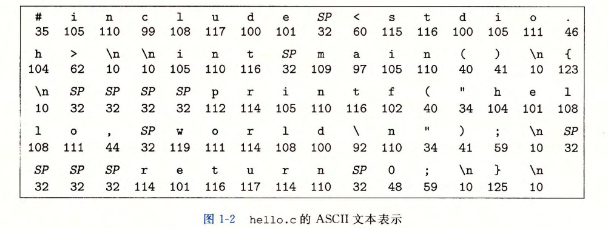
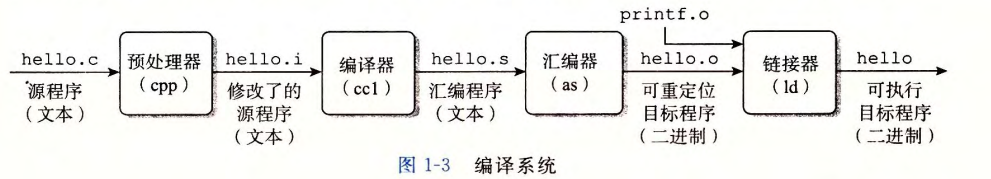

<h1 align='center'>第一章 计算机系统漫游</h1>

[TOC]

本章节通过**跟踪hello程序的生命周期开始对系统的学习**----从他被程序员创建开始, 到在系统上运行, 输出简单的消息, 然后终止.
沿着这个过程, **本章简要介绍一些逐步出现的关键概念, 专业术语和组成部分.**
```c
// hello.c
#include <stdio.h>
int main()
{
    printf("hello, world\n");
    return 0;
}
```


### 1.1 信息 = 位(bit) + 上下文


`hello.c`程序是以字节(byte)序列的方式存储在文件中, 这样只有ASCII字符构成的文件称为**文本文件**, 其他所有文件称为**二进制文件**

系统中所有信息 (包括磁盘文件, 内存中的程序, 内存中存放的用户数据...) 都是由一串比特(bit)表示的. 区分不同数据对象的唯一方法是**读到这些数据对象是的上下文**

> C语言是用作Unix系统的程序语言被开发出来的.
> C语言是**系统级编程的首选**, 但对于应用级程序的编写, C语言缺乏非常有用的抽象的显示支持, **C++和Java**等针对应用级程序的新程序语言更能胜任

### 1.2 程序的生命周期
`hello.c`首先要被编译, 生成`可执行目标文件`
```bash
gcc -o hello hello.c
```


分四个阶段, `cpp, ccl, as, ld`共同构成了**编译系统(compilation system)**
- 编译系统 = 一整套把高级语言 → 可执行程序的工具链
- gcc = 前端总指挥（调用后面所有工具）
- as = 汇编器（汇编 → 机器码）
- ld = 链接器（把多个机器码文件拼在一起）

### 1.3 了解编译系统工作机制的益处
1. 优化程序性能
e.g. 一个switch语句比多个if-else语句高效的多
2. 理解链接时出现的错误
一些最令人困扰的**程序错误往往都与链接器操作有关**
3. 避免安全漏洞
e.g. 缓冲区溢出错误

### 1.10 小结
计算机系统是由**硬件和系统软件组成**的, 他们共同协作以运行应用程序. 计算机内部的信息**被表示为一组组的位**, 他们一句**上下文**有不同的解释方式. 程序被其他程序**(编译系统)**翻译成不同的形式, 开始时是ASCII文本, 然后被编译器(as)和链接器(ld)翻译成二进制可执行文件

处理器(CPU)读取并解释存放在内存里的二进制指令. 因为计算机花费了**大量的时间**在内存, I/O 设备和CPU寄存器之间复制数据, 所以将系统中的**存储设备划分成层次结构** ---- CPU寄存器在顶部, 接着是多层的硬件高速缓存存储器(L1, L2, ...), DRAM 主存, 和磁盘存储器. 在层次模型中, 位于更高层的存储设备, 比低层的存储设备**要更快**, 单位比特造价也更高. 层次结构中较高层次的存储设备可以作为较低层次设备的高速缓存. 通过理解和运用这种存储层次结构的知识, 程序员可以优化C程序的性能.

操作系统内核是**应用程序和硬件之间的媒介**. 它提供了三个基本的抽象: (1) **文件**是对 I/O 设备的抽象; (2) **虚拟内存**是对主存和磁盘的抽象; (3) **进程**是处理器, 主存和 I/O 设备的抽象

最后网络提供了计算机系统之间通信的手段. 从特殊的系统角度看, **网络就是一种 I/O 设备.**
