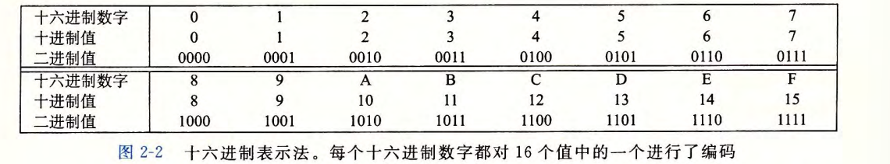
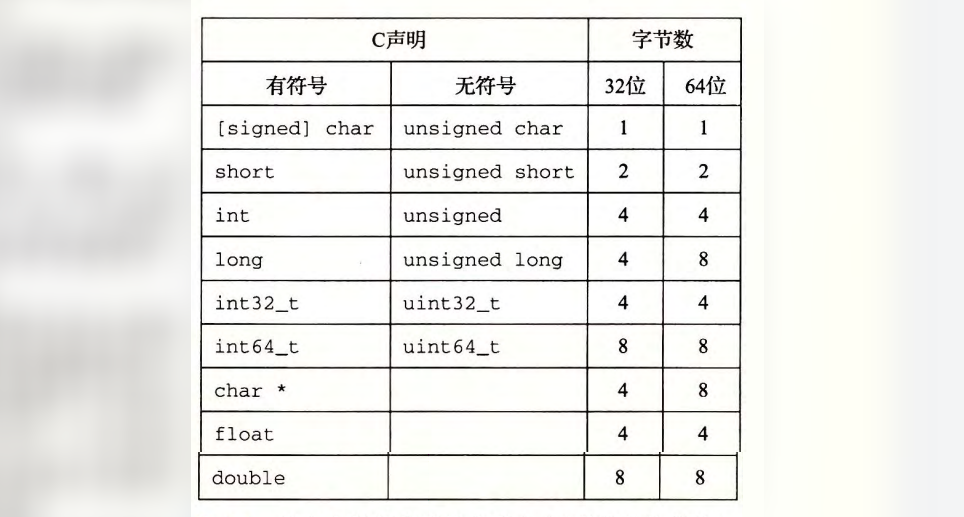
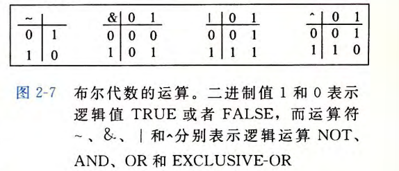
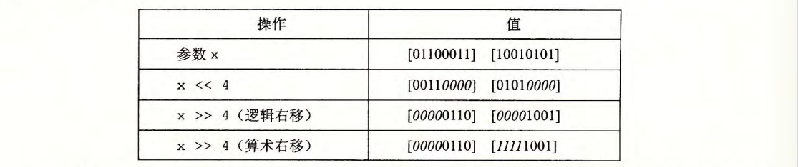
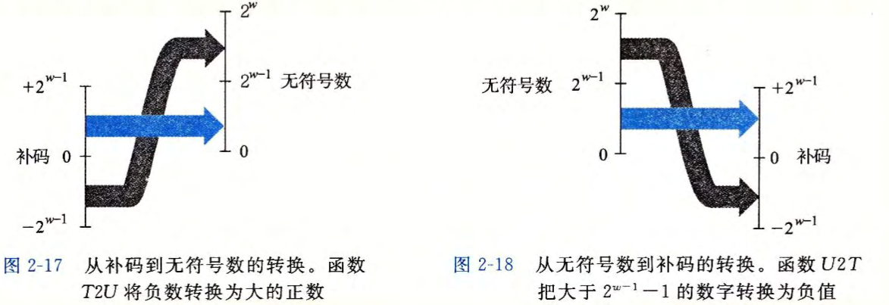
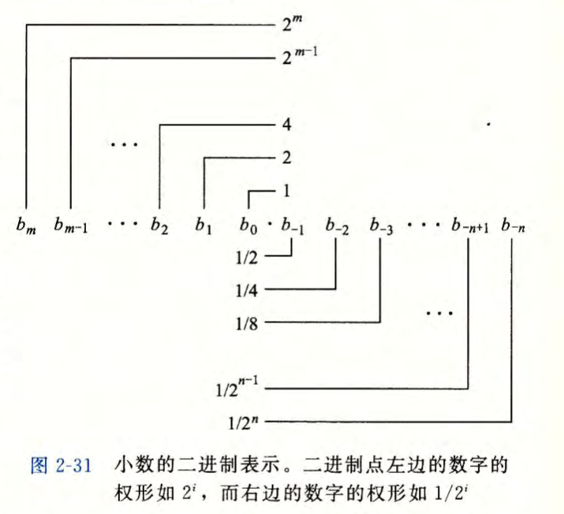
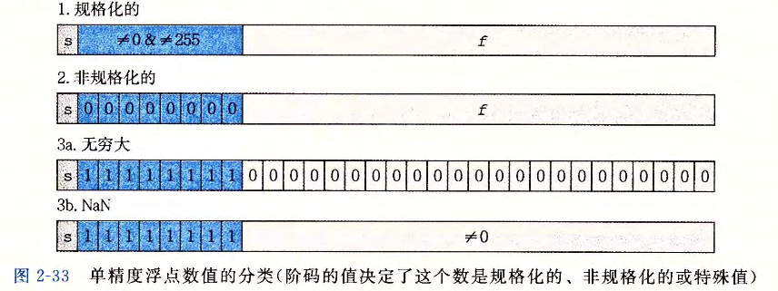
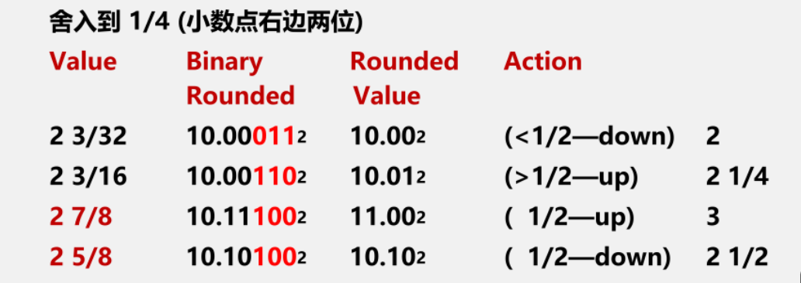

<h1 align='center'>第二章 信息的表示与处理</h1>

[TOC]

### 2.1 信息存储
大多数计算机使用*8-bits的块*, 或者*字节(byte)*, 作为最小的**可寻址**的内存单元, 而不是单独的一个位(bit).

机器级程序将内存视为一个非常大的字节数组, 成为**虚拟内存(virtual memory)**
内存的每个字节都有一个唯一的数字来表示, 称为他的**地址(addr)**, 所有可能地址的集合就成为**虚拟地址空间(virtual address space)**

实际运行时, 存储空间会被划分为可管理的单元, 来存放不同的**c程序对象(program object)**, 即*程序数据, 指令和控制信息*.

> **C语言的指针**
C语言的指针是一个重要特性, 指针有两个方面:
1. *值*: 表示某个对象的位置, 即**地址(address)**
2. *类型*: 表示那个位置上所存储对象的类型

#### 2.1.1 十六进制表示
十六位进制(hexadecimal)的每两位数可构成代表一个字节(byte, 8-bits).


#### 2.1.2 字(word)数据大小
每台计算机都有一个*字长(word size)*, 指明**指针数据**(即代表地址)的标称大小, 对于一个字长是$w$位的机器而言, 虚拟地址的范围是$(0, 2^W-1)$, $w$通常是32或64

**C语言的数据类型字长**


#### 2.1.3 寻址和字节顺序
对于跨越多字节的程序对象, 要关注两个规则:
1. 该对象的地址是什么
2. 在内存中如何排列这些字节

字节排列两种方式[e.g. 对`0x01234567`而言, 最高有效字节是指`01`]:
1. **大端法**: 最高有效字节在最前面
2. **小端法**: 最低有效自己在最前面

无论大小端, 对象的地址都是**最前面字节的addr**

#### 2.1.4,2.1.5 表示字符串, 代码
不同机器类型会使用不兼容的指令和编码方式.

#### 2.1.4~2.1.6 布尔代数, 位级运算, 逻辑运算, 移位
一个bit的布尔代数运算

可以扩展到**位向量**的运算, 即向量参数的对应元素之间的布尔代数运算

C语言支持**按位布尔运算**, `| 或   & 与  ~ 取反  ^ 异或`
C语言**逻辑运算**: `|| 或   &$ 与   !取反`

C语言**移位运算**: 


### 2.2 整数表示

对于一个二进制数[向量$\vec{x} = [x_{w-1},x_{w-2},...,x_0]$]:
1. 若当做无符号数, 进行$\sum_{i=0}^{w-1} x_i 2^i$运算, 就是$B2U_w(\vec{x})$, 该函数是**双射**, 无符号数的取值范围是$(0, 2^w-1)$
2. 若当做有符号数(无论正数还是负数), 最高位解释为**负权**, 进行$-x_{w-1}2_{w-1} + \sum_{i=0}^{w-2}x_i2^i$, 就是 $B2T_w(\vec{x})$ , 这就是**补码**, 该函数也是一个双射, 补码代表的整数的取值范围是$(-2^{w-1}, 2^{w-1}-1)$

**补码的数学定义**: 对于w位系统, 任何整数$x$的补码表示为: $补码(x) = x \bmod 2^w$
**例子(4位)**:
```text
x = +3:  补码(3) = 3 mod 16 = 3  = 0011
x = -3:  补码(-3) = -3 mod 16 = 13 = 1101
x = +7:  补码(7) = 7 mod 16 = 7  = 0111
x = -8:  补码(-8) = -8 mod 16 = 8 = 1000
```

#### 2.2.1 有符号数(补码)和无符号数之间转换
大多数C语言的*强制类型转换*, 结果就是**保持位值不变, 只是改变了解释这些位的方式.**
据此可定义有符号数和无符号数之间的转换[二进制这个串是不变的]:
$$
\begin{aligned}
T2U_w(x) \doteq B2U_w(T2B_w(x_t)) \\
U2T_w(x) \doteq B2T_w(U2B_w(x_t))
\end{aligned}
$$
实际有推导得: 

$$
U2T_w(u) = \begin{cases} u, & u \leq TMax_w = 2^{w-1}-1 \\ u - 2^w, & u > TMax_w \end{cases}
\\
T2U_w(x) = \begin{cases} x + 2^w, & x < 0 \\ x, & x \geq 0 \end{cases}
$$

#### 2.2.2 C语言有符号数和无符号数
大多数C语言的*强制类型转换*, 结果就是**保持位值不变, 只是改变了解释这些位的方式.**
据此可定义有符号数和无符号数之间的转换[二进制这个串是不变的]:

对于同时包含有符号数和无符号数的表达式, C语言会隐式的将有符号参数强制类型转换为无符号数, 然后进行表达式求值

#### 2.2.3 扩展一个数字的位表示
1. **无符号数**:
直接使用**零扩展**, 即在高位补零.
2. **有符号数(补码)**:
需要进行**符号扩展**, 即在高位补符号位(负数为1, 非负数为0).
这样进行拓展的原因是, 经证明, 符号扩展后的有符号数(补码)的值和原来是一样的, 这在计算机中能带来很多方便

#### 2.2.4 截断数字
1. **截断无符号数**
令 $\vec{x}$ 等于位向量 $[x_{w-1}, x_{w-2}, \cdots, x_0]$ , 而 $\vec{x}'$ 是将其截断为 $k$ 位的结果: $\vec{x}' = [x_{k-1}, x_{k-2}, \cdots, x_0]$ 。令 $x = B2U_w(\vec{x})$ , $x' = B2U_k(\vec{x}')$ 。则 $x' = x \bmod 2^k$ 。**[推导可见csapp, P57]**

2. **截断有符号数(补码)**
令 $\vec{x}$ 等于位向量 $[x_{w-1}, x_{w-2}, \cdots, x_0]$ , 而 $\vec{x}'$ 是将其截断为 $k$ 位的结果: $\vec{x}' = [x_{k-1}, x_{k-2}, \cdots, x_0]$ 。令 $x = B2U_w(\vec{x})$ , $x' = B2T_k(\vec{x}')$ 。则 $x' = U2T_k(x \bmod 2^k)$ 。
在这个公式中, $x \bmod 2^k$ 将是 $0$ 到 $2^k-1$ 之间的一个数。对其应用函数 $U2T_k$ 产生的效果是把最高有效位 $x_{k-1}$ 的权重从 $2^{k-1}$ 转变为 $-2^{k-1}$ 。举例来看, 将数值 $x = 53191$ 从 int 转换为 short。由于 $2^{16} = 65536 \geq x$ , 我们有 $x \bmod 2^{16} = x$ 。但是, 当我们把这个数转换为 16 位的补码时, 我们得到 $x' = 53191 - 65536 = -12345$ 。

### 2.3 整数运算
> 在机器里, 由于**数据的位数都是有限的**, 因此我们不能基于普通的算数加法去看待机器的运算, 我们需要**基于整数数据的表示方法(补码, 截断)定义一些特殊的'加法', '乘法'运算**以便我们去看待机器里面的数据处理, 另一方面也要知晓这些定义在机器上的加法乘法和算术的加法乘法有什么不一样的地方, 这样才能保证以后写出正确的无漏洞的程序
#### 2.3.1 无符号数加法
为定义参数$x$和$y$定义运算$+_w^u$, 其中$0 \leq x, y \le 2^w$, 该操作就是**把整数和x+y截断为w位得到的结果, 再把结果看做是一个无符号数**
对满足 $0 \leq x, y < 2^w$ 的 $x$ 和 $y$ 有:
$$
x +_w^u y = \begin{cases} x + y, & x + y < 2^w  \\ x + y - 2^w, & 2^w \leq x + y < 2^{w+1} \end{cases}
$$
只可能溢出一位, 因此可以看作是从$w+1$位到$w$位的截断:
$$
x + y = (x+y) \bmod 2^w
$$

#### 2.3.2 有符号数(补码)加法
在计算机这个机器中, ==加法运算并不区分无符号数和有符号数==, 都是对两个二进制数(无论是无符号的二进制还是有符号补码)进行位级加法(**即二级制串就和十进制串一个性质**). 取得的结果如果有最高位进位则直接截断, 然后返回结果, 只是对结果的解释方式不同. 
综上,定义计算补码的加法可以**当做先执行无符号数的加法, 然后将结果按补码来解释**:
$$
\begin{aligned} x +_w^t y &= U2T_w(T2U_w(x) +_w^u T2U_w(y)) \\ &= U2T_w[(x_{w-1}2^w + x + y_{w-1}2^w + y) \bmod 2^w] \\ &= U2T_w[(x + y) \bmod 2^w] \end{aligned}
$$
进一步分情况讨论, 对满足 $-2^{w-1} \leq x, y \leq 2^{w-1} - 1$ 的整数 $x$ 和 $y$ , 有:
$$
x +_w^t y = \begin{cases} x + y - 2^w, & 2^{w-1} \leq x + y \text{(正溢出)} \\ x + y, & -2^{w-1} \leq x + y < 2^{w-1}\text{(正常)} \\ x + y + 2^w, & x + y < -2^{w-1} \text{(负溢出)}\end{cases}
$$
**该公式用于判断普通的十进制数之间的加法结果**

**接下来, 假如只用二进制补码之间进行加法运算**, 则可以直接按以下这样:
$$
[x+y]_{补} = [x]_{补} + [y]_{补} \\
[x-y]_{补} = [x]_{补} + [-y]_{补}
$$
即按正常的二进制运算(包括符号位), 最后如果有进位, 就截断, 如果没有, 就直接返回结果
其中计算$-y$的补码, 直接将$y$的补码取反(包括符号位), 然后加1即可

##### 例题
*用二进制值把表格补充完整*
**解答:**
|$x$|$y$|$x + y$|$x +_5^t y$|溢出情况|
|:-:|:-:|:-:|:-:|:-:|
|`[10100]`|`[10001]`|<span style="color:red;">[100101]</span>|<span style="color:red;">[00101]</span>|<span style="color:red;">负溢出</span>|
|`[11000]`|`[11000]`|<span style="color:red;">[110000]</span>|<span style="color:red;">[10000]</span>|<span style="color:red;">正常</span>|
|`[10111]`|`[01000]`|<span style="color:red;">[11111]</span>|<span style="color:red;">[11111]</span>|<span style="color:red;">正常</span>|
|`[01100]`|`[00100]`|<span style="color:red;">[10000]</span>|<span style="color:red;">[10000]</span>|<span style="color:red;">正溢出</span>|

具体计算：
- 第一行：
    - `x = [10100]：-16 + 4 = -12`
    - `y = [10001]：-16 + 1 = -15`
    - `x + y = [100101]：-32 + 5 = -27`
    - `x +_5^t y = [00101]：5`
- 第二行：
    - `x = [11000]：-16 + 8 = -8`
    - `y = [11000]：-16 + 8 = -8`
    - `x + y = [110000]：-32 + 16 = -16`
    - `x +_5^t y = [10000]：-16`
- 第三行：
    - `x = [10111]：-16 + 7 = -9`
    - `y = [01000]：8`
    - `x + y = [11111]：-1`
    - `x +_5^t y = [11111]：-1`
- 第四行：
    - `x = [01100]：12`
    - `y = [00100]：4`
    - `x + y = [10000]：-16`
    - `x +_5^t y = [10000]：-16`

#### 2.3.3 整数乘法
有符号和无符号数的乘法都定义为对二进制串乘积多位结果 (最多$2W$位) 的截断$w$位, 只取低$w$位, 计算机用的是**同一条乘法指令**
1. **无符号乘法**
对满足$0 \leq x, y \leq UMax_w$的 x 和 y 有:
$$
x *_w^u y = (x \cdot y) \bmod 2^w
$$

2. **补码乘法**
对满足$0 \leq x, y \leq UMax_w$的 x 和 y 有:
$$
x *_w^t y = U2T((x\cdot y) \bmod 2^w)
$$

对于整数乘法这一运算而言, 如果一个整数**乘以2的幂**, 那么大多数编译器通常会聪明直接这样的运算转为**移位操作**.

### 2.4 浮点数表示
#### 2.4.1 二进制小数
类似于十进制小数, 二进制小数可表示为:


二进制小数点左移一位, 相当于这个小数在十进制上被2除;右移一位, 相当于这个小数在十进制上乘以2.
由于有限长度的编码, 二进制小数表示的精度有限

#### 2.4.2 IEEE 浮点表示
**IEEE 浮点标准**用$V = (-1)^s \times M \times 2^E$的形式来表示一个数
- **符号(sign)**  s决定小数的正负, 用一个单独的符号位来编码
- **尾数(significand)**  $M$是一个二进制小数, 他的范围是$1~2-\eta$或者是$0~1-\eta$
- **阶码(exponent)**  E的作用是对浮点数加权, 这个权重是2的$E$次幂(也可能是负数)

**位分配**
- **k位的阶码字段** $exp = e_k...e_1e_0$编码阶码$E$
- **n位的小数字段**$frac = f_{n-1}...f_1f_0$编码尾数$M$, 但是编码出来的值也依赖于阶码字段的值是否等于0.

以单精度格式(k=8位阶码, n=23位尾数)为例, 讨论编码如何转为小数$V$


1. **规格化的值**(exp的位既不全为0也不全为1时)
此时: $E = e - Bias$, 其中$e$为$e_{k-1}...e_1e_0$, $Bias = 2^{k-1} - 1$
$M = 1 + f$, 其中$小数值f = f_{n-1}f_{n-2}...f_0$, 也就是二进制$0.f_{n-1}...f_1f_0$, 表示的是$[1,2)$范围的小数
2. **非规格化的值**(exp的位全为0)
此时: $E = 1 - Bias$, 其中$e$为$e_{k-1}...e_1e_0$, $Bias = 2^{k-1} - 1$
$M = f$, 其中$f = f_{n-1}f_{n-2}...f_0$, 表示的是小于1的小数
3. **特殊值1**(当exp的位全为1, 且frac的位全为0时)
此时整个编码**表示无穷值**, s=0时是+无穷, s=1时是-无穷
4. **特殊值2**(exp的位全为1, frac的位不全为0时)
结果只被称为*NaN (Not a Number)*, 即一些不能表示的值

单精度浮点数和双精度浮点数的区别在于阶码字段和小数字段的位数不同, 但他们的编码方式是一样的
**单精度浮点数**: e=8位, f=23位, Bias=127
**双精度浮点数**: e=11位, f=52位, Bias=1023

#### 2.4.3 舍入(rounding)
**IEEE 浮点格式定义了四种舍入模式**
- **向偶数舍入(向最近舍入)**
对十进制而言, 四舍六入, 五向偶数舍入
- **向0舍入**
正数向下舍入, 负数向上舍入
- **向上舍入**
都向上舍入, 无论正负
- **向下舍入**
都向下舍入, 无论正负

##### 向偶数舍入(向最近舍入)
综上所述, 如果以形式`1.RR..RDD..D`表示浮点数(R表示有效位, 或保留位, 而D表示舍去位), Roundings to nearest/even舍入规则就是:

1. 如果`DD..D` < `10..0`, 则**向下舍入**
2. 如果`DD..D` > `10..0`, 则**向上舍入**
3. 如果`DD..D` = `10..0`, 则**向最近偶数舍入**, 细则如下:
   - 即此时把最低有效位(LSB)为1时当做奇数, 为0时当做偶数
   - 如果`RR..R` = `XX..0` (X表示任意值, 0或1), 则向下舍入
   - 如果`RR..R` = `XX..1`, 则向上舍入

**例如**


#### 2.4.4 浮点运算
IEEE标准指定了一个简单的规则, 来**确定浮点数诸如加法和乘法这样的算术运算的结果**。把浮点值x和y看成实数, 而某个运算⊙定义在实数上, 计算将产生Round(x⊙y), 这是**对实际运算的精确结果进行舍入后的结果**
对于机器而言, 浮点数的乘法和加法(定义运算符为`+^f`和`+^f`) 就变成了:
$$
x +^f y = Round(x+y) \\
x *^f y = Round(x*y)
$$

##### 浮点加法
两个浮点数再进行加法运算$(-1)^{s_1}M_1 2^{E_1} + (-1)^{s_2}M_2 2^{E_2}$时, 需要分一下步骤:
1. **对阶**
   先对阶码$E_1$和$E_2$进行对齐, **小阶向大阶对齐**(假设$E_1< E_2$)
    - 尾数$M_1$需要右移(小数点左移)$E_2 - E_1 = \Delta E$(数值不变但精度变差)
    - 同时小阶码$E_1$要增加$\Delta E$, 已达到和$E_2$相等
2. **加尾数**
对齐后的尾数$M_1$和$M_2$进行加法运算
3. **规格化**
尾数加法后要进行规格化, 是的尾数在$[1,2)$范围内.
4. **舍入**
根据舍入模式, 对结果进行舍入.

**问**: **为什么对阶时要小阶向大阶对齐?**
如果选择**大阶向小阶对齐**, 则需要将大阶数的尾数左移, 此时可能会导致**尾数的高位数字丢失**, 相较于地位的丢失, 高位丢失可能会导致更大的精度损失.

##### 浮点乘法
两个浮点数再进行乘法运算$(-1)^{s_1}M_1 2^{E_1} \times (-1)^{s_2}M_2 2^{E_2}$时, 需要分一下步骤:
1. 符号位异或($s = s_1 \oplus s_2$)得到乘积的符号位$s$
3. 尾数相乘($M = M_1 \times M_2$)得到乘积的尾数$M$
4. 阶码相加($E = E_1 + E_2$)得到乘积的阶码$E$
5. 调整: 如果$M \geq 2$, 则$M$右移(小数点左移)一位, $E$增加1, 直到$M < 2$; 然后将M舍入到frac小数字段的位数范围

### 2.5 小结
数据被编码成位(bit, 比特), 通常组织成 *字节序列* . 有*不同的编码方式*来表示整数, 实数和字符串. 不同计算机模型的在编码数字和多字节数据中的字节顺序时使用不同的约定.

C语言的设计可以保通不同*字长(word_size)* 和数字编码的实现. 64位的机器逐渐普及, 突破32位程序具有的 *4GB(2^32^)* 地址限制. 

大多数机器对整数使用*补码编码*, 而对浮点数使用*IEEE 标准 754 编码*. 在位级上理解这些编码, 并**能理解机器上定义的算数运算的数学特性**, 对于想要编写的程序**能在全部数值上正确运行的程序员**来说, 是很重要的

在相同长度的无符号和有符号整数之间进行强制类型转换是, 大多数C语言实现遵循的原则是底层的位模式不变, 在补码机器上, 对于一个$w$位的值, 这种行为是由函数$T2U_w$和$U2T_w$来描述的. C语言隐式的强制类型转换会出现许多程序员无法预计的结果, 常常导致程序错误. 
