<h1 align='center'>第三章 程序的机器级表示</h1>

[TOC]

1. 编译器是高级语言和汇编语言之间的翻译工具, 它将高级语言程序翻译成汇编语言程序
2. 高级语言编写的程序可以依靠不同的编译器在不同的机器上编译和执行，而汇编语言程序只能在特定的机器上执行
3. 汇编代码是机器代码的文本表示


## 3.1  ATT 汇编语言
1. ATT 汇编语言是一种基于 AT&T 语法的汇编语言
ATT 汇编是GCC, objdump 和其他工具的默认输出格式
2. 本片假定代码运行在 IA-32(Intel Architecture 32-bit) 架构上

## 3.2  数据格式
图为C语言数据类型的IA-32架构下的表示
| C语言声明 | Intel数据类型 | 汇编代码后缀 | 大小/字节 |
|-------------|---------------|--------------|-----------|
| char | 字节 | b | 1 |
| short | 字 | w | 2 |
| int | 双字 | l | 4 |
| long int | 双字   | l    | 4   |
| long long int| — | —  | 4 |
| char * | 双字    | l   | 4  |
| float  | 单精度  | s   | 4  |
| double | 双精度  | l   | 8  |
| long double | 扩展精度 | t | 10/12 |

## 3.3 访问信息
一个 IA-32 中央处理器(CPU)包含一组**8个存储32位数据的寄存器**
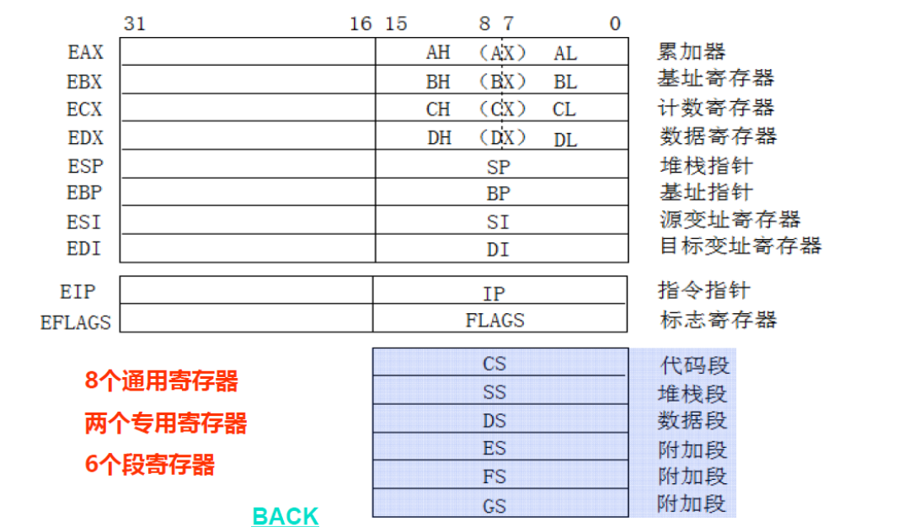

**以上寄存器中有名字的判断都是可以单独访问的**.
通常情况下, 前六个寄存器被看成通用寄存器;
1. `%esp`和`%ebp`是栈指针和基址寄存器, 分别用于栈的访问和函数调用的参数传递
2. `%eip`是程序指针寄存器, 它指向**下一条将要执行的指令的地址**(指令实际上以机器码形式存在)

## 3.4 操作数与指示符

|类型|格式|操作数值|名称|
|----|----|--------|----|
|立即数|$Imm|Imm|立即数寻址|
|寄存器|Eₐ|R[Eₐ]|寄存器寻址|
|存储器|Imm|M[Imm]|绝对寻址|
|存储器|(Eₐ)|M[R[Eₐ]]|间接寻址|
|存储器|Imm(Eᵦ)|M[Imm+R[Eᵦ]]|(基址+偏移量)寻址|
|存储器|(Eᵦ,Eᵢ)|M[R[Eᵦ]+R[Eᵢ]]|变址寻址|
|存储器|Imm(Eᵦ,Eᵢ)|M[Imm+R[Eᵦ]+R[Eᵢ]]|变址寻址|
|存储器|(,Eᵢ,s)|M[R[Eᵢ]·s]|比例变址寻址|
|存储器|Imm(,Eᵢ,s)|M[Imm+R[Eᵢ]·s]|比例变址寻址|
|存储器|(Eᵦ,Eᵢ,s)|M[R[Eᵦ]+R[Eᵢ]·s]|比例变址寻址|
|寄存器|Imm(Eᵦ,Eᵢ,s)|M[Imm+R[Eᵦ]+R[Eᵢ]·s]|比例变址寻址|

其中, **比例变址寻址** 是比较是最通用的格式, 经常用于高级语言中数组的访问, 有四个部分, 分别是 立即数偏移Imm, 基址寄存器Eᵦ, 变址寄存器Eᵢ, 比例因子s, 这里s必须是1, 2, 4, 8中的一个.

## 3.5  数据传送指令
|指令|效果|描述|
|----|----|----|
|MOV S,D|D←S|传送|
|movb|传送字节|传送字节|
|movw|传送字|传送字|
|movl|传送双字|传送双字|

|指令|效果|描述|
|----|----|----|
|MOVS S,D|D←符号扩展(S)|传送符号扩展的字节|
|movsbw|将做了符号扩展的字节传送到字||
|movsbl|将做了符号扩展的字节传送到双字||
|movswl|将做了符号扩展的字传送到双字||

|指令|效果|描述|
|----|----|----|
|MOVZ S,D|D←零扩展(S)|传送零扩展的字节|
|movzbw|将做了零扩展的字节传送到字||
|movzbl|将做了零扩展的字节传送到双字||
|movzwl|将做了零扩展的字传送到双字||

1. IA32对MOV传送指令有一个限制, 即**传送指令的两个操作数同时是存储器**.
2. MOVS和MOVZ指令都是讲一个较小的源数据复制到一个较大的源数据位置, 区别在于**进行符号拓展和零拓展**

### 函数的栈帧
每个函数或过程在执行是, 都需要**在内存中分配一个空间**来保存运行时数据, 这个空间由于是采用栈的方式进行操作, 所以也称为**栈帧**
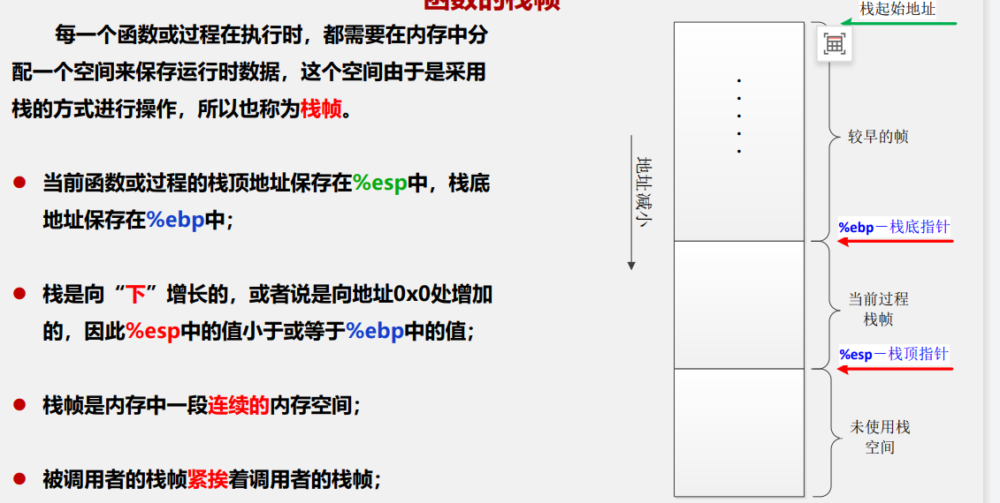
栈从**栈底到栈顶**对应内存空间的**从高到低**, 即栈底的地址是最大的, 栈顶的地址是最小的

|指令|效果|描述|
|----|----|----|
|pushl S|`R[%esp]←R[%esp]-4`<br>`M[R[%esp]]←S`|将双字压栈|
|popl D|`D←M[R[%esp]]`<br>`R[%esp]←R[%esp]+4`|将双字出栈|

pushl指令的功能就是把数据压入程序栈, popl指令的功能就是把数据从栈中弹出
他们后面都只跟一个操作数压入的数据源和弹出的数据目的寄存器.

**等价**
1. `pushl %eax`的行为等价于:
```text
subl $4, $esp   # 栈顶指针减4, 即栈增长
movl %eax, ($esp) # 源寄存器的值放入%esp指向的内存
```
2. `popl %ebx`的行为等价于:
```text
movl ($esp), %ebx # %esp指向的内存中取出值放到%ebx寄存器
addl $4, $esp   # 栈顶指针加4, 即栈缩小
```

## 3.6  算术与逻辑操作
|指令|效果|描述|
|----|----|----|
|||
|leal S,D|D←&S|加载有效地址|
|||
|INC D|D←D+1|加1|
|DEC D|D←D-1|减1|
|NEG D|D←-D|取负|
|NOT D|D←~D|取补(按位取反)|
|||
|ADD S,D|D←D+S|加|
|SUB S,D|D←D-S|减|
|IMUL S,D|D←D*S|乘|
|||
|XOR S,D|D←D^S|异或|
|OR S,D|D←D\|S|或|
|AND S,D|D←D&S|与|
|||
|SAL k,D|D←D<<k|左移(等同于SHL)|
|SHL k,D|D←D<<k|左移|
|SAR k,D|D←D>>ₐk|算术右移|
|SHR k,D|D←D>>ₗk|逻辑右移|

以上的算术与逻辑操作指令, 除了leal("load effective address")指令, 其余其他指令都会有不同大小操作数的变体, 例如: ADD类有`addb, addw, addl`三个变体, 分别对应字节, 字, 双字.

`SAL`之类的移位指令的第一个操作数, 即一个立即数(也可以是寄存器`%cl`), 只能是一个字节, 如果该操作数为指出, 则默认值为1, 例如`sal %eax`的行为等价于`sal $1, %eax`

**C语言中的移位只有`<<`和`>>`两种, 具体是逻辑移位还是算术移位取决于被移位的变量的数据类型
1. 有符号数: 算术移位
2. 无符号数: 逻辑移位

1. **加载有效地址指令leal**
例如: 假如`R[%edx]=x`那么`leal 7(%edx, %edx, 4), %eax`, 就是把`%eax`的值设为`5x+7` 
leal的目的操作数必须是一个寄存器**
2. **一元操作和二元操作**
一元操作的一个操作数既是源也是目的, 可以是一个寄存器也可以是一个存储器位置
二元操作的第二个操作数既是源也是目的, 可以是寄存器或存储器位置
3. **移位操作**
先给出移位量k, 然后给出操作数D, k可以是一个立即数, 或者放在单字节寄存器元素 **%cl** 中. k在机器语言中用单个字节编码
4. **特殊的算术操作**
    |指令|效果|描述|
    |----|----|----|
    |imull S|`R[%edx]:R[%eax]←S*R[%eax]`|有符号全64位乘法|
    |mull S|`R[%edx]:R[%eax]←S*R[%eax]`|无符号全64位乘法|
    |cltd|`R[%edx]:R[%eax]←SignExtend(R[%eax])`|转为四字(32→64位)|
    |idivl S|`R[%edx]←R[%edx]:R[%eax]modS`<br>`R[%eax]←R[%edx]:R[%eax]÷S`|有符号除法|
    |divl S|`R[%edx]←R[%edx]:R[%eax]modS`<br>`R[%eax]←R[%edx]:R[%eax]÷S`|无符号除法|

上面的`imull`指令有**单操作数**和**多操作数**的区别:
1. **单操作数**指令`imull S`是**有符号全64位乘法**, 它把S(寄存器/内存/立即数)和寄存器R[%eax]中的值相乘, 并把结果的64位结果存储在寄存器R[%edx]:R[%eax]中, 规定了必须是这些寄存器
2. **多操作数**指令`imull S,D`是**有符号全32位乘法**, 它把S(寄存器/内存/立即数)和D(寄存器)中的值相乘, 并把结果的32位结果(**溢出则截断**)存储在D中.

`imull`指令甚至有三操作数的形式:
```text
imull Imm,reg/M,reg

# 运算: result = Imm * D
```
其余`mull`和`idivl`和`divl`指令, 都是只有**单操作数的形式**


## 3.7  控制
目前为止, 只学习了**直线代码**的行为, 对于C语言的某些语句结构, 比如条件语句, 循环语句和分支语句等, 机器代码提供**两种基本的低级机制**来实现有条件的行为: 
1. 测试数据值
2. 根据测试结果改变控制流和测试流

### 3.7.1  条件码
除了八个整数寄存器, CPU还维护一组单个位的条件码(Condition Code)寄存器, **他们描述最近的算术和逻辑操作的属性**, 算术与逻辑指令以及后面的测试与比较指令都会设置条件码, 这些条件码可以用来检查操作结果的属性

- **CF**: 进位标志位, 最近的操作是最高位产生进位, 可以用来检查**无符号操作数的溢出**
- **ZF**: 零标志位, 最近的操作结果为0
- **SF**: 负号标志位, 最近的操作结果为负数
- **OF**: 溢出标志位, 最近的操作导致一个补码溢出(正溢出或负溢出)

IA-32架构下, 条件码存储在寄存器EFLAGS(%eflags)中:
- EFLAGS中的关键位:
    - CF(Carry Flag, 进位标志): **位0**。
    - ZF(Zero Flag, 零标志): **位6**。
    - SF(Sign Flag, 符号标志): **位7**。
    - OF(Overflow Flag, 溢出标志): **位11**。

对于操作$t = a + b$, 可用C语言表达式来表示条件码的设置:
```c
CF = (unsigned) t < (unsigned) a    无符号溢出
ZF = (t == 0)                       零
SF = (t < 0)                        负数
OF = (a<0 == b<0) && (t<0> != a<0)  有符号溢出
```

#### 比较与测试指令
还有两类特殊的指令, 分别是**比较指令**和**测试指令**, 他们都是**只设置条件码**, 而不改变任何数据(寄存器)., 
CMP指令行为与SUB指令相同, 只是不改变目的操作数的值.
TEST指令行为与AND指令相同, 只是不改变目的操作数的值.

|指令|基于|描述|
|----|----|----|
|CMP S₂,S₁|S₁-S₂|比较|
|cmpb|Compare byte|比较字节|
|cmpw|Compare word|比较字|
|cmpl|Compare double word|比较双字|
|||
|TEST S₂,S₁|S₁&S₂|测试|
|testb|Test byte|测试字节|
|testw|Test word|测试字|
|testl|Test double word|测试双字|

例如`testl %eax, %eax` 可以用来测试`%eax`是正数还是零还是负数, 通过设置`ZF`, `SF`标志位来实现.

### 3.7.2  访问条件码
条件码通常不会直接读取, 而是有三种常见使用方法:
1. 根据条件码某个组合, 将一个字节设置为0或1 -- **SET类指令**
2. 根据条件码实现有条件的跳转 -- **J类指令**
3. 有条件的传送数据

#### SET类指令
|指令|同义名(synonym)|效果|设置条件|
|----|----|----|----|
|sete D|setz|D←ZF|相等/**零**|
|setne D|setnz|D←~ZF|不等/**非零**|
|sets D| |D←SF|负数|
|setns D| |D←~SF|非负数|
|setg D|setnle|D←~(SF^OF)& ~ZF|大于(有符号>)|
|setge D|setnl|D←~(SF^OF)|大于或等于(有符号>=)|
|setl D|setnge|D←SF^OF|小于(有符号<)|
|setle D|setng|D←(SF^OF)\|ZF|小于或等于(有符号<=)|
|seta D|setnbe|D←~CF& ~ZF|超过(无符号>)|
|setae D|setnb|D←~CF|超过或等于(无符号>=)|
|setb D|setnae|D←CF|低于(无符号<)|
|setbe D|setna|D←CF\|ZF|低于或等于(无符号<=)|


#### J类指令
**跳转(Jump)h指令**会导致当前执行位置切换到一个全新的位置. 在汇编代码中, 通常用一个**标号(Label)**来指明这些跳转的目的地.
```text
1  movl $0, %eax
2  jmp .L1              # 无条件跳转
3  movl (%eax), %edx
4 .L1
5  popl %eax
```

跳转的目的地有两种表示方式
1. **直接跳转**: 直接用标号作为跳转目标
2. **间接跳转**: `*`号后面跟一个操作数指示符
例如: `jmp *%eax`, 寄存器的值直接作为跳转目标
`jmp *(%eax)`, 存储器M[R[%eax]]的值作为跳转目标

**`*`的含义**
`*`号表示间接寻址, 他用于指示后面的操作数是一个间接地址, `jmp *%eax`表示跳转到%eax中存储的地址, `jmp *0x8048000`的含义是: **读取内存地址** `0x8048000`中存储的值，然后将程序跳转到该值所表示的地址。

**label标号的含义**
标号实际上就是地址的别名, 例如, 设`exit`是一个标号
- 那么`jmp exit`的含义就是: 将程序跳转到标号`exit`所表示的地址.
- `jmp *exit`的含义就是: 读取**内存地址** `exit`中存储的值, 然后将程序跳转到该值所表示的地址.

```bash
.section .data

	value:
		.int 0x87654321
.section .text    
   
.global _start   
 _start:      
   nop
	movl $0x0804807e,%eax
	subl $1,%eax
loop:	
	incl %ebx
	# jmp loop
	# jmp *%eax # %eax的值直接付给%eip
	# jmp *0x08049010 # 把该地址对应的内存赋值给%eip
	jmp exit  # exit是地址，直接跳转到该地方
	incl %eax
	# jmp *exit    # exit这个地址对应内存赋值给%eip  
	movl 1,%eax  #
	
exit:  
	movl $1, %eax   
   movl $0, %ebx
   int $0x80  
```


|指令|同义名|跳转条件|描述|
|----|----|----|----|
|jmp Lable| |1|直接跳转|
|jmp *Operand| |1|间接跳转|
|je Lable|jz|ZF|相等/**零**|
|jne Lable|jnz|~ZF|不等/**非零**|
|js Lable| |SF|负数|
|jns Lable| |~SF|非负数|
|jg Lable|jnle|~(SF^OF)& ~ZF|大于(有符号>)|
|jge Lable|jnl|~(SF^OF)|大于或等于(有符号>=)|
|jl Lable|jnge|SF^OF|小于(有符号<)|
|jle Lable|jng|(SF^OF)\|ZF|小于或等于(有符号<=)|
|ja Lable|jnbe|~CF& ~ZF|超过(无符号>)|
|jae Lable|jnb|~CF|超过或等于(无符号>=)|
|jb Lable|jnae|CF|低于(无符号<)||
|jbe Lable|jna|CF\|ZF|超过或等于(无符号<=)|

### 3.7.3 条件分支
机器指令一般是结合跳转指令来实现C语言中的条件分支.
下面是一个例子
```C
int abs_diff(int x, int y)
{
      if(x < y)
		return y - x;
      else
		return x - y;
}
```
以上代码编译后生成的汇编代码如下: [ `body`部分 ]
```bash
...
  movl 0x8(%ebp), %edx 	# get x
  movl 0xc(%ebp), %eax	# get y
  cmpl %eax, %edx		# compare x:y
  jge .L2				# if >=, goto "x-y"
  subl %edx, %eax		# y-x
  jmp .L3				# goto 'done'
.L2:
  subl %eax, %edx		# "x-y"
  movl %edx, %eax		# set result as return value
.L3
  ...
```
汇编代码通过比较两个操作数来设置条件码, 然后根据条件码体现出来的两个操作数的大小关系来决定跳转目标

#### C语言 goto语句
C语言有`goto`语句, 与汇编代码的风格很相似, 虽然C语言的`goto`语句比较low, 但是观察这样的语句能更好的理解汇编代码的执行流程.
```C
int abs_diff(int x, int y){
	int result;
	if (x>=y)
		goto x_ge_y;
	result = y-x;
	goto done;
x_ge_y:
	result = x-y;
done:
	return result;
} 
```

#### 重要题型: 由汇编代码推断C代码
挖空的C代码如下, 需要根据汇编代码来推断出空缺的部分
```C
int test(int x, int y){
	int val = ___;
	if (____){
		if (____)
      val = ____;
		else
			val = ____;
	} else if (____)
		val = ____;

	return val;
}
```
汇编代码: 
```bash
  movl 0x8(%ebp), %eax
  movl 0xc(%ebp), %edx
  cmpl $-3, %eax
  jge .L2
  cmpl $edx, %eax
  jle .L3
  imull %edx, %eax
  jmp .L4
.L3:
  leal (%edx,%eax), %eax
  jmp .L4
.L2:
  cmpl $2, %eax
  jg .L5
  xorl %edx, %eax
  jmp .L4
.L5:
  subl %edx, %eax
.L4:
  ...
```
有两种解法, 下面只介绍第一种
```C
int test(int x, int y){
	int val = x - y;
	if (x < -3){
		if (x > y)
			val = x * y;
		else
			val = x + y;
	} else if (x <= 2)
		val = x ^ y;

	return val;
}
```

### 3.7.4 条件传送指令(cmov)
现代处理器为了提高流水线(Pipelining)技术, 指令的处理分为几个步骤(取值, 译码, ... ), 通过**重叠连续指令**的步骤来提高性能(指令并行执行).
但是**遇到条件分支**时, **J指令由于不知道要不要跳转**, 可能导致并行出错
条件传送指令这一策略能够**更好的匹配**现在处理器的流水线设计, 避免了预测错误的代价, 流水线效率更高
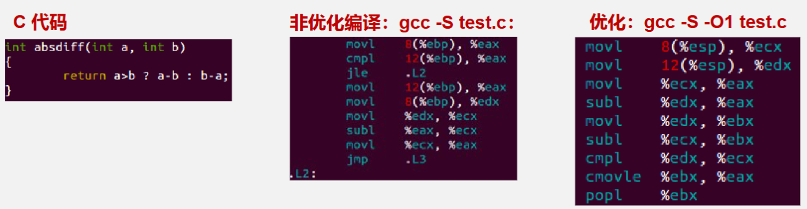
采用优化编译方式(`-O1`)可以得到采用**条件传送指令**代替**J跳转指令**的汇编代码.
条件数据传送方式将可能的所有结果都预先计算出来, 这样使得控制流不依赖于数据, 保持处理器流水线的满工作状态

#### 编译命令
1. `gcc -S -O1 -g -m32 abs_diff.c -o abs_diff.s`
2. `gcc -c -O1 -g -m32 abs_diff.c -o abs_diff.o`

#### 条件传送的代价
1. 条件测试结果的每一种情况**都要预先计算出来**, 无论后面是否需要
2. 一些特定的情况如果没有限制直接计算会引发**非法操作**

因此, 并不是所有情况都适合用条件传送指令

#### cmov类指令
|指令|条件码组合|描述|
|---|---|---|
|cmove/cmovz|ZF|相等/零|
|cmovne/cmovnz|~ZF|不等/非零|
|cmovs|SF|负数|
|cmovns|~SF|非负数|
|cmovg/cmovnle|~(SF^OF)& ~ZF|大于|
|cmovge/cmovge|~(SF^OF)|大于或等于|
|cmovl/cmovnge|SF^OF|小于|
|cmovle/cmovng|(SF^OF)|ZF|小于或等于|
|cmova/cmovnbe|~CF& ~ZF|高于|
|cmovae/cmovnb|~CF|高于或相等|
|cmovb/cmovc|CF|低于|
|cmovbe/cmovna|CF|ZF|低于或相等|


## 3.8 call指令
以一个汇编代码中`call sum`语句为例, 来讲清楚`call`函数过程中都发生了什么, 汇编代码标号为`sum`的片段如下
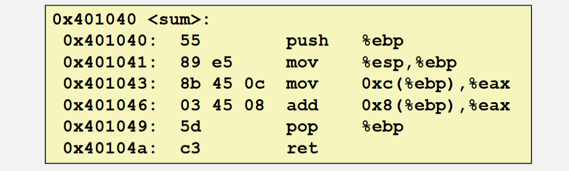

### 3.8.1 调用前
如果`sum`函数有参数, 则需要先将参数压入栈中(参数从右到左压入), 此时栈结构如下: **[假设向上为内存地址增长方向, 即栈减小方向]**
```text
      [调用者的其他数据]
      [参数2]
栈顶 → [参数1]
```

### 3.8.2 执行`call sum`指令
1. **把返回地址压入栈中保存**
相当于执行了一个`pushl %eip`指令, 把当前指令的地址压入栈中, 作为返回地址, 返回地址即为调用`call sum`后的下一条指令地址
```text
      [调用者的其他数据]
      [参数2]
      [参数1]
栈顶 → [返回地址]
```
2. **跳转到被调用函数的入口**
相当于执行了一个`jmp sum`指令, 把`sum`函数的地址付给`%eip`, 从而跳转到`sum`函数的入口
```text
      [调用者的其他数据]
      [参数2]
      [参数1]
栈顶 → [返回地址]
```
### 3.8.3 `sum`函数主体执行
```bash
# setup阶段
push %ebp
mov %esp, %ebp

# body阶段
mov 0xc(%ebp), %eax
add 0x8(%ebp), %eax

# finish阶段
pop %ebp
ret
```
函数体执行一般分为三个阶段:
- `setup`: 函数入口处的代码, 用于设置函数的栈帧
- `body`: 函数的主要代码
- `finish`: 函数退出处的代码, 用于恢复调用者的栈帧

1. **setup阶段**
`push %ebp` 把当前的`%ebp`值压入栈中, 作为函数的栈帧指针, 即保存调用者的`%ebp`值, 即上一帧的`%ebp`值
```text
      [调用者的其他数据]
      [参数2]
      [参数1]
      [返回地址]
栈顶 → [旧的%ebp所指的地址]
```
`mov %esp, %ebp` 把当前的`%esp`值赋值给`%ebp`, 即让`%ebp`指向当前栈顶
```text
            [调用者的其他数据]
            [参数2]
            [参数1]
            [返回地址]
栈底、栈顶 →  [旧的%ebp所指的地址]
```

2. **body阶段**
函数体执行, 主要用于计算函数的返回值, 
分别执行`mov 0xc(%ebp), %eax`和`add 0x8(%ebp), %eax`指令, 即取参数1, 并把参数2加到参数1(%eax)上

3. **finish阶段**
函数退出, 要把调用者的栈帧恢复, 并返回调用者
`pop %ebp`, 弹出`[旧的%ebp所指的地址]`, 即恢复调用者的`%ebp`值
```text
       [调用者的其他数据]
       [参数2]
       [参数1]
栈顶 →  [返回地址]
       [旧的%ebp所指的地址]
```
`ret`的效果等同于`pop %eip`, 即把当前栈顶存的`[返回地址]`弹给`%eip`, 即跳转到返回地址, 即返回调用者

### 3.8.4 补充: `leave`指令
有时候`finish`阶段的代码可以简化为一个指令`leave`, 比如:
```bash
sum:
    pushl   %ebp
    movl    %esp, %ebp
    # sub $0x4, %esp
    
    movl    0xc(%ebp), %eax
    addl    0x8(%ebp), %eax
    
    leave
    ret
```
`leave`指令是IA-32架构中的一个**复合**指令, 他等价于执行:
```bash
mov %ebp, %esp # 将栈顶指针恢复到栈帧底部
pop %ebp       # 恢复调用者的%ebp值
```
注意这里的`mov %ebp, %esp`指令, 在这个例子中看似多余了, 但是一般的函数`setup`阶段, 在执行`mov %esp, %ebp`指令后, 有时还需要执行`sub $0x4, %esp`指令, 为函数的局部变量分配栈空间, 这时候, `leave`中的`mov %ebp, %esp`指令就显得必要了

## 3.9 循环指令和switch语句

### 3.9.1 循环结构
C语言有`do-while`, `while`和`for`三种循环结构
但是大多数编译器只有一种形式的循环, 基本都是按照`do-while`的形式产生出来的, 其他的循环方式会先被编译器转换成`do-while`的形式, 再变成汇编代码

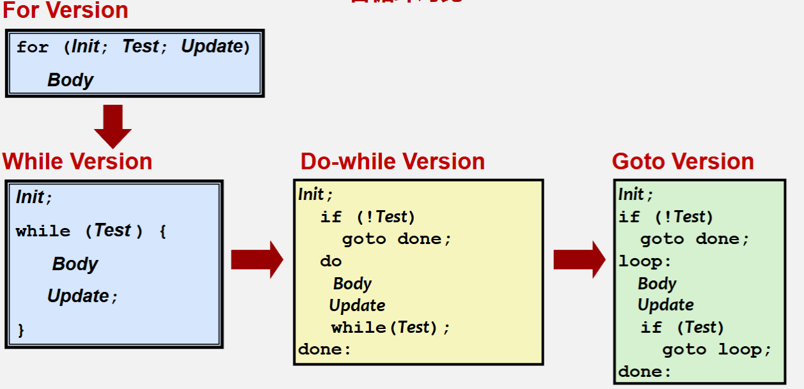

### 3.9.2 switch语句
C语言提供`switch`语句来便捷的实现多分支的条件判断, 同时也会在合适的情况下应用**跳转表(Jump table)机制**来提高跳转的效率.

下面是一个很典型的`switch`语句的例子
```C
long switch_eg1(long x, long y, long z){
  long w=1;    // 需要w初始化的case只有3和6, 
  // 其他不需要w初始化, 此处汇编器也会聪明的进行优化
  switch(x){
    case 1:
      w = y * z;
      break;
    case 2:     // 无break, 该片段执行后会(fall through)继续执行case 3的片段
      w = y / z;
    case 3:
      w += z;   // 这些`+=`自操作符隐含了需要将w作为源操作数之一
      break;
    case 5:
    case 6:
      w -= z;
      break;
    default:
      w = 2;
  }
  return w;
}
```

#### Jump table跳转表
关于上面的switch语句，如果不用跳转表编译, 由于**每个case的代码长度不一样, 所有分支代码段的其实地址之间不是等距的**, 此时处理器要根据索引值(本例子属于变量`x`)的不同去取不同的case指令会很难, 比较繁琐, 效率不高(可直接用gcc编译上述代码查看为什么低下, 每次jmp之前都要进行cmpl判断, 并且必须先判断前面的case分支)

可以用**跳转表**来优化, 跳转表的核心好处就是: **能够只用一条jmp指令**, 利用索引值(变量`x`)来直接跳转到不同的case代码段, 从而提高效率.
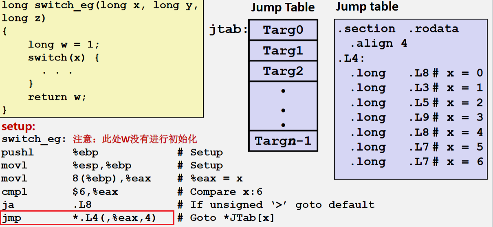

跳转表的每个表项存储的都是地址, 每个地址指向一个case代码段的入口, 这些地址表项在内存中是相邻的
以`jmp *.L4(,%eax,4)`为例, 从中可以看出, `.L4`就是跳转表的起始地址, `4`表示每个表项占`4`个字节, 该指令根据`x`的值算偏移量, 从而匹配到想跳转的表项, `*`表示间接寻址, 用表项所存的地址作为跳转目标, 直接跳转到需要执行的case片段

由上可知, 当**开关(case)的数量比较多, 并且值的范围跨度不大时(不是非常离散)**, 这时候就会使用跳转表来优化, 不然取值效率会很低

## 3.10 过程
高级语言中, 一个主函数里可以有多个嵌套的子函数, 帮助主函数完成一些特定的功能, 这些函数也成为**过程**
由于处理器用来运算的资源(寄存器等)是有限的, 因此在过程被调用是, **调用者(主函数)**需要将控制和数据交给**被调用者(子函数)**, 同时还要在被调用者执行完毕后, 能够正确的返回到调用者继续执行, 这就需要**过程调用机制**来实现这些功能

### 3.10.1 控制转移
本节课以看[3.8 call指令](#38-call指令), 看完就能清楚的知道汇编中的**栈帧结构**和**转移控制**是怎样的

### 3.10.2 参数转移
接下来以一个sum函数的调用(**值传递**)的汇编代码为例, 来讲解**参数转移**的过程, 也涉及到关于`main`栈帧准备的一些细节
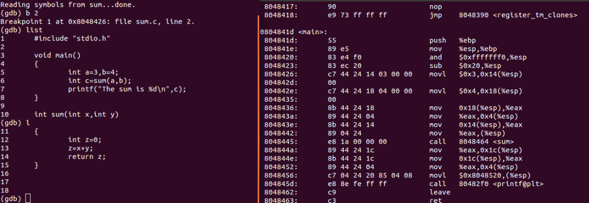

```bash
<sum>:
    push   %ebp
    mov    %esp, %ebp
    sub    $0x10, %esp
    mov    $0x0, -0x4(%ebp)
    movl   0xc(%ebp), %eax
    movl   0x8(%ebp), %edx
    addl   %edx, %eax
    mov    %eax, -0x4(%ebp)
    mov    %-0x4(%ebp), %eax
    leave
    ret
```

#### main栈帧准备的细节
main栈帧的建立过程中, 有一个`and $0xfffffff0, %esp`指令 
该指令的效果是将`%esp`的值的低4位(二进制)强制清零, 这样使得栈顶的值是16的整数倍, **IA32体系的硬性规范+硬件/库函数要求**

#### sum函数的参数传递
在`call sum`之前, 也就是sum(被调用者)的栈帧建立之前, 会有:
```bash
mov 0x18(%esp), %eax
mov %eax, 0x4(%esp)
mov 0x14(%esp), %eax
mov %eax, (%esp)
```
以上的汇编就是sum函数的参数传递, 他们会把main局部变量**拷贝一份**, 分别放到`(esp)`和`0x4(%esp)`位置(这里是值传递, 所以要进行拷贝, 存副本,  后续会以`swap`函数为例来说明关于引用传递, 能够在被调用者的帧中直接修改原变量的值) 

后续sum栈帧建立后, 就会通过访问`0x8(%ebp)`和`0xc(%ebp)`来访问这两个参数, 这是因为sum建立时, 有两个push过程, 此时`%esp`相较原来减小了`0x8`, 后续又有`mov %esp, %ebp`指令, 此时`%ebp`来到了`%esp`位置, 因此此时的`0x8(%ebp)`和`0xc(%ebp)`就分别对应了之前的`(esp)`和`0x4(%esp)`位置

### 3.10.3 递归过程
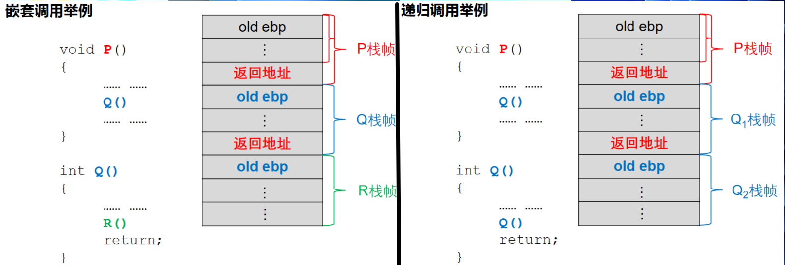

#### 寄存器的值保存惯例
寄存器是有限的, 在被调用者(Q)被调用之前, 如果某些寄存器存有调用者(P)稍后需要用到的内容, 但这些寄存器需要被Q使用, 则需要将这些内容保存起来.
在IA-32架构下, 约定了**调用者(P)**和**被调用者(Q)**的寄存器使用惯例:
1. **`%eax`, `%ecx`, `%edx`**属于**由调用者保存**的寄存器, 调用发生时, P负责将它们先压栈保存, 再产生Q的栈帧
2. **`%ebx`, `%esi`, `%edi`**属于**由被调用者保存**的寄存器, Q被调用后, 在这些寄存器被覆盖前, 要将它们在Q的栈帧里面保存, Q返回前进行恢复

#### 递归调用例子--阶乘
```C
int rfact(int n){
  int result;
  if (n <= 1)
    result = 1;
  else
    result = n * rfact(n-1);
  return result;
}
```
以上代码编译后生成的汇编代码如下:
```bash
#Argument: n at %ebp+8
#Registers: n in %ebx, result in %eax
1   rfact:
2       pushl   %ebp                #save old %ebp
3       movl    %esp, %ebp          #set %ebp as frame pointer
4       pushl   %ebx                #save callee-save register %ebx(调用者保存寄存器)
5       subl    $4, %esp            #allocate 4 bytes on stack
6       movl    8(%ebp), %ebx       #get n
7       movl    $1, %eax            #result = 1
8       cmpl    $1, %ebx            #compare n:1
9       jle     .L53                 #if <=, goto done
10      leal    -1(%ebx), %eax      #compute n-1
11      movl    %eax, (%esp)        #store at top of stack
12      call    rfact               #call rfact(n-1)
13      imull   %ebx, %eax          #compute result=return_value*n
14  .L53:                           #done:
15      addl    $4, %esp            #deallocate 4 bytes from stack
16      popl    %ebx                #restore %ebx (需要用到时进行恢复)
17      popl    %ebp                #restore %ebp
18      ret                         #Return result
```

### 3.10.4 Swap函数--引用传递
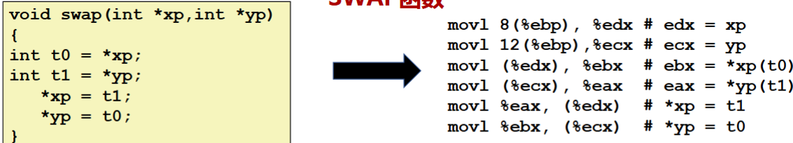

## 3.11 数组分配与访问
C语言中数组元素的访问可以通过对**指针(地址)**的运算来实现, 这样的较为简单的实现方式使得编译器对**C语言数组的机器代码翻译很容易**

数组的核心元素是**元素的个数**和**元素的数据类型**:
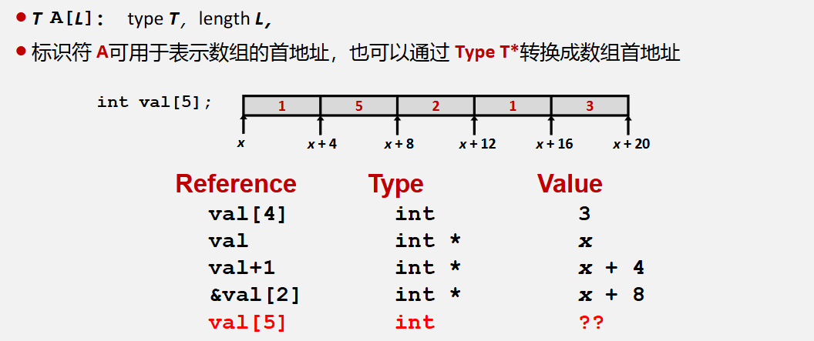

### 3.11.1 一维数组访问
设$K$是每个元素占用的字节数, $x_A$是数组A的基地址, 那么访问数组元素`A[i]`的地址可以通过以下公式计算得到:
$$
A[i] = x_A + i \times K
$$

### 3.11.2 二维数组访问
二维数组可以理解有两种形式:
1. **以行为主序的二维数组**, 实质上是一维数组
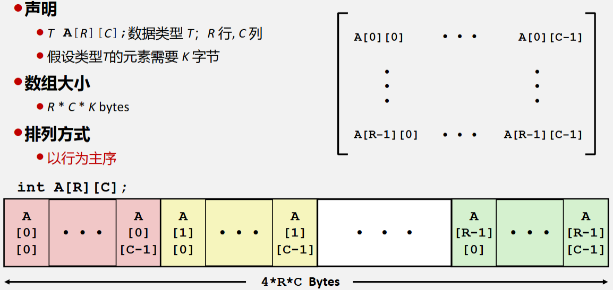

2. **指针嵌套数组**
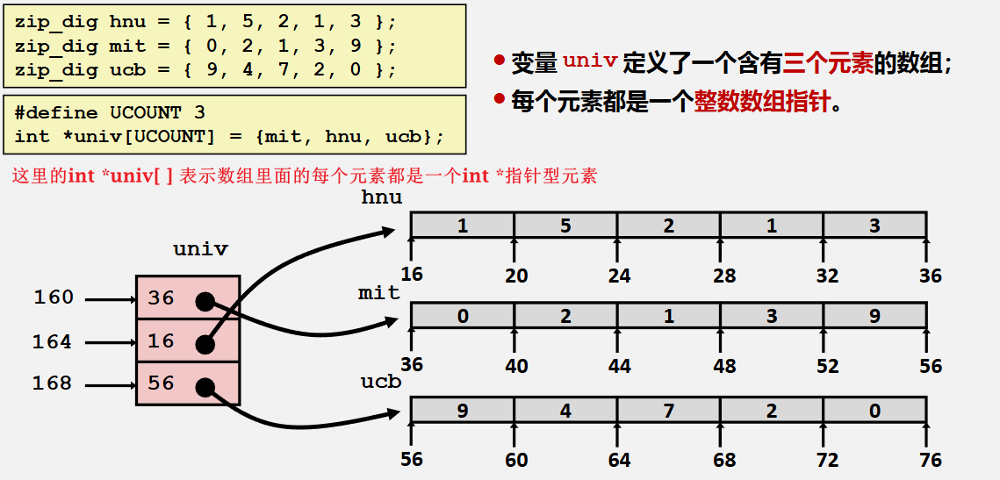

$$
\begin{aligned}
A[i][j] &= x_A + (i \times C \times K) + j \times K \\
  &= x_A + (i \times C + j) \times K
\end{aligned}
$$

访问A[i][j]的汇编如下:
```bash
# A at %ebp+8, i at %ebp+12, j at %ebp+16
movl 12(%ebp), %eax
leal (%eax, %eax, 2), %eax
movl 16(%ebp), %edx
sall $2, %edx                   # compute j*4
addl 8(%ebp), %edx              # compute xA+4j
movl (%edx, %eax, 4), %eax      # read from M[xA+12i+4j]
```
对于第二种, 汇编代码如下:
```bash
movl 8(%ebp), %eax          # index
movl univ(,%eax,4), %edx    # p = univ[index]  (指针必定是4byte, 32位系统)
movl 12(%ebp), %eax         # dig
movl (%edx, %eax, 4), %eax  # p[dig]
```

## 3.12 结构体和联合
C语言中的结构体(struct)和联合(union)都是**用户定义的数据类型**, 他们都可以包含多个成员, 但是他们的内存布局

### 3.12.1 结构体(struct)
C语言中结构体内存连续分配, 可以包含不同数据类型的成员
下面是一个结构体成员访问的例子
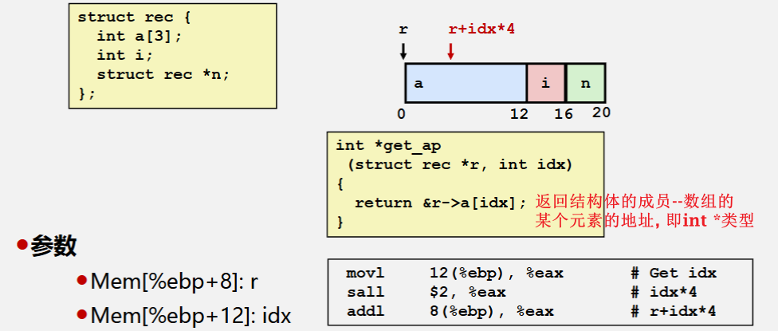

#### 结构体的内存对齐
结构体的内存对齐有整体上和局部上两方面规则
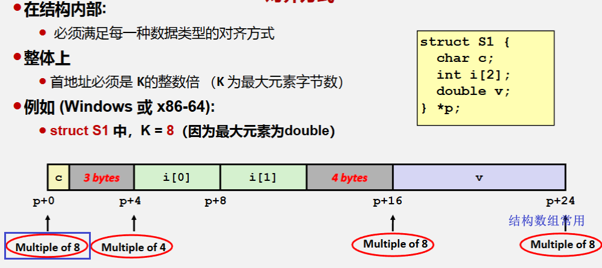
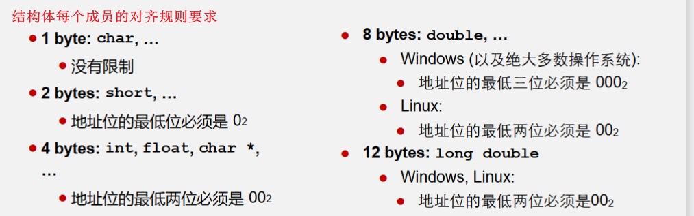

结构对齐三大原则: 
1. 结构的首地址必须是最大元素字节数的整数倍
2. 结构中的每个数据的地址必须是自身字节数的整数倍
3. **结构的总体长度必须是最大元素字节数的整数倍**
例子:
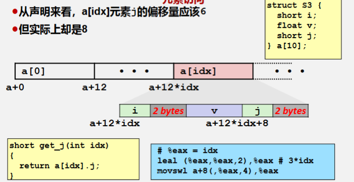

### 3.12.2 联合(union)
不同于结构体的对齐式内存分配, 联合的内存分配是**所有成员共享同一块内存**, 联合的大小等于其**最大成员的大小**, 联合的地址就是其最大成员的地址
以下是对联合体的访问的一个剖析
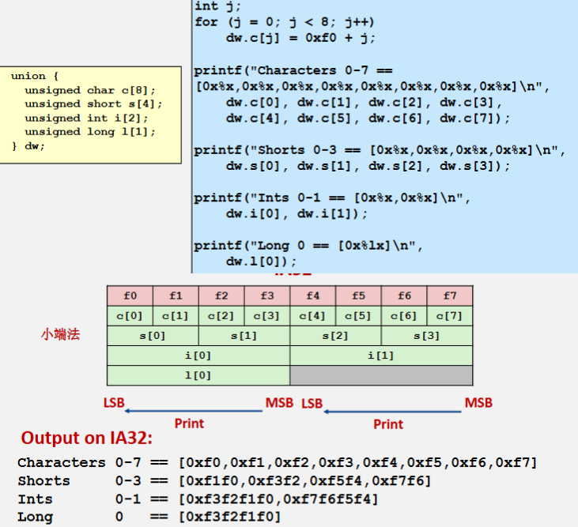

## 3.13 理解黑客攻击和防御

### 3.13.1 SQL注入攻击
后台接收前台的用户名和密码, 拼接成SQL语句并提交给数据库执行, 如果执行的结果不为空, 则说明用户名和密码正确
但某些用户可能通过构建**含有特殊字符**的用户名, 使得拼接的SQL语句含有攻击信息, 这就是**SQL注入攻击(SQL Injection)**
[SQL注入攻击演示网站](https://csapp.ccccocccc.cc/phplogin.html)
除了绕过登录, SQL注入攻击漏洞的危害远不止于此, 例如, 在付出一定的时间成本后, 可以获得任一个用户的密码

### 3.13.2 直接修改可执行文件
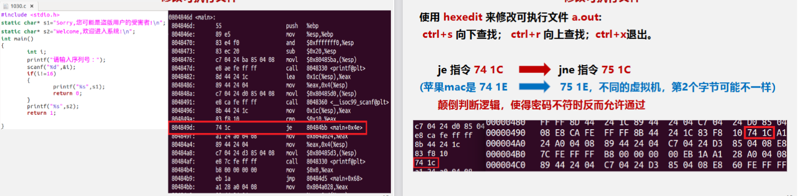

### 3.13.3 改变程序返回地址
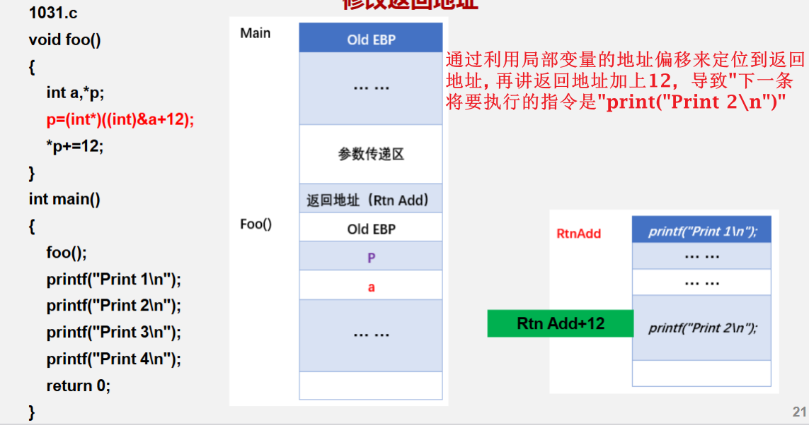

### 3.13.4 缓冲区溢出攻击
缓冲区溢出是一种非常普遍, 危险的漏洞, 在各种操作系统, 应用软件中广泛存在.
缓冲区溢出攻击是利用缓冲区溢出漏洞所进行的攻击行为

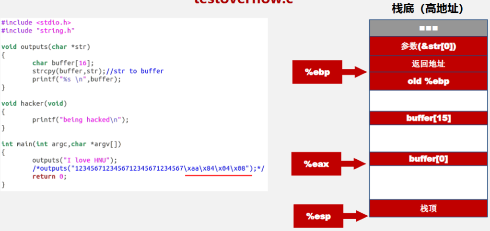
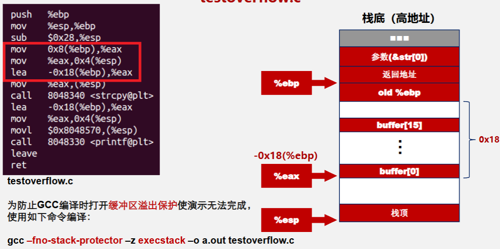
