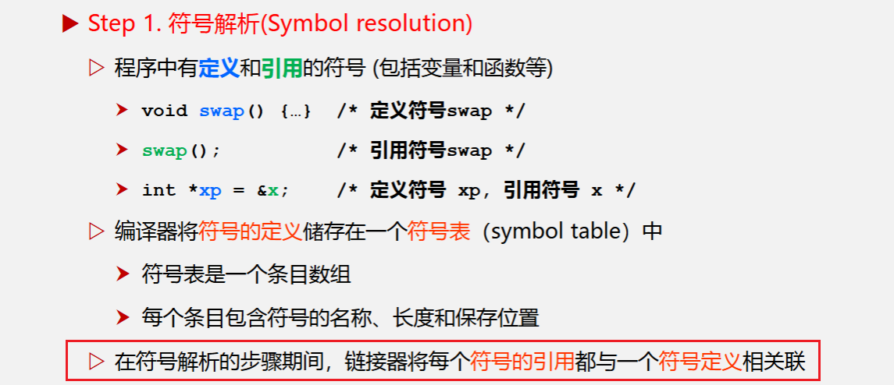
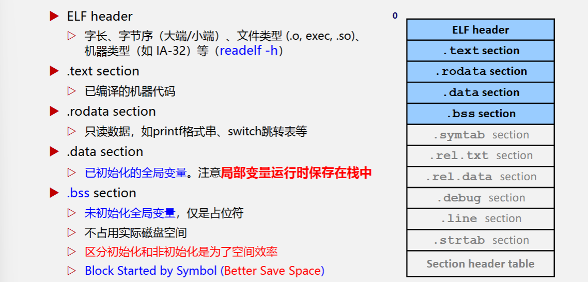
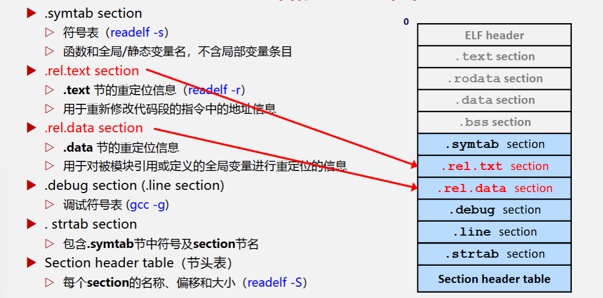
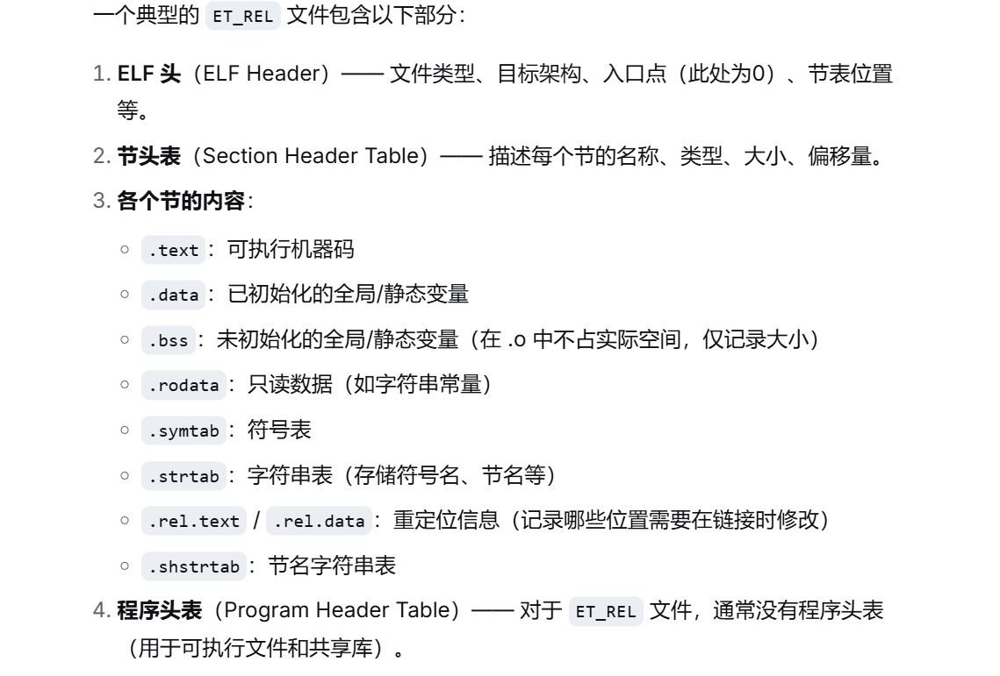
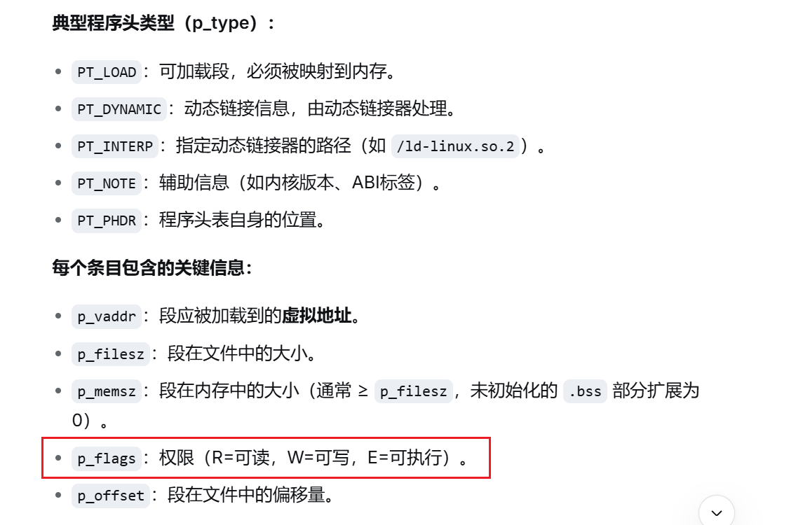
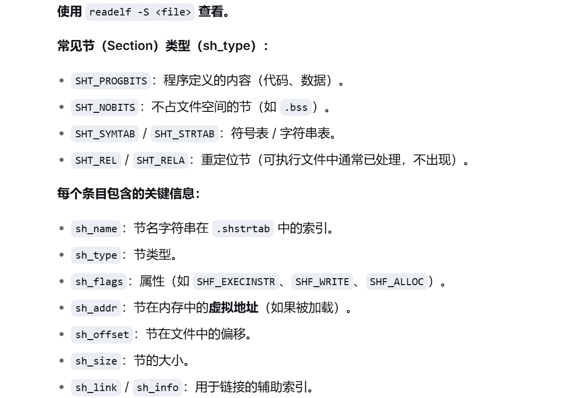
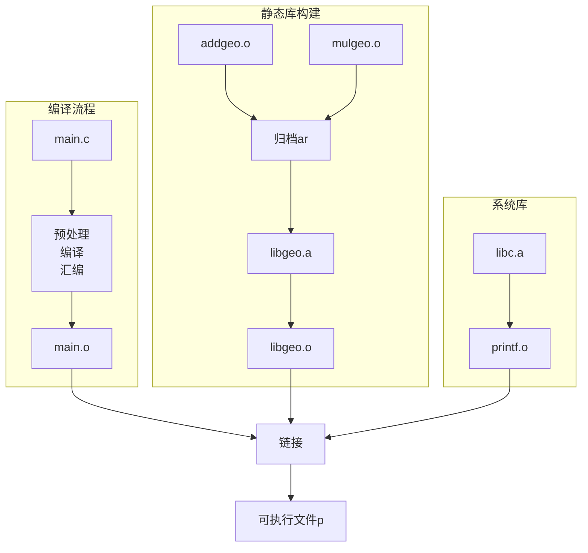
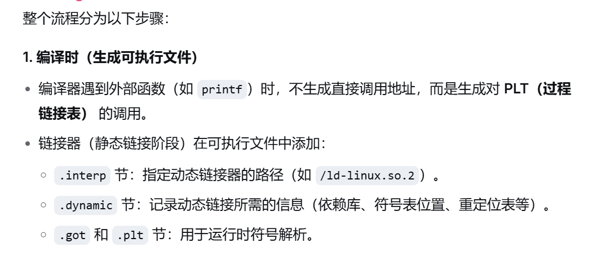
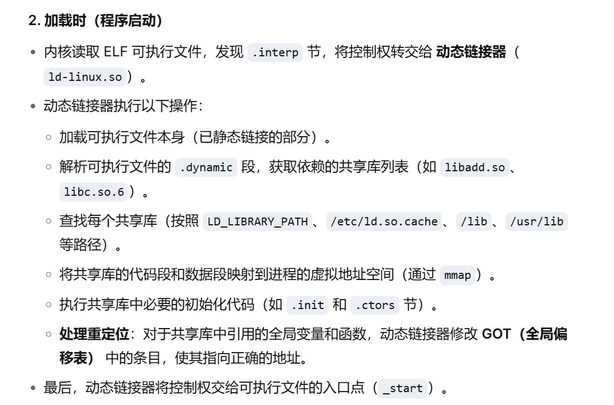
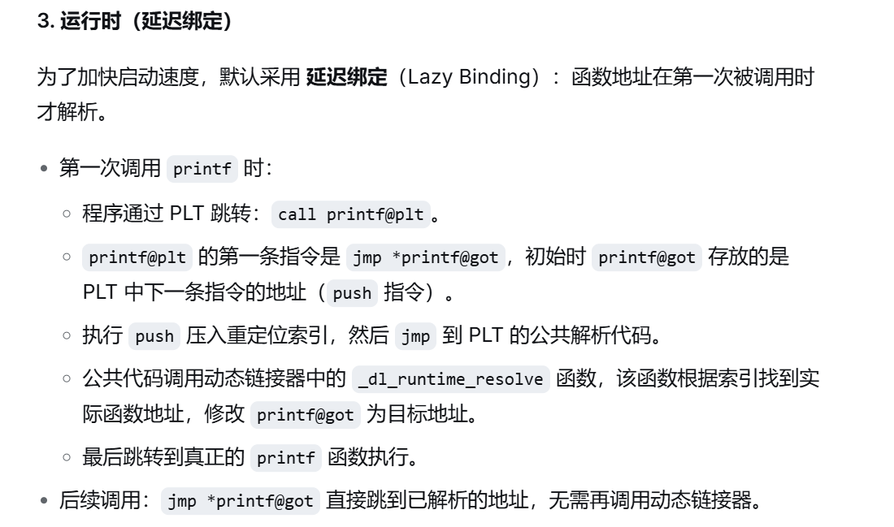

<h1 align='center'>第四章 链接器</h1>

[TOC]

## C语言的符号变量定义相关

### 作用域 vs. 链接属性


| 声明写法 | 作用域 | 链接属性 | 典型场景 |
|---|---|---|---|
| **函数外 `int g_val;`** | 文件作用域 | **external** | 全局变量（可跨文件访问） |
| 函数外 `static int s_val;` | 文件作用域 | internal | 文件私有全局变量 |
| 函数内 `int l_val;` | 块作用域 | none | 普通局部变量 |
| 函数内 `static int sl_val;` | 块作用域 | none*（**但生命周期静态**） | 静态局部变量 |
| 函数**声明** `void foo();` | — | **默认 external** | 跨文件调用函数 |

**注意**:
1. 函数内的static变量声明


### 变量定义 vs. 声明
1. **定义**: 分配内存空间, 例如`int g = 10` (强符号, 有初始值)
2. **声明 (extern)**: 不分配内存空间, 仅仅告诉编译器 "这个符号在别处定义"
```C
// file1.c
int g = 10;         // 定义（强符号）

// file2.c
extern int g;       // 仅仅声明，不分配空间
```

注意**函数声明**和**函数定义**的区别:
```C
//file1.c
void foo() {
    ...
}   

//file2.c
void foo();  // 仅仅声明，不定义

```


## 链接时的强弱符号
**链接器在处理多个目标文件时, 根据符号强弱决定冲突规则**:
| 符号类型 | 强弱 | 例子 |
|---|---|---|
| 已初始化的全局变量 | 强 | `int x = 5;` |
| 未初始化的全局变量 | 弱 | `int x;`（常见实现为 common 块） |
| 函数定义 | 强 | `void foo() { ... }` |
| 带 static 的全局变量 | 不参与链接（局部符号） | `static int y;` |

**冲突规则**
1. 不允许两个强符号（重定义错误）
2. 一强一弱 → 选强符号
3. 两个弱符号 → 选占用空间大的（如果大小不同会警告）

## 链接器的工作流程



链接器对**可重定位目标文件**并不是"机械"的合并:

1. 一方面他讲不同目标文件中的各个部分按照代码, 数据等进行分类合并, 尤其对于静态链接, 链接器会将代码和数据都合并到可执行的文件中, 既需要确定各个代码和数据的最终存储位置;
2. 另一方面他需要分析目标文件中**符号定义**的完整性, 对于符号的地址信息进行就解析, 并将**符号的引用和相应符号定义关联起来.**

### "符号解析"中"符号"

**符号（Symbol）**在链接的语境下，是指**在目标文件（.o）的符号表(symbol table)中记录的一个名字**，它代表一个全局可见的地址（代码地址或数据地址）。链接器只关心那些跨目标文件可见或需要重定位的符号。

**那些C语言元素会成为"符号"**


**关于"符号引用"和"符号定义"的区分**
**符号定义**：分配了存储空间的符号（在某个目标文件中提供）。
**符号引用**：使用了该符号但没有定义的地方（通常需要链接器去找到定义）。

```C
// ref.c
extern int ext_var;   // 引用（声明），没有定义
void bar(void);       // 引用（函数声明），没有定义

int main() {
    ext_var = 5;
    bar();
    return 0;
}

// def.c
int ext_var = 10;     // 定义
void bar(void) { }    // 定义
```

```text
// ref.o的符号表
Num:    Value  Size Type    Bind   Vis      Ndx Name
  5: 00000000     0 NOTYPE  GLOBAL DEFAULT  UND ext_var
  6: 00000000     0 NOTYPE  GLOBAL DEFAULT  UND bar
  7: 00000000    35 FUNC    GLOBAL DEFAULT    1 main

// def.o的符号表
  5: 00000000     4 OBJECT  GLOBAL DEFAULT    2 ext_var
  6: 00000000    10 FUNC    GLOBAL DEFAULT    1 bar
```
**`UND`** 表示undefined, 即表示该符号是引用
**链接时，链接器会把 ref.o 中的 UND 条目与 def.o 中的 GLOBAL 定义关联起来，完成符号解析。**

### 为什么要链接器

1. **模块化编程**: 允许将程序分成多个源文件，分别编译，最后链接成一个可执行文件
2. **代码重用**: 可以链接库文件（如标准库）来重用已有的功能
3. **分离编译**: 只需要重新编译修改过的源文件，而不需要重新编译整个程序


## ELF
**ELF (Executable and Linkable Format)** Linux / Unix 系统下目标文件的标准二进制格式，规范了如何组织代码、数据、符号表、重定位信息、动态链接信息等。
你看到的所有 `.o`、`.so`、不带后缀的可执行文件、甚至是内核模块 `.ko`，本质上都是 符合 ELF 规范的文件，只是 ELF 头中的类型字段不同。

相当于：**ELF 是一套“文件格式模版”**，而 `.o`、`.so`、可执行文件是这套模版的不同“实例化角色”。

### ELF 格式下的文件


**`readelf` 查看文件类型**

```bash
readelf -h add.o | grep Type
# Type: REL (Relocatable file)

readelf -h prog | grep Type
# Type: EXEC (Executable file)

readelf -h libadd.so | grep Type
# Type: DYN (Shared object file)
```

### 可重定位目标文件(`.o`)的格式和内容





#### ELF Header (ELF头) 
ELF 头位于文件开头，固定长度 **（32位为52字节，64位为64字节）。** 它描述了文件的基本属性和其他关键数据结构的位置与大小。
```bash
readelf -h <file>
```
**主要字段:** 

**ELF头的作用:** 告诉加载器该文件是**何种类型, 入口在哪, 程序头表和节头表在何处**

#### Program Header Table (程序头表)
程序头表是一个结构体数组, 每个条目描述一个**段(Segment),** 段是**运行时**的视图: 它将多个具有相同权限(读/写/执行)的姐(section)合并在一起, 告知操作系统**如何加载文件的不同部分到内存**
```bash
readelf -l <file>
```

一个简单可执行文件的程序头表如下:

```text
Type           Offset   VirtAddr   PhysAddr   FileSiz  MemSiz   Flg Align
PHDR           0x000034 0x8048034  0x8048034  0x00100  0x00100  R   0x4
INTERP         0x000134 0x8048134  0x8048134  0x00013  0x00013  R   0x1
LOAD           0x000000 0x8048000  0x8048000  0x0069c  0x0069c  R E 0x1000
LOAD           0x000f0c 0x8049f0c  0x8049f0c  0x0010c  0x00124  RW  0x1000
DYNAMIC        0x000f18 0x8049f18  0x8049f18  0x000c8  0x000c8  RW  0x4
...
```
- 第一个 LOAD 段（R E）包含 .text、.rodata 等，只读+可执行。
- 第二个 LOAD 段（RW）包含 .data、.bss，可读写。
- INTERP 段告诉加载器使用动态链接器。

程序头表的作用： 告诉操作系统内核“如何将文件中的内容映射到进程地址空间”，是 **加载可执行文件的核心依据。**

#### Section Header Table (节头表)
节头表是一个结构体数组，每个条目描述一个节（Section）。**节是链接时的视图：它将不同功能的代码、数据、调试信息等分开，供链接器使用。** 对于可执行文件，**节头表不是运行时必需的（可被 strip 删除），** 但保留它有助于调试和查看元信息。
```bash
readelf -S <file>
```


典型的节:

**节头表的作用:** 供调试器, 链接器, 反汇编工具理解文件结构, 不是运行时加载必需

## 链接第一步 -- 符号解析

**符号解析**就是要确定**每一个符号引用和相应的符号定义之间的关联**

在编译过程层中, 编译器只要找到相应的变量声明, 他就会继续编译过程, 他所产生的`.o`中的**符号表**只表达了两件事:

1. GLOBAL: 本目标文件能够提供给其他文件使用的符号
2. UND: 本目标文件需要其他文件提供的符号;

### 解析多重定义的符号

**链接器将所有符号分为两类：**

- **强符号（Strong Symbol）**：已初始化的全局变量、非 `static` 函数定义。
- **弱符号（Weak Symbol）**：未初始化的全局变量（GCC 中默认视为 `COMMON` 弱符号）、显式用 `__attribute__((weak))` 标记的符号。

**多重定义时的处理规则**（按优先级从高到低）：

1. **多个强符号** → 链接器报错：`multiple definition of 'symbol'`。
   例如：`file1.c` 中 `int x = 1;`，`file2.c` 中 `int x = 2;`。
   **结果**：链接失败。
2. **一个强符号 + 一个或多个弱符号** → 选择**强符号**，忽略弱符号。
   例如：`file1.c` 中 `int x = 100;`（强），`file2.c` 中 `int x;`（弱，COMMON）。
   **结果**：所有引用都绑定到 `x = 100`，弱符号的定义被丢弃。
   *可能发出警告*（若大小不一致时）。
3. **多个弱符号** → 选择**占用空间最大的**那个（若类型/大小不同则选最大的，否则任选一个）。
   例如：`file1.c` 中 `int x;`（4字节），`file2.c` 中 `double x;`（8字节）。
   **结果**：符号 `x` 最终大小为 8 字节（对应 `double`），所有引用都指向它。
   *通常也会发出警告*。

### 链接静态库

**静态库的动机**

在静态库出现之前，每个程序需要包含所有依赖的 `.o` 文件，导致：

1. **重复存储**：多个程序都用 `printf.o`、`sqrt.o` 等，每个可执行文件都复制一份，浪费磁盘和内存。
2. **维护困难**：库函数更新后，所有程序必须重新链接。
3. **编译繁琐**：命令行需要列出大量 `.o` 文件。

**静态库解决**：

- 将常用函数打包成一个文件（如 `libc.a`），链接器自动提取需要的 `.o` 模块。
- 链接后的可执行文件**独立无外部依赖**，但仍有冗余（每个程序包含库代码副本）。

**自己建立动态库和与动态库的链接**

```bash
# 1. 编译 addgeo.c 和 mulgeo.c 生成目标文件
$gcc -c addgeo.c mulgeo.c

# 2. 将目标文件打包成静态库 libgeo.a
$ar rcs libgeo.a addgeo.o mulgeo.o

# 3. 编译 main.c 生成目标文件 main.o
$gcc -ol -c main.c

# 4. 静态链接，生成可执行文件 p
$gcc -static -o p main.o ./libgeo.a
```





## 链接第二步 -- 重定位

可重定位目标文件（`ET_REL`）中的代码和数据从地址 0 开始编译，各个 `.o` 文件相互独立。链接器需要：

1. 合并相同类型节
2. 符号引用的重定位, 链接器会依据**可重定位表**, 修改订**代码节和数据节**中的每个符号引用, 使他们均指向正确的运行时地址

**重定位条目（Relocation Entry）**

重定位条目记录了：**在 `.o` 文件的某个位置，需要如何修改以引用某个符号**。每个可重定位节（如 `.text`）可能有对应的 `.rel.text` 节, 这些就是可重定位表的表项条目

**条目结构（`typedef struct`）**：

- `r_offset`：需要修改的位置在节内的字节偏移（相对于节起始）。
- `r_info`：符号表索引 + 重定位类型（高24位符号索引，低8位类型）。
- `r_addend`（某些格式）：一个加数，用于计算最终地址。

使用 `readelf -r file.o` 查看。

**重定位类型** 

在32位x86架构中, **重定位类型决定了如何计算最终地址:** 

| 类型             | 描述                   | 计算公式        | 常用场景                                                     |
| :--------------- | :--------------------- | :-------------- | :----------------------------------------------------------- |
| `R_386_32`       | 绝对地址重定位         | `S + A`         | 引用全局变量的地址（`movl $sym, %eax` 或 `movl sym, %eax` 中的符号地址） |
| `R_386_PC32`     | PC 相对地址重定位      | `S + A - P`     | 调用函数（`call sym`）、跳转（`jmp sym`）                    |
| `R_386_GLOB_DAT` | 用于 GOT（全局偏移表） | 同 `R_386_32`   | 动态链接中访问全局变量                                       |
| `R_386_JMP_SLOT` | 用于 PLT（过程链接表） | 同 `R_386_PC32` | 动态链接中调用函数（延迟绑定）                               |

> 其中：`S` = 符号的**实际运行时地址**，`A` = 重定位条目中的加数（通常就是原指令中的常数值），`P` = 被修改位置的实际运行时地址（即 `r_offset` 对应的运行时地址）。

#### 重定位的符号引用过程实例

```c
// main.c
extern int sum(int a, int b);   // 定义在其他文件
int x = 100;                    // 强符号
int main() {
    return sum(x, 200);
}
```

编译成 32 位目标文件（默认未链接）：

```bash
gcc -m32 -c main.c -o main.o
```


(1) 查看重定位条目

```bash
readelf -r main.o
```

输出（简化）：

```text
Relocation section '.rel.text' at offset 0x3a0 contains 2 entries:
 Offset     Info    Type            Sym.Value  Sym. Name
0000000c  00000802 R_386_PC32       00000000   sum
00000007  00000a01 R_386_32         00000000   x
```

- 偏移 `0x07` 处（`movl x, %eax` 中的 `x` 地址）**使用 `R_386_32` 类型，引用符号 `x`。**

- 偏移 `0x0c` 处（`call sum` 指令中的目标地址）使用 `R_386_PC32` 类型，引用符号 `sum`。

(2) 查看原始指令（反汇编，AT&T 格式）

```bash
objdump -d -M att main.o
```

输出：

```text
00000000 <main>:
   0:   55                      push   %ebp
   1:   89 e5                   mov    %esp,%ebp
   3:   83 ec 04                sub    $0x4,%esp
   6:   a1 00 00 00 00          mov    0x0,%eax      # 偏移 7: 占位地址 0x0, 引用 x
   b:   83 c0 c8                add    $0xffffffc8,%eax
   e:   50                      push   %eax
   f:   e8 fc ff ff ff          call   10 <main+0x10> # 偏移 14: 占位 -4, 引用 sum
  14:   83 c4 04                add    $0x4,%esp
  17:   c9                      leave
  18:   c3                      ret
```

- `mov 0x0, %eax` 中操作数是 `0x0`，这是占位符，需要重定位。
- `call 10` 的相对偏移是 `0xfcffffff`（小端，即 -4），这也是占位符。

(3) 假设最终链接后地址分配

链接器决定：

- `.text` 段起始地址为 `0x8048000`，`main` 函数在偏移 `0x0` 处，所以 `main` 地址 = `0x8048000`。
- `x` 是全局变量，位于 `.data` 段起始地址 `0x804a000`，偏移 `0`，所以 `x` 地址 = `0x804a000`。
- `sum` 函数定义在 `sum.o` 中，假设其起始地址为 `0x80480a0`。

**(4) 链接器执行重定位计算**

对于 `R_386_32`（绝对地址）：

- 位置：`.text` 节偏移 `0x07`（即指令 `mov 0x0,%eax` 中的 `0x0` 字段）。
- 计算公式：`S + A`，**其中 `S = 0x804a000`（x 的地址），`A = 0`（原始占位值）。**
- 得到 `0x804a000`，以小端 4 字节写入。指令变为 `mov 0x804a000, %eax`。

对于 `R_386_PC32`（PC 相对地址）：

- 位置：`.text` 节偏移 `0x0f`（`call` 指令后的 4 字节）。
- 计算公式：`S + A - P`，其中：
  - `S = 0x80480a0`（sum 地址）
  - `A = -4`（原指令中的相对偏移，即 `0xfcffffff` 的有符号值）
  - **`P` = 被修改位置的实际运行地址 = `main` 地址 + 0x0f = `0x8048000 + 0x0f = 0x804800f`**
- 计算：`0x80480a0 + (-4) - 0x804800f = 0x91`（十进制 145）。
- 写入 `0x91`（小端 `91 00 00 00`）。因此 `call` 指令变为 `call 0x80480a0`（实际上在反汇编中会显示为 `call sum`）。

(5) 最后结果

```text
8048000:       55                      push   %ebp
8048001:       89 e5                   mov    %esp,%ebp
8048003:       83 ec 04                sub    $0x4,%esp
8048006:       a1 00 a0 04 08          mov    0x804a000,%eax   # 绝对地址重定位
804800b:       83 c0 c8                add    $0xffffffc8,%eax
804800e:       50                      push   %eax
804800f:       e8 8c 00 00 00          call   80480a0 <sum>    # PC相对重定位
8048014:       83 c4 04                add    $0x4,%esp
8048017:       c9                      leave
8048018:       c3                      ret
```


## 动态链接

动态链接是现代操作系统将程序与共享库（`.so` 文件）在运行时绑定在一起的技术。它与静态链接（**链接时合并所有代码**）相反，可以**节省磁盘和内存空间，并允许库独立升级。**

### 共享库 (Shared Library)
共享库是一种特殊的 ELF 目标文件（类型 ET_DYN），包含可被多个进程共享的代码和数据。

**特点：**

- **位置无关代码（==PIC== , Position-Independent Code）：** 使用相对寻址，可在内存任意地址加载。
- **文件后缀：** .so（如 libc.so.6）。
- **多个进程共享物理内存：** 内核将同一份共享库的代码段映射到不同进程的虚拟地址空间，但数据段各自独立（写时复制）。
- **独立升级：** 库更新后，无需重新链接程序，只要接口不变。

### 动态链接过程
动态链接发生在两个阶段：加载时（程序启动前）和运行时（首次调用库函数时，即延迟绑定）。



