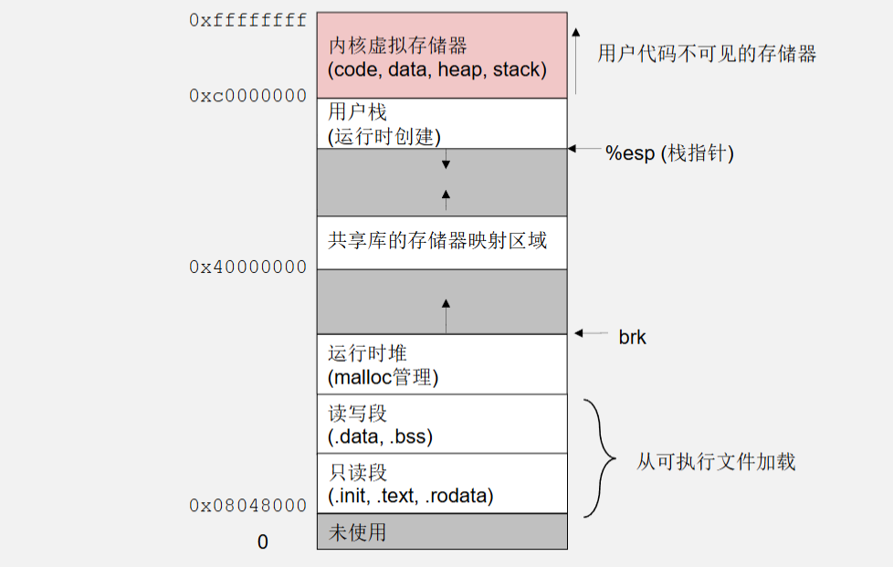

<h1 align='center'>第七章 异常与进程</h1>

[TOC]

程序执行是一个“指令流”，正常情况下 PC（程序计数器）依次递增。但遇到**分支、跳转、函数调用**时，指令流会发生“自愿”的偏离。还有一种**非自愿**的偏离——当 CPU 检测到异常事件（如除零、缺页、系统调用）时，会强制跳转到操作系统预先设置好的**异常处理程序**。这种机制就是**异常控制流（ECF, Exception Control Flow）**。

## 7.1 异常

### 7.1.1 异常处理

**异常**是 CPU 在执行指令过程中，检测到某个“需要操作系统介入”的事件，而触发的**处理器到操作系统（内核）的受控转移**。
每个异常被分配一个**异常号**（0～255，部分保留），CPU 利用异常号在**中断描述符表（IDT, Interrupt Descriptor Table）** 中找到对应的**处理程序入口**。

> 在 Linux/IA-32 中，IDT 的每个表项包含处理程序的段选择子和偏移，以及权限等信息。

**异常与普通函数调用的区别**：

- 异常由硬件触发，不是代码主动调用。
- 异常可能发生在指令执行中间，处理完后可能返回原指令继续，也可能终止程序。
- 异常的返回地址可能是触发异常的指令，也可能是下一条指令，取决于类型。

**操作系统如何响应异常？**

当 CPU 遇到异常时，执行以下硬件动作（简化）：

1. **保存当前上下文**：将 `eflags`、`cs`、`eip`（返回地址）以及可能的错误代码压入内核栈。
2. **查 IDT**：根据异常号找到处理程序所在的段和偏移。
3. **权限切换**：如果从用户态陷入内核，切换堆栈（从用户栈切换到内核栈）。
4. **跳转**：`call` 到处理程序。

处理程序执行完毕后，通过 `iret` 指令恢复上下文，并返回用户态。

> **注意**：故障类异常返回时，重新执行 **导致异常的指令**；陷阱类返回下一条指令；中止不会返回。

### 7.1.2 异常分类

| 类别                  |                  原因                  | 返回行为                 | 典型例子                                 |
| :-------------------- | :------------------------------------: | :----------------------- | :--------------------------------------- |
| **陷阱（Trap）**      | 故意触发（如**系统调用 `int $0x80`**） | 返回到**下一条指令**     | `syscall`、断点调试 `int 3`              |
| **故障（Fault）**     |              可恢复的错误              | 可能重新执行**当前指令** | 缺页（Page Fault）、除零（Divide Error） |
| **中止（Abort）**     |           不可恢复的严重错误           | 不会返回，进程终止       | 硬件错误、双重故障（Double Fault）       |
| **中断（Interrupt）** |       来自 CPU 外部（I/O 设备）        | 返回到**下一条指令**     | 键盘输入、时钟中断                       |

> 注意：广义“异常”有时包括外部中断，但狭义仅指 CPU 内部事件。这里我们按教材狭义，但会提中断以作对比。

#### 异步异常--中断(Interrupt)

#### 同步异常

**缺页异常（Page Fault，异常号 14）**

- 属于 **故障**，但可恢复。
- 发生条件：访问的虚拟页不在物理内存中（页表项有效位=0）或权限不够。
- CPU 行为：压入错误代码（指明访问类型：读/写/执行、用户/内核模式等），跳转到 `do_page_fault`。
- 操作系统行为：如果是合法访问但页面未分配（如写时复制、栈自动增长、换入），则分配物理页或从磁盘读入，修改页表，然后**重新执行触发故障的指令**；若是非法访问（如空指针解引用），则发送 `SIGSEGV`。

**系统调用（通过 `int $0x80` 或 `sysenter`）**

- 属于 **陷阱**。
- 用户程序主动调用 `int $0x80`（或其他快速系统调用指令），将系统调用号放入 `eax`，参数放入其他寄存器。
- CPU 行为：切换到内核模式，跳转到 IDT[0x80] 对应的 `system_call` 处理程序。
- 操作系统处理：根据 `eax` 调用对应的内核函数，完成后返回 **下一条指令**（`iret`）。
- 这是应用程序请求内核服务的唯一入口（例如 `read`, `write`, `open`）。

## 7.2 进程

### 7.2.1 什么是进程

**进程**是操作系统对**正在运行的程序**的抽象。它包含：

- 一个**地址空间**（代码、数据、堆、栈）
- 至少一个**执行线程**（通常就是主线程）
- 一组**资源**（打开的文件、信号处理函数、环境变量等）
- 运行状态（就绪、运行、阻塞等）

> 程序和进程的区别：程序是静态的可执行文件（如 `prog`），而进程是动态的执行实例。同一个程序可以对应多个进程（比如同时打开两个终端运行 `ls`）。

### 7.2.2 进程的核心部分

#### 虚拟地址空间

每个进程拥有**独立的虚拟地址空间**（32 位下 4GB），由操作系统通过**页表**映射到物理内存。



- **内核空间**：所有进程共享同一个内核映射，但用户态不能访问（通过特权级隔离）。
- **栈**：存储局部变量、函数调用帧。
- **堆**：动态分配的内存（`malloc`/`new`）。
- **数据段**：已初始化（.data）和未初始化（.bss）的全局变量。
- **代码段**：可执行指令（.text）。

#### 进程控制块(PCB)

内核中维护**每个进程的数据结构（`struct task_struct` 在 Linux 中）**，包含：

- **进程 ID（PID）**: **每个进程的唯一标识**
- **程序计数器（PC）、寄存器上下文**（保存调度时的状态）
- **页表基址**（CR3 寄存器值）
- **内存映射信息**（代码、数据、堆、栈的界限）
- **打开文件表**
- **信号处理信息**
- **进程状态**（运行、就绪、等待、僵尸等）
- **调度信息**（优先级、时间片等）
- **统计信息**（CPU 时间、缺页次数等）

#### 上下文 (Context)

进程的**上下文**包括：

- 用户态寄存器（`eax, ebx, ecx, edx, esi, edi, esp, ebp, eip, eflags`）
- 段寄存器（`cs, ds, es, ss`）
- 页表基址（CR3）
- 内核栈内容（当陷入内核时）

当进程被切换出去时，**内核将当前上下文保存到 PCB**；恢复另一个进程时，加载其 PCB 中的上下文到 CPU。

### 7.2.3 并发进程(Concurrent Processes)

在操作系统中，**并发**指多个进程（或线程）在**同一时间段内**交错执行。它们可能共享 CPU 时间（单核）或真正同时运行（多核），但从宏观上看仿佛“同时进行”。

#### 并发 vs 并行

| 概念     | 定义                               | 硬件要求          | 关键点                       |
| :------- | :--------------------------------- | :---------------- | :--------------------------- |
| **并发** | 多个进程**交替**执行，在时间上重叠 | 单核或多核均可    | 逻辑上的“同时”，微观上是切换 |
| **并行** | 多个进程**真正同时**执行           | 必须多核/多处理器 | 物理上的“同时”               |

- **并发**是操作系统提供的一种“假象”，通过**进程调度**快速切换进程（例如时间片轮转）实现。
- **并行**是硬件能力的体现。

> 回忆之前讲过的**异常**：时钟中断是进程调度的常见触发器；调度器在中断处理中可能将当前进程换出，选择另一就绪进程运行 → 这就是并发的底层实现。

#### 为什么需要并发？

1. **提高资源利用率**：当一个进程等待 I/O（如读磁盘、网络）时，CPU 可以执行另一个进程。
2. **响应及时**：用户交互程序需要保持响应（如编辑文档同时下载文件）。
3. **多任务需求**：现代用户同时运行多个应用（浏览器、音乐播放器、编译器）。

## 7.3 进程的执行

### 7.3.1 进程的生命周期与状态

常见状态 (简化)

```
        创建（fork）        调度（schedule）
    ┌─────────┐           ┌──────────┐
    │   NEW   │──────────→│   READY  │
    └─────────┘           └────┬─────┘
                               │ 被调度（选中）
                               ↓
    ┌─────────┐           ┌──────────┐
    │  EXIT   │←──────────│  RUNNING │
    └─────────┘  终止      └────┬─────┘
         ↑                     │
         │          等待事件     │ （I/O、锁、信号）
         │               ↓      │
         │           ┌──────────┐
         └───────────│  WAITING │
           父进程回收   └──────────┘
```


- **NEW**：进程正在被创建（`fork` 后尚未调度）。
- **READY**：可运行，等待 CPU。
- **RUNNING**：正在 CPU 上执行。
- **WAITING**：阻塞（如等待 I/O 完成）。
- **EXIT**：终止，等待父进程回收（僵尸状态）。

状态转换由**调度器**和**异常/中断**驱动。例如：

- 进程执行系统调用（陷阱）可能主动进入等待（`read` 等）。
- 时钟中断可能触发调度，将当前进程从 RUNNING 变为 READY，选择另一个 READY 进程。
- 缺页异常（故障）可能使进程进入等待（等待磁盘 I/O 换页），但也可能瞬间完成并重新执行指令（仍然 RUNNING）。
